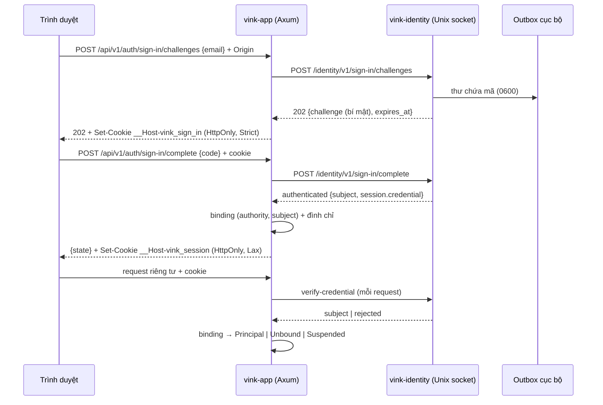

# D-05 / S-03 — Lựa chọn auth authority

> **Đổi hướng 10/11/2026 (chủ sản phẩm):** **username + mật khẩu** là phương thức đăng nhập chính;
> mã email có thể bổ sung sau, chưa ưu tiên (ACC-03). Lựa chọn “mã email trước” của tài liệu này
> **không còn là hướng chính**. Nội dung dưới đây vẫn mô tả đúng **code hiện có** (chỉ mã email) và
> được giữ nguyên làm lịch sử + hiện trạng; khác biệt và gap cho PR auth sau ở
> [§12](#12-đổi-hướng-10112026-username--mật-khẩu-là-chính). D-05 vẫn chưa Accepted.

**Ngày:** 07/11/2026 (spike), cập nhật 10/11/2026 (đường production, §11) · **Base spike:**
`develop@9dc4991620ef93b09c21fdba355a3c3f557da608` ·
**Trạng thái:** **Đề xuất cho pilot (Recommended / Provisional)**, chưa Accepted. Spike chạy được
cục bộ và đổi D-05 từ “Cần spike + lựa chọn” sang “Đề xuất A, chờ chủ sản phẩm và các blocker ở
§9”. Từ 10/11/2026 backend có **đường production**: thư qua outbox bền + SMTP (Resend), giới hạn
lạm dụng nhiều process, fence đình chỉ tại commit cho mọi lệnh ghi được bảo vệ, retention và
rollback (§11). **Đăng nhập production vẫn bị khóa** (`VINK_AUTH_SIGN_IN` mặc định `disabled`):
chưa có thư tới hộp thư thật từ domain Vink, UI đăng nhập Web mới được kiểm chứng trong môi trường
thử ([Auth Web](../development/auth-web.md); chưa HTTPS/nhiều trình duyệt/mobile), chưa review bảo
mật độc lập, chưa có người chịu trách nhiệm vận hành auth.

Bằng chứng chạy và ma trận kịch bản: [auth-authority-s03-evidence](../development/auth-authority-s03-evidence.md).
Ranh giới database/process có từ trước: [identity-postgres-boundaries](identity-postgres-boundaries.md).

**Record (11/11/2026):** quyết định auth authority tra tại `D-05@r1` (`PROVISIONAL`). Phương thức
đăng nhập chính tra tại `USER-08@r2`. Tài liệu này giữ spike, so sánh, đường production, blocker
trước khi Accepted và hiện trạng code.

<!-- vdr: active D-05@r1 -->

## 1. Câu hỏi quyết định

Vink cần một authority xác thực cho MVP/Pilot sao cho: principal Vink ổn định và độc lập
provider; xác thực tách khỏi phân quyền nghiệp vụ; có email đã xác minh; logout/revoke/đình chỉ
không cấp quyền sai; mở rộng được Web + Android/iOS; chi phí và vận hành hợp lý; không biến Vink
thành hệ thống auth quá phức tạp (ACC-01, ACC-02, INV-05).

Phạm vi pilot dùng để cân: nhóm người lớn được mời (D-11 đề xuất), một website Leptos SSR, chưa có
app native sản phẩm, chưa cần SSO doanh nghiệp hay đăng nhập mạng xã hội, một nhóm vận hành nhỏ.

## 2. Hiện trạng trước spike

| Lớp | Có sẵn tại base | Thiếu |
| --- | --- | --- |
| `vink-identity` | Process riêng, DB `vink_identity` (chỉ migration baseline), Unix socket, caller = peer uid, contract v1 `verify-credential` luôn `501 authority_not_configured` | Authority, tài khoản, credential, session |
| App `identity` | `IdentityResolver` → `Principal`/`Anonymous`/`Unavailable`; `IdentityService` gửi `Authorization: Bearer` sang Identity và **không bao giờ** map subject → principal | Binding, đình chỉ, carrier cookie, đường đăng nhập |
| App HTTP | `Actor` extractor, kiểm `Origin` cho mọi phương thức ghi, `LocalFixture` chỉ ở local + loopback | Endpoint đăng nhập/đăng xuất |

Mọi route riêng tư production trả `401`; đọc công khai/SSR không gọi Identity.

## 3. Tiêu chí và kịch bản chung

Mười tiêu chí của yêu cầu được áp như nhau cho ba hướng: bảo mật và email đã xác minh; độ phức
tạp hiện thực; tích hợp Rust/Axum; độ khớp với `vink-identity`; principal ổn định và account
linking; đúng logout/revoke/ban; Web SSR và CMP/mobile tương lai; tái lập cục bộ; chi phí vận hành;
riêng tư và độc lập provider.

Kịch bản chấp nhận dùng chung (chi tiết và kết quả ở file bằng chứng): email chưa xác minh không
có quyền; subject/user_id/role giả bị từ chối; signup đồng thời không nhân đôi principal; cùng email
khác subject không tự nối; đổi email/bút danh giữ principal; credential sai/hết hạn/phát lại bị từ
chối; logout chặn thao tác sau; revoke/đình chỉ mất quyền; request cũ không khôi phục quyền;
Identity timeout/outage đóng; RPC sai/khác version bị từ chối; provisioning lỗi không gán sai chủ;
cô lập nháp/bình luận/ghi nhận giữa tài khoản; đọc công khai còn khi Identity sập; secret không vào
log/bundle.

## 4. Ba ứng viên (một cho mỗi hướng)

| Hướng | Ứng viên chọn để so | Vì sao là đại diện của hướng |
| --- | --- | --- |
| A. Native Rust | Tài khoản trong `vink-identity`, **mã email một lần** (không mật khẩu) + **phiên opaque phía server**; mật khẩu Argon2id để sau | Khớp process/DB đã có; thư viện Rust duy trì tốt (`sha2`, `subtle`, `getrandom`; `argon2` 0.6.0 và `webauthn-rs` 0.6.2 cho bước sau theo crates.io 07/11/2026) |
| B. OIDC tự host | **Keycloak 26.x** (bản mới nhất trên trang tải: 26.8.2; image `quay.io/keycloak/keycloak`) | Trưởng thành, có self-registration, email verification, back-channel logout, chạy trên PostgreSQL. **Kanidm**: tự đăng ký công khai mới được nhắc tới là “tính năng signup mới” (issue #4666, 01/11/2026), chưa xác nhận bản stable; Cantos (cùng tổ chức) dùng Kanidm làm issuer nhưng phải tự xây luồng enrollment bằng Firebase và tới audit 17/10/2026 vẫn thiếu đăng ký native ([cantos#174](https://github.com/loveoverflowcom/cantos/issues/174)). **ZITADEL**: AGPL-3.0 từ v3, theo nguồn thứ ba v4 tách dịch vụ login riêng — thêm một service nữa |
| C. Managed | **Supabase Auth** | Mã nguồn mở (GoTrue) nên có đường tự host, region chọn được, JWKS bất đối xứng. **Clerk**: 50.000 MRU miễn phí, Pro $25/tháng, $0,02/MRU vượt mức; trang giá không nêu chọn vùng dữ liệu |

Giá và giới hạn trích từ trang chính thức truy cập 07/11/2026: Supabase Free 50.000 MAU, project
Free tạm dừng sau 1 tuần không hoạt động; Pro từ $25/tháng gồm 100.000 MAU, $0,00325/MAU vượt mức.
Mail mặc định của Supabase chỉ gửi tới thành viên team, 2 thư/giờ, “not meant for production use”:
mọi hướng đều cần nhà cung cấp mail riêng.

## 5. So sánh

Chất lượng bằng chứng: **[R]** chạy trong spike này; **[D]** tài liệu chính thức đã đọc; **[I]**
suy luận kiến trúc, chưa chạy.

| Tiêu chí | A. Native (mã email + phiên server) | B. Keycloak | C. Supabase Auth |
| --- | --- | --- | --- |
| Email đã xác minh | Mỗi lần đăng nhập chứng minh kiểm soát hộp thư [R]. Không phải authenticator theo NIST 800-63B (email “SHALL NOT” dùng cho OOB) — tương đương mật khẩu + reset qua email [D] | Có verify email, MFA, phát hiện brute force [D] | Có verify email, MFA [D] |
| Bề mặt tấn công do Vink giữ | Nhỏ nhưng **của Vink**: throttle, thử sai, enumeration, mail, phục hồi [R]/[I] | Nhỏ ở code Vink; lớn ở vận hành JVM + nâng cấp [I] | Nhỏ ở code; phụ thuộc vendor [I] |
| Độ phức tạp hiện thực | ~1 module chính sách + 1 store + 5 thao tác contract; đã chạy [R] | RP OIDC (code + PKCE, JWKS, back-channel logout) + theme login FreeMarker tiếng Việt [I] | Gọi REST + kiểm JWT/JWKS; vẫn cần phiên Vink riêng [I] |
| Rust/Axum | Thuần Rust, không SDK [R] | `openidconnect` 4.1.0 [D] | REST + thư viện JWT [I] |
| Khớp `vink-identity` | Identity giữ tài khoản/credential/phiên đúng như ranh giới định ra [R] | Identity thành RP/verifier; Keycloak là owner dữ liệu thứ ba [I] | Identity thành verifier; dữ liệu người dùng ở ngoài [I] |
| Principal ổn định, linking | Subject = id tài khoản, không đổi khi đổi email; App binding `(authority, subject)` [R] | `sub` ổn định trong realm [D]; binding như A [I] | `sub` = uuid người dùng [D]; binding như A [I] |
| Logout/revoke/ban | Thu hồi là UPDATE một hàng, hiệu lực ở request kế tiếp; disable/đổi email thu hồi trong cùng transaction [R] | Phiên Vink tức thời; disable phía Keycloak cần back-channel hoặc introspection [D]/[I] | Access JWT còn hiệu lực tới `exp` sau khi đăng xuất; ban tạm không thu hồi phiên đang có [D] |
| Web SSR + CMP/mobile | Cookie `__Host-` HttpOnly cho Web [R]; cùng API mã + Bearer opaque trong Keychain/Keystore cho native [I] | AppAuth/system browser (RFC 8252) [I] | SDK Kotlin/Swift; CMP cần adapter [I] |
| Tái lập cục bộ | `cargo` + PostgreSQL + thư mục outbox [R] | Container Keycloak + DB thứ ba [I] | Supabase CLI (nhiều container) hoặc GoTrue riêng [I] |
| Chi phí định kỳ | Hạ tầng sẵn có + nhà cung cấp mail (chưa chọn, chưa ước giá) | Máy chủ JVM + backup realm + nâng cấp; chưa ước giá | $0 tới giới hạn Free (project bị pause khi không hoạt động), Pro từ $25/tháng [D] + mail |
| Riêng tư/độc lập | Dữ liệu ở PostgreSQL của Vink; chỉ relay mail thấy địa chỉ [I] | Tự host, dữ liệu ở Vink [I] | Xử lý bởi bên thứ ba; Luật BVDLCN 91/2025/QH15 (hiệu lực 01/01/2026) yêu cầu hồ sơ đánh giá chuyển dữ liệu ra nước ngoài theo nguồn pháp lý thứ ba — chưa có tư vấn pháp lý [D thứ ba]/[I] |

## 6. Quyết định đề xuất

**Chọn A cho pilot:** `vink-identity` là authority native với đăng nhập bằng mã email một lần và
phiên opaque phía server; App sở hữu principal, binding subject → principal, đình chỉ và mọi
quyền nghiệp vụ.

Lý do theo bằng chứng:

1. Phần authority thực sự phải làm ở Vink hẹp: chứng minh kiểm soát hộp thư lúc đăng nhập và giữ
   phiên. Principal, binding, đình chỉ, kiểm duyệt và quyền xuất bản thuộc App trong **mọi**
   hướng. B và C chỉ thay phần hẹp đó nhưng thêm một lớp phiên thứ hai và bài toán đồng bộ thu hồi.
2. Thu hồi đúng ngay: logout, disable và đổi email thu hồi phiên trong cùng transaction với thay
   đổi trạng thái, có test đồng thời trên PostgreSQL thật. Với C, JWT đã phát còn hiệu lực tới khi
   hết hạn theo chính tài liệu Supabase.
3. Không có mật khẩu để lưu, bị dùng lại hay bị nhồi; luồng reset (vốn cũng là mã email) trùng với
   đăng nhập, nên trần bảo mật vẫn là hộp thư như một hệ mật khẩu + reset, nhưng ít bề mặt hơn.
4. Pilot là nhóm được mời, giao diện tiếng Việt riêng: trang login hosted của B cần theme; C vẫn cần
   UI riêng. A dùng chung UI Vink.
5. Dữ liệu tài khoản ở hạ tầng Vink, giảm câu hỏi chuyển dữ liệu xuyên biên giới cho pilot.

**Không chọn B (Keycloak)** cho pilot: thêm một dịch vụ JVM, một database và vòng nâng cấp cho nhóm
nhỏ, cộng đồng bộ phiên/thu hồi; lợi thế chính (SSO, liên kết danh tính, MFA sẵn) chưa là nhu cầu
pilot. Giữ làm đích di chuyển nếu cần SSO/MFA/federation (§8). Kanidm và ZITADEL bị loại vì lý do
ở §4.

**Không chọn C (Supabase/Clerk)** cho pilot: thu hồi không tức thời với JWT, phụ thuộc vendor cho
vòng đời danh tính, câu hỏi pháp lý về chuyển dữ liệu chưa có tư vấn, và vẫn phải tự xây phiên Vink
+ mail. Lợi thế “ít vận hành” nhỏ hơn với phạm vi hẹp ở điểm 1.

**Mật khẩu (Argon2id) để sau, không loại:** nếu pilot cho thấy mail chậm/khó nhận, thêm mật khẩu
như một credential khác của **cùng tài khoản** (subject không đổi): `argon2` 0.6.0, tham số tối thiểu
OWASP m=19 MiB, t=2, p=1, lưu chuỗi PHC, rehash khi đăng nhập nếu tham số đổi. **Passkey**
(`webauthn-rs`) là bước tăng cường chống phishing ưu tiên hơn mật khẩu.

## 7. Kiến trúc của spike

| Owner | Giữ | Không bao giờ |
| --- | --- | --- |
| `vink-identity` (DB `vink_identity`) | `accounts`, `account_emails` (1 địa chỉ đã xác minh/tài khoản), `email_challenges` (chỉ verifier), `sessions` (chỉ hash) | Principal, quyền, tác phẩm; đọc bảng App |
| App (DB `vink`) | `principal_bindings` (bất biến, PK `(authority, subject_id)`, 1 subject/principal), `principal_suspensions`, mọi quyền | Email, mã, credential, hash phiên |

**Phiên do Identity phát (điều chỉnh so với ranh giới 02/11).** Ranh giới cũ đề xuất App giữ
“session ứng dụng”. Spike đặt phiên ở Identity vì: bearer secret và trạng thái credential cùng một
DB/role nhạy cảm; disable và đổi email thu hồi phiên **trong cùng transaction** — nếu phiên ở App,
mỗi thay đổi đó thành đồng bộ xuyên owner không nguyên tử, đúng rủi ro đã nêu cho B/C. Đổi lại: mỗi
request riêng tư thêm một lời gọi Unix socket + một lookup có index (chưa đo hiệu năng), và Identity
sập thì request riêng tư `503` (đóng an toàn; đọc công khai không bị ảnh hưởng — đã chạy). Phân
quyền (binding, đình chỉ) vẫn ở App và được đọc ở mỗi request.

**Kết quả có kiểu.** Identity: `authenticated` / `rejected{reason}` / `501` / `503`. App
`Resolution`: `Principal` / `Anonymous` / `Unbound(subject)` / `Suspended` / `Unavailable`; chỉ
`Principal` được hành động, `Unavailable` không bao giờ thành ẩn danh hay `Unbound` (tránh mời tạo
principal thứ hai). `GET /api/v1/auth/session` cho client biết trạng thái; route riêng tư trả `401`
cho ba trạng thái không-principal.

**Contract.** Identity RPC: thêm thao tác và trường **trong v1** theo quy tắc tương thích (chỉ
thêm thao tác/trường phản hồi; request mới đều `deny_unknown_fields`); fixture cũ không đổi ý
nghĩa ([contract v1](../../services/vink-identity/contracts/rpc/v1/README.md)). App HTTP v1 thêm
nhóm `auth` ([API v1](../../services/vink-app/contracts/http/v1/README.md#sign-in-d-05)).

**Phiên Web.** Cookie `__Host-vink_session` (`Secure; HttpOnly; Path=/; SameSite=Lax`), giá trị
256 bit ngẫu nhiên, chỉ lưu SHA-256; hết hạn tuyệt đối 30 ngày (NIST 800-63B-4 AAL1: tổng ≤ 30 ngày),
không gia hạn trượt. CSRF: mọi phương thức ghi của API đã bắt `Origin` khớp `VINK_PUBLIC_ORIGIN`.
Session fixation: credential luôn do server phát mới khi đăng nhập, client không đề xuất được.
Challenge handle ở cookie `__Host-vink_sign_in` `SameSite=Strict`; mã lưu dạng
`SHA-256(domain, bí mật client giữ, mã)` nên mã gõ ở trình duyệt khác (thiếu handle) là mã sai.
Logout chỉ xóa cookie khi Identity đã thu hồi; khi Identity sập, cookie giữ lại để thử lại
(trong lúc đó phiên không xác minh được nên không cấp quyền).

**Mobile (chưa làm).** Cùng hai thao tác mã; client native nhận credential qua kênh riêng (không
cookie) và gửi `Authorization: Bearer`; cần quyết định cách chống CSRF/Origin cho client native và
nơi lưu (Keychain/Keystore). Không có magic link nên không cần universal link.

## 8. Đánh đổi bảo mật, vận hành và chiến lược thoát

| Rủi ro | Giảm thiểu trong spike | Còn thiếu |
| --- | --- | --- |
| Đoán mã | 6 chữ số, 5 lần sai đóng challenge, 10 phút, mã gắn bí mật client; **từ §11:** 30 lần trả mã/15 phút/mạng nguồn | CAPTCHA/biên khi cần |
| Spam mã tới hộp thư người khác | 3 mã/địa chỉ/15 phút, khóa advisory chống vượt đồng thời; **từ §11:** 10 lần xin mã/15 phút/mạng, trần toàn cục 200/10 phút | CAPTCHA/biên, chặn domain, theo dõi lạm dụng |
| Enumeration | Xin mã không đọc bảng tài khoản; trả lời và thư giống nhau; **từ §11:** gửi thư tách khỏi request (thời gian không phụ thuộc relay), đổi email sang địa chỉ người khác trả như địa chỉ trống, không gửi thư | Thời gian phản hồi chưa đo thống kê |
| Mất hộp thư | — | Quy trình phục hồi thủ công, thông báo về địa chỉ cũ khi đổi email |
| Chiếm hộp thư = chiếm tài khoản | Như mọi hệ reset bằng email | Passkey; thông báo đăng nhập mới |
| Lộ DB Identity | Chỉ verifier/hash; **từ §11:** mã chờ gửi lưu rõ tới khi gửi xong (thiếu bí mật client thì vô dụng), retention 7/30 ngày | — |
| Request đang chạy khi bị đình chỉ | Đình chỉ kiểm ở mỗi request; **từ §11:** fence tại commit cho nháp, tag, bình luận (gửi/xóa), chế độ bình luận, kiểm duyệt, ghi nhận | Disable ở Identity không fence được request App đang chạy (hai DB) — runbook: đình chỉ ở App trước |

**Chi phí vận hành A:** thêm một nhà cung cấp mail (deliverability, SPF/DKIM/DMARC, bounce), quy
trình phục hồi tài khoản, giám sát lạm dụng; không thêm service hay database. Chưa có ước giá.

**Thoát/di chuyển:** subject luôn là `(authority, id)` và App chỉ biết binding. Chuyển sang OIDC
(Keycloak/managed) = thêm authority mới chạy song song; người dùng cũ liên kết **có xác minh** (đăng
nhập authority cũ trong cùng luồng) trước khi App thêm binding thứ hai — khi đó mới nới ràng buộc
một subject/principal bằng migration có chủ đích. Không liên kết tự động theo email (App không thấy
email). Dữ liệu tài khoản nằm trong PostgreSQL của Vink, xuất được bằng `pg_dump` theo owner.

## 9. Blocker trước khi Accepted

Trạng thái sau §11 (10/11/2026): **đã xử lý trong code** = có implementation và bằng chứng cục bộ;
**còn mở** = chặn Accepted.

1. **Đã trả lời 10/11/2026:** chủ sản phẩm **không** chọn UX chỉ-mã-email; yêu cầu username + mật
   khẩu làm phương thức chính (§12). Phần này chuyển thành việc triển khai, chưa có code.
2. **Một phần:** mail transport production đã có (SMTP + outbox bền, chọn Resend); **còn mở:** gửi
   thật qua Resend, domain SPF/DKIM/DMARC, bounce/complaint, chi phí thật.
3. **Một phần:** rate limit theo mạng nguồn (trusted proxy) + trần Identity, log giám sát; **còn
   mở:** biên/WAF chống flood thể tích, quy trình phục hồi tài khoản, thông báo về địa chỉ cũ khi đổi
   email.
4. **Còn mở:** qualification trình duyệt (cookie `__Host-` trên origin thật, HTTPS) và UI đăng
   nhập; carrier/CSRF cho native.
5. **Đã xử lý trong code:** fence đình chỉ tại commit cho mọi lệnh ghi được bảo vệ hiện có; retention
   phiên/challenge/bộ đếm. **Còn mở:** review bảo mật độc lập.
6. **Còn mở:** một người/nhóm được giao chịu trách nhiệm bảo trì bảo mật auth (vá, sự cố, phục hồi
   tài khoản) — điều kiện tech stack đặt ra cho native auth.

## 10. Lát cắt tiếp theo

1. **Production authority:** mail transport thật, gửi **bất đồng bộ** (challenge và thư chờ gửi ghi
   cùng transaction, worker gửi và thử lại) vì lời gọi contract có hạn 2 s và client App bỏ cuộc sau
   1,5 s — spike ghi file đồng bộ và đã thấy một lần vượt hạn khi đĩa bận (xem bằng chứng); rate
   limit biên, retention, thông báo đổi email, fence đình chỉ tại commit; giữ contract v1.
2. **Phiên + API được bảo vệ:** UI đăng nhập/đăng xuất Leptos, `GET /auth/session` trong shell, thử
   trình duyệt (cookie, reload, hai tab) — **đã có cho Web trong môi trường thử**
   ([Auth Web](../development/auth-web.md)). Còn: đổi bút danh, HTTPS/domain thật, trình duyệt khác.
3. **Native/CMP:** carrier Bearer cho app, lưu trữ an toàn, qualification Android/iOS.

## 11. Đường production (10/11/2026)

Mục tiêu: đưa authority A từ spike tới backend vận hành được, không thêm service, Redis hay hàng
đợi ngoài. Bằng chứng: [auth-production-evidence](../development/auth-production-evidence.md);
vận hành: [runbook](../development/auth-operations.md).

### C1. SMTP hay API transactional email — **chọn SMTP (Resend)**

| | SMTP submission (`lettre`, rustls) | API HTTP của nhà cung cấp |
| --- | --- | --- |
| Phụ thuộc | Một crate, chuẩn RFC 5321; đổi nhà cung cấp = đổi host/credential | SDK hoặc client HTTP riêng cho từng hãng |
| Kiểm thử | Relay giả nói đúng giao thức qua TCP thật | Mock HTTP theo hợp đồng hãng |
| Ngữ nghĩa lỗi | Mã 4xx/5xx, không idempotency key | Lỗi có cấu trúc, idempotency key |

**WHY:** trung lập nhà cung cấp, kiểm được bằng giao thức thật, cùng hướng Cantos đã vận hành
(Resend qua SMTP, `lettre`). **Seam đổi nhà cung cấp:** worker chỉ giữ `Arc<dyn MailSender>`;
`VINK_IDENTITY_SMTP_PROVIDER=resend` là một preset cấu hình; nhà cung cấp SMTP khác chỉ đổi cấu hình,
nhà cung cấp chỉ có API HTTP là một `MailSender` mới — outbox, retry, nội dung thư không đổi. Gửi thật
qua Resend (10/11/2026) thành công cả lệnh `mail test` lẫn luồng challenge → outbox → worker; trên mạng
văn phòng, cổng 465 bị firewall Fortinet chặn TLS (client từ chối đúng), 587 STARTTLS dùng được. **HOW:** TLS bắt buộc (465 implicit hoặc 587 STARTTLS), plaintext chỉ cho
relay loopback; mật khẩu (API key) chỉ qua file `0600`, đọc lại mỗi lần gửi (xoay không restart);
lỗi rút gọn thành loại + mã số, không giữ văn bản relay (có thể chứa địa chỉ). **TRADEOFF:** không
có idempotency key → trùng thư có thể xảy ra (cùng mã, cùng `Message-ID`, vô hại); bounce/complaint
cần webhook của nhà cung cấp — chưa làm.

### C2. Outbox PostgreSQL hay worker hiện có — **outbox của Identity, worker trong `serve`**

`vink-worker` là tiến trình App, không được đọc DB Identity (mã là secret của Identity). **HOW:**
bảng `mail_deliveries` trong `vink_identity`; challenge và ý định gửi commit cùng transaction; worker
claim `FOR UPDATE SKIP LOCKED` + lease 45 s (nhiều instance an toàn), gửi ngoài transaction, ghi kết
quả chỉ khi còn giữ `lease_token`; 5 lần, backoff 5→60 s + jitter; `5xx` dừng ngay; mã đã dùng/hết
hạn bị hủy; trạng thái cuối xóa mã; worker thức ngay sau commit (Notify) và poll 2 s cho việc của
instance khác/retry. **TRADEOFF:** at-least-once, không exactly-once; thông lượng gắn với số instance
Identity (đủ cho pilot; tách `deliver` thành lệnh riêng nếu cần).

### C3. Rate limit trong DB hay ở edge tin cậy — **DB làm authority, edge là phòng thủ thêm**

**WHY:** App là tiến trình duy nhất thấy mạng nguồn; nhiều process App cần một bộ đếm chung; không
có hạ tầng edge nào được xác nhận. **HOW:** App: bảng `auth_rate_limits` (upsert nguyên tử, cửa sổ
cố định theo đồng hồ DB, khóa = SHA-256 của bucket + IPv4 hoặc IPv6 /64); `X-Forwarded-For` chỉ đọc
khi peer thuộc `VINK_TRUSTED_PROXIES`, lấy hop không tin cậy ngoài cùng bên phải; không đếm được =
`503`. Identity: trần theo địa chỉ (chính xác, khóa advisory), theo tài khoản (chính xác, khóa hàng
tài khoản), toàn cục (mềm: đồng thời có thể vượt tối đa bằng số request đồng thời). **TRADEOFF:** một
lần ghi DB mỗi request đăng nhập (đo p50 0,12 ms cục bộ); cửa sổ cố định cho phép tối đa 2× ở ranh giới
cửa sổ; không chống DDoS thể tích (việc của edge).

### C4. Fence chung hay guard theo owner — **một primitive chung, gọi bởi từng owner**

**HOW:** `principal::require_active` khóa hàng principal `FOR UPDATE` (xung đột với khóa `FOR KEY
SHARE` mà insert đình chỉ lấy qua FK) rồi đọc đình chỉ ở câu lệnh riêng; trả
`StoreError::PrincipalSuspended` → `403 principal_suspended`. Mỗi adapter gọi nó **tại commit**,
đúng thứ tự khóa của mình: nháp tạo/lưu (đầu tiên — không khóa gì khác), xóa bình luận (sau hàng
comment), đổi chế độ (sau hàng thread), kiểm duyệt (sau grant + hàng comment), ghi nhận (sau các
khóa share, trước khóa khóa-lệnh). Không dùng middleware (chỉ là kiểm lúc request) hay trigger (ẩn
thứ tự khóa). **TRADEOFF:** mọi lệnh ghi của một principal tuần tự hóa trên hàng principal (bình
thường không đáng kể); disable ở Identity không thể nguyên tử với ghi ở App — không giả lập giao dịch
xuyên DB, runbook yêu cầu đình chỉ ở App trước.

### C5. Retention, dọn dẹp, phục hồi

Challenge (kèm thư) xóa 7 ngày sau hết hạn; phiên 30 ngày sau khi đóng; bộ đếm 1 ngày sau cửa sổ.
Prune chạy mỗi giờ (Identity `serve`, `vink-worker`) và bằng lệnh vận hành; idempotent, an toàn khi
nhiều tiến trình. Phục hồi: lease hết hạn → thư được gửi lại; relay phục hồi → backoff gửi tiếp.
Rollback: script `migrations-rollback/*.down.sql` (đã chạy trên PostgreSQL thật) chỉ mất dữ liệu tạm
(thư chờ, bộ đếm), không mất tài khoản, phiên hay principal.

### Phiên và CSRF (rà lại)

Cookie `__Host-` (`Secure`, `HttpOnly`, `Path=/`; phiên `Lax`, challenge `Strict`), `Origin` khớp
cho mọi phương thức ghi, phản hồi auth `no-store`, credential do server phát (không fixation). Mới:
đăng nhập lại thu hồi phiên cũ trình duyệt đang giữ; khóa kích hoạt `VINK_AUTH_SIGN_IN` (production
mặc định tắt; đăng xuất và xác minh phiên cũ không phụ thuộc).

## 12. Đổi hướng 10/11/2026: username + mật khẩu là chính

<!-- vdr: active USER-08@r2 -->

**Quyết định (`PRODUCT_CONFIRMED`, USER-08 → ACC-03):** username + mật khẩu là đăng nhập chính; mã
email có thể bổ sung sau, chưa ưu tiên; username đăng nhập khác bút danh công khai và không buộc
trùng nhau. Lượt 10/11/2026 **không** viết runtime auth, không xóa code mã email, không bỏ
session/rate-limit/security guard nào.

**Không đổi:** authority native trong `vink-identity`; subject `(authority, id)` và
`principal_bindings` bất biến ở App; phiên opaque lưu dạng hash, cookie `__Host-`, kiểm `Origin`;
đình chỉ ở App + disable ở Identity và fence tại commit; primitive rate limit trong DB; quy tắc chỉ
thêm của contract v1; khóa `VINK_AUTH_SIGN_IN`. §6 đã dự trù mật khẩu là **một credential khác của
cùng tài khoản** (Argon2id, chuỗi PHC, rehash khi tham số đổi): đó là đường triển khai tự nhiên.

| | `CURRENT_IMPLEMENTATION` (`develop@4891c77`) | `TARGET_BEHAVIOR` (chưa có code) |
| --- | --- | --- |
| Phương thức | Chỉ mã email một lần (`email_challenges`, `account_emails`) | Username + mật khẩu; mã email là phụ/khôi phục, nếu giữ |
| Lưu credential | Không có username, password hash hay Argon2 ở cả hai service | Bảng credential của Identity: username duy nhất, hash Argon2id có tham số theo version |
| Route App | `POST /auth/sign-in/challenges`, `/auth/sign-in/complete`, `/auth/session`, `/auth/principal` | Thêm đăng ký và đăng nhập bằng mật khẩu; phiên và `/auth/session` giữ nguyên |
| Web | Luồng email → mã → bút danh; chữ “Vink không dùng mật khẩu” (`apps/vink-web/src/account.rs`) | Form username + mật khẩu; chữ trên phải đổi |
| Bút danh | `principals.display_name`, không duy nhất, đặt một lần | Không đổi; **không** suy ra từ username |
| Phụ thuộc mail | Bắt buộc để đăng nhập (blocker deliverability) | Không cần để đăng nhập; chỉ cần nếu có khôi phục qua email |

**Gap và tương thích cho PR auth sau (`DESIGN_PROPOSED`):**

1. Quy tắc username và mật khẩu (O-12): đề xuất ASCII thường `a–z 0–9 _ .`, 3–30 ký tự, duy nhất
   không phân biệt hoa thường, không hiển thị công khai; mật khẩu ≥ 10 ký tự, không luật ký tự bắt
   buộc, Argon2id. **11/11/2026 (`O-12@r2`, `PRODUCT_CONFIRMED` qua signoff ủy quyền):** mật khẩu
   chuẩn hóa NFKC rồi đếm 10–128 ký tự, mỗi Unicode code point là một ký tự. Dữ liệu nhập vượt 4096
   byte bị từ chối trước khi chuẩn hóa. Username giữ đề xuất trên.

<!-- vdr: active O-12@r2 -->

2. Lỗi đăng nhập đồng nhất (không lộ username tồn tại); rate limit theo mạng nguồn **và** theo
   username; đổi mật khẩu thu hồi phiên khác.
3. Khôi phục tài khoản (O-11): nếu không có email, quên mật khẩu là mất tài khoản. Đề xuất email đã
   xác minh là kênh khôi phục **tùy chọn**, tái dùng challenge/outbox hiện có.
4. Tài khoản mã email hiện có có thể thêm username và mật khẩu qua luồng triển khai bên dưới.
5. Danh sách blocker §9 đổi trọng tâm: deliverability không còn chặn đăng nhập; thêm review lưu trữ
   mật khẩu, chống credential stuffing, và (sau) kiểm mật khẩu đã lộ.
6. Số phận code mã email (giữ làm phụ/khôi phục hay gỡ bằng migration có chủ đích) do PR auth quyết
   định, không phải lượt tài liệu này.

**Hiện trạng triển khai backend (#152):** backend native username/password credential đã được triển
khai trên Identity (`vink-identity`) và App (`vink-app`):
- Hash Argon2id với salt ngẫu nhiên (`argon2` crate, PHC string), pure policy `services/vink-identity/src/password.rs` (O-12: username chuẩn hóa chữ thường `a-z 0-9 _ .` từ 3–30 ký tự; mật khẩu 10–128 byte theo #152, đổi ngày 11/11/2026 theo `O-12@r2` thành 10–128 ký tự sau NFKC; cả hai ẩn trong `Debug`).
- Bảng `account_passwords` (FK `accounts`, username UNIQUE, password_hash, version) và `password_login_attempts` (throttling 10 lần sai / 15 phút).
- Đăng nhập kiểm Argon2id với hash giả khi username không tồn tại. Với cùng đầu vào, cả hai nhánh
  thử cùng các dạng mật khẩu. Nhánh tương thích 10–128 byte cho phép dùng chính mật khẩu của hash
  cũ trước NFKC. Đăng ký và thêm mật khẩu luôn áp dụng `O-12@r2`.
- Identity contract v1: `POST /identity/v1/password/register` và `POST /identity/v1/password/sign-in`.
- App HTTP v1 edge: `POST /api/v1/auth/register` và `POST /api/v1/auth/login`, rate limit theo mạng nguồn (`PASSWORD_REGISTER` 5/giờ, `PASSWORD_LOGIN` 15/15 phút) trong PostgreSQL, phát cookie `__Host-vink_session`, thu hồi phiên cũ.
- `VINK_AUTH_SIGN_IN` vẫn mặc định `disabled` trong production. Form Web/CMP và khôi phục
  mật khẩu (`O-11`, `OPEN`) là phần việc còn lại.

### Thêm mật khẩu vào tài khoản mã email

Mức triển khai là `persistence-api`. Một tài khoản dùng cả mã email và mật khẩu qua cùng
`(authority, subject)`. Cả hai phát phiên opaque thuộc tài khoản đó. Binding, bút danh và quyền
đối với tác phẩm, nháp và bình luận tiếp tục do App quyết định theo principal đã có.

- App cho phép phiên hợp lệ ở trạng thái `active` hoặc `needs_principal`. App đọc đình chỉ trước
  khi gọi Identity và các quyền nghiệp vụ tiếp tục chịu kiểm tra đình chỉ của App. Identity kiểm
  tài khoản và phiên tại điểm ghi. Hai owner dùng database riêng. App không khóa transaction
  xuyên RPC.
- Identity gửi mã tới địa chỉ đã xác minh của tài khoản. Mã chỉ dành cho enrollment, gắn với
  tài khoản và phiên đã yêu cầu, hết hạn sau 10 phút và đóng sau năm lần sai. Thay địa chỉ làm
  đóng các proof đã phát. Luồng giả định hộp thư xác minh do người dùng kiểm soát và chỉ tiến
  trình App được ủy quyền gọi Unix socket. Đổi email qua API riêng của Identity vẫn nằm ngoài
  giao diện công khai.
- Hash Argon2id chạy trước transaction. Identity khóa account → session → challenge và kiểm lại
  thời hạn sau khi chờ UNIQUE username. Ghi credential và tiêu thụ mã là một transaction.
  Username trùng hoặc lỗi trước commit làm rollback credential và proof. Logout/disable thắng trước
  khóa thì enrollment bị từ chối. Credential mới không cấp lại phiên hay quyền đã bị thu hồi.
- Đọc lại `GET /api/v1/auth/password/enroll` sau khi mất phản hồi. API chỉ trả boolean của phiên
  hiện tại. Đăng ký mới trả `409 already_signed_in` nếu đã có phiên, kể cả khi tài khoản chưa
  có principal.
- Migration Identity `20261114000000` mở thêm mục đích của challenge/outbox và gắn khóa ngoại tới
  phiên. Rollback schema được kiểm trong PostgreSQL, xóa challenge enrollment và delivery đi
  kèm, giữ username và hash đã thêm. Nếu quay về binary tại `develop@0ac1133`, RPC mật khẩu của
  binary đó vẫn giới hạn đầu vào 256 byte. Đăng nhập bằng mã email vẫn dùng cùng tài khoản.
  Chi tiết hợp đồng nằm trong
  [Identity RPC](../../services/vink-identity/contracts/rpc/v1/README.md#password-enrollment) và
  [App HTTP](../../services/vink-app/contracts/http/v1/README.md#sign-in-d-05).

## Nguồn (truy cập 07/11/2026)

- NIST SP 800-63B (rev. 4): <https://pages.nist.gov/800-63-4/sp800-63b.html> — email không dùng cho
  xác thực out-of-band; mã xác nhận/khôi phục qua email không thuộc lệnh cấm; phiên ≥ 64 bit,
  cookie `Secure`, `HttpOnly`, `__Host-`, `SameSite`; AAL1 tổng ≤ 30 ngày.
- OWASP Password Storage Cheat Sheet: <https://cheatsheetseries.owasp.org/cheatsheets/Password_Storage_Cheat_Sheet.html>.
- Supabase: giá <https://supabase.com/pricing>, SMTP <https://supabase.com/docs/guides/auth/auth-smtp>,
  khóa ký JWT <https://supabase.com/docs/guides/auth/signing-keys>, đăng xuất
  <https://supabase.com/docs/guides/auth/signout>, quản lý người dùng
  <https://supabase.com/docs/guides/auth/managing-user-data>.
- Clerk: <https://clerk.com/pricing>.
- Keycloak: <https://www.keycloak.org/downloads>.
- Kanidm: <https://github.com/kanidm/kanidm/issues/4666>, <https://github.com/kanidm/kanidm/issues/2287>.
- ZITADEL changelog (đổi giấy phép sang AGPL-3.0 ở v3): <https://zitadel.com/changelog>; chi tiết v4
  tách dịch vụ login chỉ có từ nguồn thứ ba, chưa đối chiếu tài liệu chính thức.
- Luật Bảo vệ dữ liệu cá nhân 91/2025/QH15 (tóm tắt của các hãng luật, không phải văn bản gốc):
  <https://tilleke.com/insights/vietnams-new-personal-data-protection-law-a-closer-look>.
- crates.io API cho phiên bản `openidconnect`, `argon2`, `webauthn-rs`.
