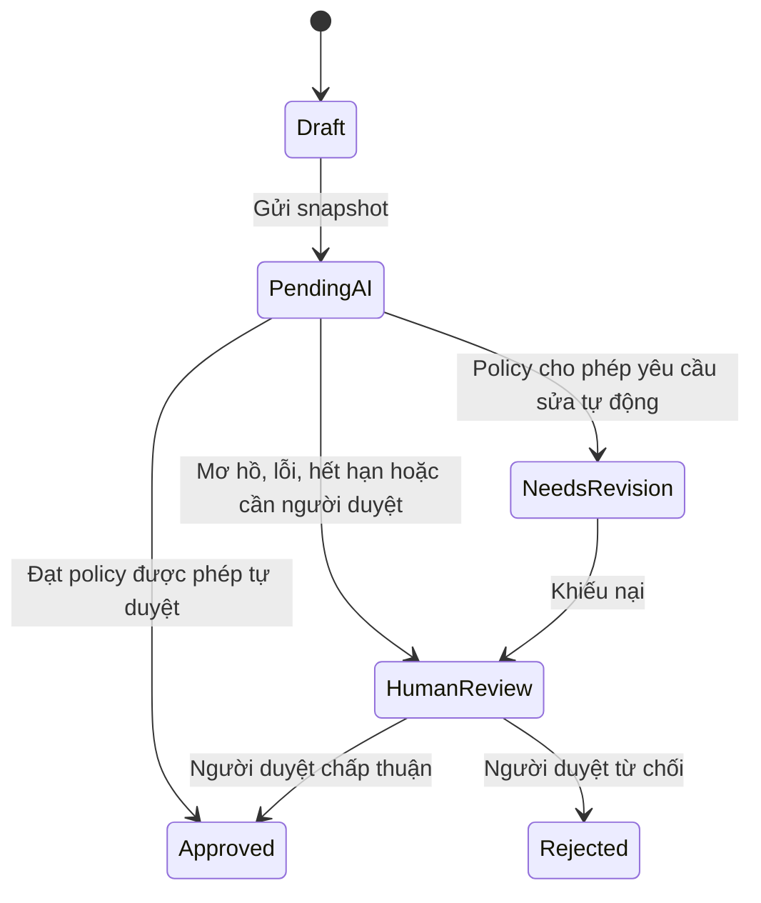

# Các quyết định và lộ trình kiến trúc Vink

**Phiên bản:** 0.2 · **Ngày:** 30/10/2026 · **Trạng thái:** Decision log đề xuất. Không mục nào tự chuyển thành Accepted chỉ vì được viết trong tài liệu này.

## 1. Ba quyết định ảnh hưởng lớn nhất

### Quyết định 1 — Ai sở hữu tác phẩm?

**Đề xuất:** Vink sở hữu Work/Chapter/Revision/Publication trong PostgreSQL; Discourse sở hữu thảo luận.

Lợi ích là làm chủ bản nháp song song với bản công khai, quyền xuất bản, tuyển chọn và export. Chi phí là Vink phải xây một màn vận hành tác phẩm riêng và chịu trách nhiệm về revision schema, backup, migration. Đây là lý do chọn B; không dựa trên khẳng định rằng Discourse tuyệt đối không thể mở rộng.

Chỉ chọn A nếu ưu tiên kiểm chứng cộng đồng nhanh hơn các khả năng này và chấp nhận Topic/Post là đơn vị nội dung ban đầu. Nếu B chỉ tận dụng một tập rất nhỏ chức năng Discourse, cần so lại với C trước khi đầu tư bridge sâu.

### Quyết định 2 — Frontend riêng tới mức nào trong beta?

**Đề xuất:** Vink tự làm đọc, soạn, publication và phần bình luận thiết yếu; staff giữ Discourse Admin cho việc cộng đồng. Thảo luận nâng cao có thể dùng UI Discourse nếu chủ sản phẩm chấp nhận trải nghiệm đó và các đường truy cập đã được bảo vệ.

Không đặt mục tiêu tái tạo toàn bộ profile, notifications, search, badge và history của Discourse trong Leptos ngay. Nếu yêu cầu trải nghiệm hoàn toàn thống nhất từ đầu, phải đưa toàn bộ phần UI/API đó vào kế hoạch và chấp nhận khối lượng lớn hơn.

### Quyết định 3 — Ai là nguồn xác thực?

**Đề xuất:** Vink có principal và session độc lập; khảo sát một auth authority được duy trì, rồi dùng DiscourseConnect nếu Vink là cổng đăng nhập chính. Native auth riêng và dùng Discourse làm nguồn auth là hai phương án thay thế cần so bằng thời gian vận hành và UX thực tế.

Không dùng chung bảng session/password với Cantos. Liên thông audio chưa đòi hỏi SSO; một handoff có sự đồng ý và tài khoản được xác minh có thể đi trước hệ thống đăng nhập chung. Cantos Identity hiện không phải OIDC provider sẵn có cho Vink. [C6]

## 2. Sổ quyết định

| ID | Nội dung | Trạng thái | Mặc định đề xuất / điều cần chứng minh |
| --- | --- | --- | --- |
| D-01 | PostgreSQL, database nghiệp vụ độc lập Cantos | Ràng buộc đầu vào | Giữ nguyên trong mọi phương án |
| D-02 | Hybrid và Vink sở hữu content | Đề xuất ưu tiên | Chốt sau khi tính đủ admin, auth, moderation bridge |
| D-03 | Một Rust app + worker, chia module trước | Đề xuất | Không tách microservices theo tên nghiệp vụ |
| D-04 | Leptos SSR + JavaScript editor | Cần spike | Giữ nếu editor/SSR đạt; có thể đổi frontend mà giữ API/domain |
| D-05 | Auth authority và DiscourseConnect | Cần spike + lựa chọn | Một Vink principal ổn định, session độc lập; verify linking/ban/logout |
| D-06 | Nháp riêng + public publication | Đề xuất pilot | Nhóm kín/unlisted/shared editing để sau |
| D-07 | AI hỗ trợ từ MVP | Ưu tiên đầu vào | Pilot có người duyệt; auto-approval theo nhóm được đánh giá |
| D-08 | Bình luận mới tiền kiểm; sửa công khai theo gate đã chứng minh | Cần spike | Nếu edit gate chưa đạt, chặn edit cả UI/API trong pilot |
| D-09 | Tạp Chí chỉ hiện snapshot còn là publication hiện hành | Đề xuất pilot | Bản mới làm tuyển chọn tạm ngừng, chờ biên tập xác nhận lại |
| D-10 | Một phần trước, nhiều chương cơ bản ở beta | Cần lựa chọn sản phẩm | Nếu nhiều chương là điểm khác biệt ngày đầu, nâng WR-04 thành Must — Pilot |
| D-11 | Nhóm tuổi beta và kênh giao tiếp | Cần lựa chọn sản phẩm | Nhóm người trưởng thành được mời là phương án giảm phạm vi ban đầu; chưa mở DM |
| D-12 | Rút bài và thu hồi discussion/excerpt | Cần chốt policy + spike | Vink chặn đọc ngay; remote cleanup có trạng thái riêng; không báo hoàn tất trước khi xác minh |

## 3. Không dùng một state enum cho toàn bộ vòng đời

Tách các trục sau giúp diễn đạt đúng trạng thái người dùng thấy:

| Trục | Ý nghĩa | Ví dụ |
| --- | --- | --- |
| Working draft | Bản tác giả đang soạn | Version 18 chưa gửi duyệt |
| Revision moderation | Kết luận chính sách cho snapshot bất biến | r2 đang PendingAI, r1 đã Approved |
| Publication | Snapshot đang được phép đọc công khai | Pointer hiện tại là r1, generation 7 |
| Curation | Quyết định giới thiệu một snapshot | r1 từng được chọn; r2 chưa được chọn |
| Audience/access | Ai có quyền đọc tại thời điểm hiện tại | Nháp riêng, public publication; rút bài đóng public read |
| Job/integration | Tiến độ xử lý kỹ thuật | Retry AI, đang tạo thread, remote cleanup pending |

`Approved` là đủ điều kiện theo một quyết định; `Published` là kết quả của hành động công khai có quyền và ý định tác giả. Job thành công không tự quyết định publication.

### Máy trạng thái kiểm duyệt ở mức khái niệm

Sơ đồ mô tả luồng, không phải file Quint đã thực thi. Trong pilot AI chỉ tư vấn, cả kết quả rõ và mơ hồ đều đi HumanReview kèm gợi ý; AI không tự áp quyết định cuối. Chỉnh nội dung sau submit tạo snapshot mới; không biến một revision bất biến về Draft rồi sửa tại chỗ. Mọi phương án hủy, gửi lại và mở lại quyết định cần audit và version guard khi triển khai.

### Guard khi xuất bản

Một publish command chỉ có hiệu lực khi đúng snapshot/hash đã được duyệt, người thực hiện còn quyền, có ý định xuất bản phù hợp, access/withdrawal gate cho phép và expected publication generation vẫn khớp. Giao dịch ghi pointer, receipt/audit và outbox cùng lúc.

Để giữ UX gọn, nút “Gửi để đăng khi được duyệt” có thể lưu trước ý định xuất bản cho đúng snapshot. Khi được duyệt, application vẫn phải kiểm lại các guard; tác giả đã rút yêu cầu hoặc publication đã tiến sang phiên bản khác thì không tự đăng tiếp.

### Ví dụ cần giữ đúng

| Sự kiện | Người đọc Xưởng thấy | Tạp Chí thấy |
| --- | --- | --- |
| r1 đã công khai và được tuyển | r1 | r1 |
| Tác giả sửa r2, r2 đang chờ | r1 | r1 |
| r2 bị yêu cầu sửa/từ chối | r1 | r1 |
| r2 được duyệt nhưng chưa có publish intent hợp lệ | r1 | r1 |
| r2 được xuất bản thay r1 | r2 | Mục tuyển chọn tạm ngừng; chờ biên tập chọn r2 |
| Tác giả rút tác phẩm | Không trả văn bản công khai tại Vink | Không hiển thị tuyển chọn; xử lý các bản sao theo policy thu hồi |

Pilot chưa mở kho phiên bản công khai. Lịch sử revision và quyết định tuyển chọn vẫn được giữ theo quyền/retention đã chốt. Cách tách editing head và publication có điểm tương đồng với ADR 0054 của Cantos, nhưng thiết kế và mức hoàn thiện của Vink được quyết định riêng. [C7]

## 4. Các bất biến và giới hạn kiểm chứng

| ID | Thuộc tính cần giữ | Bằng chứng cần có |
| --- | --- | --- |
| INV-01 | Public read chỉ trả snapshot có quyết định phù hợp, ý định xuất bản và access gate hiện tại | Model/pure tests + API/SSR/search tests |
| INV-02 | Sửa/chờ/từ chối r2 không thay publication r1 | Model + PostgreSQL transaction/concurrency test |
| INV-03 | Callback cũ/sai hash không thắng decision hoặc generation mới | Model + worker lease/version tests |
| INV-04 | Curation không tự chuyển sang revision mới; mất quyền hiển thị thì không được đọc qua tuyển tập | Model + query/UI tests |
| INV-05 | Client không chọn thay identity hoặc quyền người khác | Auth/API integration tests; không chỉ model giả định actor hợp lệ |
| INV-06 | Một subject có một mapping discussion hữu hiệu; retry không tạo thread ngoài kiểm soát | Unique constraint + Discourse crash/reconcile test |
| INV-07 | Publish event cũ không khôi phục nội dung đã rút | Subject generation + remote fencing hoặc cơ chế có phạm vi bảo đảm được công bố |
| INV-08 | Nháp riêng không lọt vào public DTO/cache/provider ngoài scope | Review data flow + integration/browser tests |

**Tiến triển cần điều kiện vận hành:** PendingAI phải được worker/watchdog đẩy tiếp khi retry/deadline hết; HumanReview phải có người phụ trách và khung xử lý được thông báo. Một queue có dữ liệu không chứng minh rằng người dùng sẽ được giải quyết. Thời gian chờ là chỉ số cần đo trong pilot.

Quint phân biệt safety và liveness; liveness thường cần temporal properties và giả định fairness. Model chỉ có giá trị trong phạm vi đã mô tả và phương pháp chạy được ghi lại. Không dùng câu “đã chứng minh không bao giờ lỗi” cho code, PostgreSQL hay Discourse chỉ vì simulation PASS. [T8], [C8]

## 5. Quyết định về thu hồi và đồng bộ cần viết rõ

**Mặc định đề xuất cho pilot:** rút bài đóng ngay public read ở Vink, đồng thời yêu cầu ẩn thread tương ứng khỏi người đọc thông thường và dừng replies mới. Mapping được giữ dưới dạng tombstone/trạng thái thu hồi để tiếp tục đối soát. Không chỉ unlink hoặc xóa mapping.

Tiêu đề, Post đầu tiên, excerpt, trích dẫn trong replies và cache là các bề mặt khác nhau. MVP nên hạn chế sao chép nội dung sang Discourse, nhưng vẫn cần policy cho các bản sao đã tồn tại. Đóng hoặc unlist topic không tự được coi như thu hồi quyền đọc.

Nếu Discourse không phản hồi, giao diện tác giả phải phân biệt “đã rút khỏi Vink” với “đang thu hồi thảo luận/bản sao”. Không báo thao tác đã hoàn tất trên mọi hệ thống trước khi kiểm chứng. Thời hạn thu hồi remote và xử lý khi quá hạn cần chủ sản phẩm chốt trước public beta.

Nếu sản phẩm yêu cầu không có khoảng chờ đọc được ở remote, phải bổ sung cổng kiểm quyền đồng bộ/fail-closed tại đường đọc Discourse và thử cả direct URL/cache. Event bất đồng bộ đơn thuần không đáp ứng yêu cầu đó.

Mỗi subject cần generation tăng dần và desired state bền vững. Worker điều phối theo subject, đọc lại desired state trước side effect và đối soát sau. Local lock không ngăn một HTTP request cũ đã timeout tiếp tục chạy bên đích. Muốn bảo đảm mạnh INV-07, endpoint/plugin đích cần nhận generation và từ chối lệnh cũ; nếu không làm được, phải ghi đúng giới hạn eventual reconciliation và điều chỉnh phạm vi beta.

## 6. Năm thử nghiệm cần làm trước khi chốt stack

| Spike | Câu hỏi cần trả lời | Đầu ra và tiêu chí go/no-go |
| --- | --- | --- |
| S-01 Editor + SSR | Leptos và editor có cho trải nghiệm viết tiếng Việt tốt không? | Demo có thơ/tản văn, IME, paste, undo, autosave, hai tab, refresh và mobile; schema round-trip; public HTML/metadata đúng. Nếu không đạt, thử editor/frontend thay thế trước khi xây nhiều màn |
| S-02 Discourse moderation | Giữ nội dung trước khi công khai ở create/edit được không? | Pin release/plugin; ma trận native/API/Vink/email/import/staff; review action/version; test direct topic. Đường không đạt phải tắt hoặc đổi thiết kế, không coi webhook là đủ |
| S-03 Identity | Map người và quyền mà không mở lỗ hổng đăng thay được không? | Thử signup/verified email, account đã có, đổi email/username, provisioning lỗi, logout/ban, request giả user; quyết định auth authority và authority cho suspension |
| S-04 Đồng bộ + dữ liệu | Có sống sót qua crash/replay/withdraw/restore không? | PostgreSQL transaction và CAS; topic create mất acknowledgment; publish/withdraw đến sai thứ tự; remote cleanup thất bại; restore và reconcile giữ đúng dữ liệu/quyền |
| S-05 AI + vận hành | Tự động hóa mức nào giảm việc mà không làm hại vòng phản hồi? | Bộ mẫu tiếng Việt, schema output, thử injection/timeout, cost baseline, false positives, tuổi human queue; chốt nhóm auto-approve và cách tắt/đảo quyết định |

Skeleton ngày 30/10/2026 ([docs/development](../development/README.md)) dùng Hybrid B, một app Rust + worker và Leptos SSR làm giả định bootstrap. Nó cung cấp chỗ thử cho S-01, S-03 và S-04 (textarea, seam identity, CAS bản nháp trên PostgreSQL) nhưng không hoàn tất spike nào và không đổi trạng thái D-02–D-12.

Mỗi spike cần ghi phiên bản, môi trường, kịch bản, kết quả quan sát, giới hạn và quyết định tiếp theo. Không cần xây một sản phẩm hoàn chỉnh để thử, nhưng demo “happy path” duy nhất chưa đủ để chốt B.

## 7. Lộ trình theo điều kiện hoàn thành

| Mốc | Sản phẩm bàn giao | Điều kiện chuyển mốc |
| --- | --- | --- |
| M0 — Nền tảng quyết định | Bộ vision/stack/requirements này và chủ sở hữu review | Xác định nhóm beta, content ownership, UI boundary và auth direction |
| M1 — Luồng xuyên suốt | Một tác phẩm thật đi từ editor tới publication và discussion | S-01–S-04 có bằng chứng đủ; không lộ nháp, không đăng nhầm bản, có admin tối thiểu |
| M2 — Pilot có mời | Nhóm nhỏ viết/đọc/góp ý; AI hỗ trợ; người trực hàng đợi | Quan sát chất lượng phản hồi, thời gian chờ, lỗi editor, chi phí; có export/restore thử |
| M3 — Public beta | Phạm vi đã chốt, quy tắc công khai, vận hành có người chịu trách nhiệm | MOD-06 nếu mở auto-approval; budgets, privacy/age, withdrawal policy và compatibility matrix được chấp nhận |
| M4 — Mở rộng | Nhiều chương nâng cao, margin notes, coach, Cantos handoff theo nhu cầu | Mỗi phần có usage case, owner, quyền dữ liệu và thử nghiệm riêng |

Không ấn định số tuần hoặc ngày ra mắt trước khi biết số người vận hành, phạm vi UI headless và kết quả spike. Với đội nhỏ, giảm phạm vi chức năng trước khi giảm các bảo đảm về bản thảo, quyền và xuất bản đúng phiên bản.

## 8. Những tài liệu nên viết sau bộ này

Sau review/spikes: ADR content ownership và identity; schema tài liệu editor và migration strategy; API contracts/fixtures; publication/moderation transition rules; plugin compatibility contract; một hoặc hai model Quint tập trung; runbook moderation/backup/restore. Mỗi tài liệu gắn với quyết định đã chốt, tránh sinh đồng thời một bộ đặc tả lớn chưa có cơ sở.

[C6]: https://github.com/loveoverflowcom/cantos/blob/a8e2b6f40b58e0e72a2bdab2d4f44240cb6a0330/services/cantos-server/contracts/auth/identity-auth/v1/README.md
[C7]: https://github.com/loveoverflowcom/cantos/blob/a8e2b6f40b58e0e72a2bdab2d4f44240cb6a0330/docs/decisions/0054-publication-generation-and-access.md
[C8]: https://github.com/loveoverflowcom/cantos/blob/a8e2b6f40b58e0e72a2bdab2d4f44240cb6a0330/docs/decisions/0027-quint-executable-behavior.md
[T8]: https://quint.sh/docs/checking-properties
