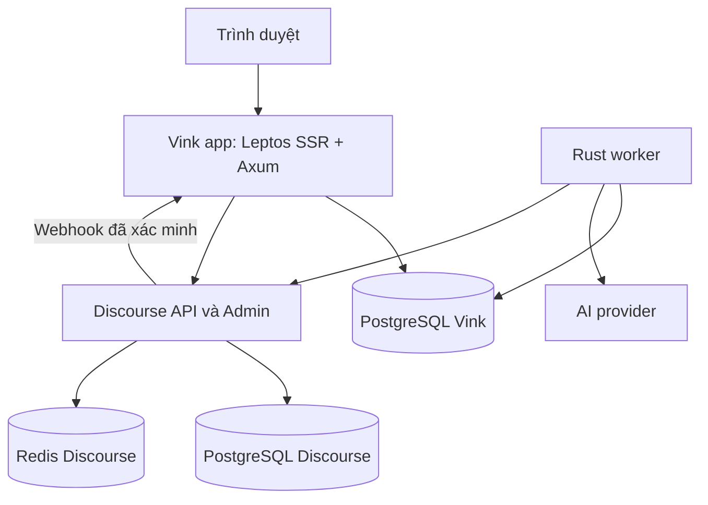

# Tech stack và kiến trúc Vink

**Phiên bản:** 0.2 · **Ngày:** 30/10/2026 · **Trạng thái:** Khuyến nghị có điều kiện, chưa chốt phiên bản dependency hay topology production.

## 1. Khuyến nghị chính

Ưu tiên **B — Hybrid**, với Vink sở hữu nội dung văn học và Discourse sở hữu thảo luận. Khởi đầu bằng **một ứng dụng Rust có các module rõ ràng**, chạy Leptos SSR và Axum, cùng một worker nền. Không cần tách BFF, Literary API, Curation và Moderation thành bốn dịch vụ mạng.

Stack đề xuất:

| Thành phần | Lựa chọn khởi điểm | Vì sao phù hợp |
| --- | --- | --- |
| Web đọc, tạp chí, bàn viết | Leptos SSR + hydration có chọn lọc + CSS tokens M3 Expressive | Giữ kinh nghiệm Rust/Leptos; HTML nội dung và metadata có sẵn từ server |
| Editor | ProseMirror hoặc lớp bọc phù hợp, đóng gói thành module JavaScript riêng | Tập trung kiểm chứng nhập tiếng Việt, cấu trúc văn bản và phục hồi bản thảo |
| Web/API/application | Axum + Tokio trong một deployable | Giảm số ranh giới mạng trong sản phẩm mới |
| Nghiệp vụ | Các module Rust thuần cho revision, publication, moderation policy, curation | Tách quy tắc khỏi HTTP, SQL và AI provider |
| Persistence Vink | PostgreSQL + SQLx + migrations có phiên bản | Giao dịch, ràng buộc và truy vấn do Vink sở hữu |
| Job Vink | PostgreSQL jobs + transactional outbox/inbox | Khởi điểm ít thành phần, có thể gắn việc gửi job vào giao dịch nghiệp vụ |
| Community | Discourse + plugin tích hợp nhỏ về phạm vi | Thảo luận, báo cáo, review queue và công cụ quản trị cộng đồng |
| Phụ thuộc Discourse | Rails/Ember, PostgreSQL và Redis theo bản triển khai được pin | Theo topology mà Discourse hỗ trợ, giữ khả năng nâng cấp |
| AI | Adapter provider + worker giới hạn quyền | Đổi model mà không đổi luật xuất bản |
| Xác thực | Vink principal/session độc lập; giải pháp auth và bridge DiscourseConnect cần chốt | Tránh ghép session/password với Cantos |
| Xác minh | Rust/integration tests + contract fixtures + cargo xtask nhỏ + Quint có chọn lọc | Kiểm cả quy tắc và hành vi tại ranh giới thực tế |

Đây là đề xuất kiến trúc. Khả năng cụ thể của Leptos SSR/Axum, SQLx và editor có nguồn chính thức [T1], [T4], [T5]; việc chúng đáp ứng trải nghiệm Vink phải được thử nghiệm.

## 2. Ba hướng vẫn đáng cân nhắc

| Hướng | Nội dung nằm ở đâu? | Ưu điểm chính | Chi phí chính | Nên chọn khi |
| --- | --- | --- | --- | --- |
| A. Discourse-first | Topic/Post là nơi lưu chính; plugin bổ sung metadata | Đưa cộng đồng và quản trị vào hoạt động nhanh | Phải điều chỉnh vòng đời sáng tác và UX quanh mô hình diễn đàn | Muốn kiểm chứng cộng đồng trước, chấp nhận UI gần Discourse và chưa cần publication riêng |
| B. Hybrid | Work/Chapter/Revision ở Vink; discussion ở Discourse | Làm chủ trải nghiệm văn học, vẫn tận dụng engine cộng đồng | Hai hệ sinh thái, bridge identity, đồng bộ và hai mặt quản trị | Ownership nội dung và UX riêng là giá trị cốt lõi |
| C. Rust-native | Nội dung, bình luận và workflow đều ở Vink | Ít ranh giới sản phẩm hơn, toàn quyền quyết định domain | Tự xây moderation tools, spam defense, notification, admin và vận hành cộng đồng | Discourse chỉ còn đem lại ít giá trị, hoặc có đội chịu trách nhiệm xây toàn bộ |

Ở A, tên stack chính xác là **Rails + Ember.js + theme tùy biến/Horizon + PostgreSQL + Redis**. Horizon là theme, không phải framework thay Ember. B vẫn phải vận hành hệ Discourse dù frontend công khai của Vink dùng Leptos. [D1], [D2]

Không khẳng định B luôn rẻ hơn C. Nếu cuối cùng chỉ dùng Discourse cho một ô bình luận đơn giản và phải thay gần hết moderation UI, chi phí bridge có thể không còn hợp lý. Ngược lại, nếu dùng thật sự review queue, flags, staff tools và cộng đồng thảo luận, B có lý do mạnh để tồn tại.

**Điều kiện giữ B:** có người phụ trách nâng Discourse/plugin; editor đạt trải nghiệm cần thiết; tiền kiểm và xử lý sửa bình luận được kiểm chứng; Vink chấp nhận làm màn quản trị tác phẩm tối thiểu.

## 3. Những gì thực sự học từ Cantos

Đối chiếu `develop` tại commit **a8e2b6f40b58e0e72a2bdab2d4f44240cb6a0330**, ngày 30/10/2026. Nguồn repo mô tả code và trạng thái acceptance tại thời điểm đó; không thay cho kiểm tra production.

| Quan sát có bằng chứng | Áp dụng vào Vink | Điều không nên suy ra |
| --- | --- | --- |
| ADR 0046 đã retired `packages/contracts`; service sở hữu schema, consumer sở hữu DTO/binding [C1] | Mỗi API có một chủ schema, fixture và kiểm tra drift | Không cần một contracts crate dùng chung Vink–Cantos |
| Cantos khuyến khích modular monolith, chỉ thêm service/crate khi có nhu cầu [C3] | Chia module trước, chia deployable sau | Domain isolation không đồng nghĩa microservices |
| Theatre/Studio Web dùng Leptos CSR; `ssr` trong manifest được đọc là dev-dependency native [C2], [C2S] | Kế thừa kinh nghiệm Leptos và UI | SSR/hydration/hosting Vink vẫn là công việc mới |
| Server/Axum và Identity có owner dữ liệu riêng [C4], [C6] | Quy tắc nghiệp vụ và quyền sở hữu dữ liệu phải rõ | Không sao chép toàn bộ topology Identity riêng ngay từ MVP |
| Store hiện dùng embedded `turso = 0.8.3` [C5] | Học transaction discipline và owner boundary | Không mô tả runtime hiện tại là libsql hay dùng adapter đó cho PostgreSQL |
| Web session là cookie; native là opaque Bearer; Identity không cung cấp OIDC công khai [C6] | Giữ secrets phía server, phân biệt authentication và quyền nghiệp vụ | Không thể dùng Cantos như SSO provider sẵn có |
| ADR 0054 tách immutable publication generation khỏi editing head; rollout còn theo từng phần [C7] | Bản đang đọc phải tách khỏi bản đang sửa | Không nói Cantos đã hoàn tất toàn bộ luồng này trên production |
| Quint gate là mô phỏng có giới hạn; có qualification lane thủ công, không phủ mọi PR/lifecycle [C8], [C9] | Mô hình hóa các race quan trọng, ghi rõ phạm vi bằng chứng | Model PASS không là chứng minh toàn hệ thống hoặc database đúng |

UI System, cách đặt trạng thái và công cụ xtask là tài liệu tham khảo. Nếu tái sử dụng code, cần kiểm tra dependency, quyền sử dụng và mức tương thích với Vink; không mặc định import trực tiếp repository Cantos.

## 4. Topology khởi điểm

App và worker dùng chung code application/persistence thuộc Vink; worker nhận job có kiểu và gửi kết quả qua luật chuyển trạng thái. Worker không được tự đặt con trỏ xuất bản tùy theo văn bản do model trả về.

SSR chạy trong server có thể gọi application service nội bộ. Không cần vòng HTTP quay lại chính mình. Browser chỉ nhận DTO công khai và gọi endpoint được phân quyền; domain không import kiểu dữ liệu Discourse, HTTP hoặc AI SDK.

## 5. Quyền sở hữu dữ liệu

| Dữ liệu/hành vi | Chủ sở hữu | Bản sao hoặc ánh xạ được phép |
| --- | --- | --- |
| Work, nội dung chương, bản nháp, revision, publication | Vink | Discourse chỉ giữ link và đoạn giới thiệu được phép công khai |
| Quyết định duyệt tác phẩm, appeal, curation | Vink | Dashboard Vink; link sang discussion nếu cần ngữ cảnh |
| Bình luận, replies, flags, reviewables, trust signals của diễn đàn | Discourse | Vink giữ mapping và cache/projection tối thiểu cần cho UI |
| Định danh ứng dụng, bút danh và hồ sơ tác giả Vink | Vink | Discourse account được map theo ID bất biến |
| Credential và bằng chứng đăng nhập | Auth authority được chọn | Vink nhận identity fact/session; không đồng bộ password |
| Lưu tác phẩm, theo dõi tác giả | Vink trong phạm vi sản phẩm văn học | Không tạo thêm bản tương đương ở Discourse nếu chưa cần |
| Thông báo về duyệt/xuất bản | Vink | Có thể tổng hợp vào một inbox UI sau |
| Thông báo reply/mention Discourse | Discourse | BFF có thể đọc/tổng hợp; trạng thái đã đọc vẫn có owner rõ |
| Audio và trạng thái sản xuất Cantos tương lai | Cantos | Vink lưu liên kết, snapshot nguồn và quyền chuyển thể |

Axum không đọc/ghi trực tiếp bảng lõi Discourse. Plugin Discourse cũng không kết nối SQL vào database Vink. Tích hợp qua API, event và contract có phiên bản.

Hai database **có thể** dùng chung một PostgreSQL instance nếu phiên bản, cấu hình, extensions, tài nguyên và backup tương thích; vẫn dùng database/role riêng và không có quyền ghi chéo. Đây không phải mặc định bắt buộc: quy trình cài đặt Discourse cần được tôn trọng trước khi tối ưu hạ tầng. Cùng instance tạo miền lỗi và lịch nâng cấp chung. [D14]

## 6. Mô hình nội dung ở mức định hướng

Vink cần phân biệt **tác phẩm**, **đơn vị văn bản**, **bản đang soạn**, **snapshot đã gửi duyệt** và **bản đang công khai**. Với tiểu thuyết, đơn vị văn bản là chương; với thơ/truyện ngắn, UI có thể chỉ hiện một thân bài. Tên bảng và cách dùng chung mô hình này sẽ chốt trong thử nghiệm schema, không ép người dùng thấy “Chương 1” dưới một bài thơ.

Luồng khái niệm: Work quản lý tác phẩm; Chapter/body chứa các revision; Publication trỏ tới snapshot đủ điều kiện. Revision đã gửi duyệt phải bất biến. Autosave làm việc trên working draft có version riêng; tạo snapshot rõ tại các mốc lưu/gửi duyệt, không tạo một bản ghi revision lớn cho mọi phím gõ.

Mỗi kết quả duyệt gắn với đúng `revision_id`, `content_hash`, phiên bản policy và phiên bản quyết định. Revision mới, callback muộn, quyết định người duyệt và thao tác rút bài không được vô tình ghi đè nhau. Metadata công khai như tiêu đề, tóm tắt và nội dung cũng phải thuộc phạm vi snapshot hoặc chính sách kiểm duyệt đã xác định.

**Thread thảo luận gắn với work/chapter ổn định**, không gắn khóa duy nhất với mỗi lần xuất bản. `discussion_links` ánh xạ subject Vink sang topic Discourse. Chuyển từ revision 1 sang revision 2 không tạo một thread mới hoặc làm mất bình luận cũ; UI có thể chỉ ra phiên bản ngữ cảnh khi cần.

### Vì sao không dùng Topic/Post làm nguồn tác phẩm chính?

Lý do ưu tiên Vink-owned content là quyền kiểm soát publication, bản thảo song song, export, curation và dữ liệu nhiều chương. Cơ chế sửa Post và PostRevision mặc định của Discourse khác với một working draft độc lập bên cạnh snapshot đang xuất bản. [D5], [D16]

Điều này không chứng minh Discourse không thể được mở rộng để làm content engine. Nếu chọn A, cần đo và thử mô hình thực tế. Không có benchmark trong nghiên cứu này để kết luận custom fields chắc chắn chậm; cũng chưa có thử nghiệm để nói pipeline render Discourse luôn phá neo ghi chú.

### Chuẩn bị cho ghi chú bên lề

Lưu tài liệu có cấu trúc, schema version, snapshot revision và cân nhắc block ID từ đầu. Một neo có thể cần block ID cộng đoạn trích, prefix/suffix và vị trí trong phiên bản. Block ID một mình không giải quyết tách đoạn, gộp đoạn hoặc xóa đoạn. Khi không tìm được neo đáng tin cậy, giữ ghi chú ở phiên bản gốc hoặc đánh dấu mất neo; không tự gán sang đoạn khác. Pilot chỉ cần schema/version tối thiểu và editor round-trip đáng tin cậy; UI margin notes và phục hồi neo triển khai sau.

## 7. Frontend và editor

### Leptos SSR là lựa chọn có chủ đích

Trang tác phẩm, tác giả và Tạp Chí cần HTML nội dung, canonical URL, metadata chia sẻ và liên kết để đọc ngay từ server. Leptos hỗ trợ SSR với Axum; server build và browser hydration build là hai mục tiêu biên dịch khác nhau. [T1], [T2]

Public SSR phải đọc publication đã được phép hiển thị. Không serialize working draft hoặc field riêng vào HTML/hydration. Cache công khai cần version và cơ chế vô hiệu hóa khi rút bài; response có dữ liệu theo tài khoản không vào shared cache. Một SSR page đọc thành công chưa đủ chứng minh mọi endpoint tải lại/hydrate giữ cùng quyền.

Leptos islands là một lựa chọn để giảm phần tương tác phải hydrate, nhưng không bắt buộc dùng toàn bộ app ở chế độ islands. Cần cân đối routing, navigation và editor qua benchmark thực tế. [T3]

### Giữ Leptos không có nghĩa tự viết editor bằng Rust

| Phương án editor/frontend | Khi có lợi | Điều phải thử |
| --- | --- | --- |
| Leptos shell + ProseMirror module JavaScript | Giữ stack Rust cho app, dùng editor có schema/transaction sẵn | Lifecycle mount/unmount, IME, undo, paste, autosave, mobile, schema bridge |
| Editor văn bản/Markdown gọn trong Leptos | Pilot chỉ cần soạn cơ bản, tác giả chấp nhận Markdown | Hiển thị thơ, preview, paste, dễ sử dụng và chuyển đổi về sau |
| SvelteKit hoặc frontend JavaScript tương đương + Axum API | Đội frontend/editor làm việc hiệu quả hơn trong hệ JavaScript hoặc spike Leptos không đạt | Thêm ngôn ngữ, contract sinh/đối chiếu, SSR và design parity |

**Mặc định đề xuất:** Leptos shell + editor JavaScript giới hạn phạm vi. Đây là một ứng viên cần thử, không phải integration đã có sẵn. ProseMirror có document schema và JSON serialization; Vink vẫn phải định nghĩa schema, validation server, sanitation và migration. [T4] Leptos có đường tích hợp JavaScript/Web APIs, nhưng tài liệu đó không chứng minh editor cụ thể đã vận hành tốt trên Vink. [T10]

Không đồng thời lưu Markdown, HTML và editor JSON như ba nguồn chân lý. Chọn một dạng canonical có schema version; HTML và text phục vụ đọc/search là sản phẩm dẫn xuất có thể tái tạo. Cần kiểm thử xuống dòng, dấu tiếng Việt, dán từ Word/Docs, undo sau lưu, refresh và xung đột hai tab.

M3 Expressive là design system do Vink triển khai qua semantic tokens và component states. Nó không tự có vì chọn Leptos. Tách component đọc dài khỏi navigation, form và editor toolbar; accessibility và typography là tiêu chí nghiệm thu.

## 8. Cấu trúc Rust và contracts

Đề xuất bố trí ban đầu theo trách nhiệm; chưa cần tạo một crate cho mỗi hàng:

| Vị trí minh họa | Vai trò |
| --- | --- |
| `apps/vink-web` | View Leptos và DTO/client theo nhu cầu UI |
| `services/vink-app` | Axum, server SSR composition, application modules, persistence/Discourse adapters |
| `services/vink-app/contracts` | Schema API do Vink cung cấp, fixtures, ví dụ lỗi và versioning |
| `services/vink-worker` hoặc binary thứ hai cùng package | Worker moderation, outbox, reconcile; tách process để không giữ request chờ AI |
| `packages/editor` | Editor JavaScript, bridge document schema, build và tests chuyên biệt |
| `plugins/discourse-vink` | Plugin mở rộng đúng những điểm được integration spike chứng minh cần thiết |
| `specs/behavior` và `xtask` | Các model được chấp nhận và lệnh verify nhỏ, có phạm vi rõ |

**Hiện thực ở skeleton (30/10/2026):** đã có `apps/vink-web`, `services/vink-app` (worker là binary thứ hai cùng package), `services/vink-app/contracts/http/v1` và `xtask`; `packages/editor`, `plugins/discourse-vink` và `specs/behavior` chưa tồn tại. Chi tiết và lý do ở [docs/development](../development/README.md). Đây là giả định bootstrap, không chốt D-03/D-04.

Domain rules không phụ thuộc Axum, SQLx, Leptos hay SDK model. Application layer điều phối; adapters thực hiện I/O. `vink-app` là composition root, phụ thuộc view package và application core. `vink-web` không import service crate; SSR nhận facade qua interface/context do composition root cung cấp. Nếu app và worker cần dùng chung core, dùng binary thứ hai cùng package hoặc một thư viện server-only có owner rõ. Browser build chỉ chứa view/client types, không link persistence/secrets. Tách domain crate chỉ khi có consumer hoặc lợi ích kiểm chứng thực tế.

API công khai bắt đầu bằng JSON có schema/error model rõ. Mỗi provider giữ canonical schema và fixtures; mỗi consumer sở hữu kiểu dữ liệu cần dùng và kiểm tra drift. Không cần gRPC/Protobuf cho mọi API, không tạo contracts crate toàn cục Vink–Cantos. Leptos server functions là transport adapter cho use case, không tạo luật nghiệp vụ thứ hai cạnh REST. Bài học ownership đến từ ADR 0046; bố trí Vink là đề xuất riêng. [C1]

## 9. Tích hợp Discourse theo phạm vi hữu hạn

MVP chỉ tích hợp những khả năng có nhu cầu rõ: tạo và đọc thảo luận của một tác phẩm, gửi phản hồi, báo cáo, xem trạng thái chờ và xử lý review. Các chức năng như inbox hợp nhất, badge, full-text search liên hệ thống, chat hoặc giao diện lịch sử chỉnh sửa không tự xuất hiện trong Leptos chỉ vì Discourse có sẵn.

Plugin Ruby nên **nhỏ về trách nhiệm**: bảo vệ điểm ghi cần thiết, phát event hoặc cung cấp endpoint tích hợp hẹp. Chưa ước lượng bằng số dòng. Adapter Rust chịu mapping, retry, kiểm tra schema/version; Discourse vẫn sở hữu trạng thái bình luận.

### Hai nơi giữ cổng công khai

- **Tác phẩm:** application Vink giữ revision chưa được duyệt khỏi public read. Worker chỉ tạo kết quả; Vink kiểm điều kiện để áp dụng.
- **Bình luận:** Discourse phải giữ nội dung ở trạng thái chưa public trước khi chờ worker. Review queue có API nhưng chỉ chứa các đối tượng đã được đưa vào pending hoặc flagged. [D3]

`post_created`/`post_edited` webhook không thay một cổng trước khi công khai. Code hiện được đọc cho thấy create qua `NewPostManager`, update qua `PostRevisor`, import và email có đường xử lý khác. `review_every_post` cũng không đồng nghĩa mọi nội dung đều bị giữ trước xuất bản. Những đường đang bật phải được thử trên release pin. [D4], [D5], [D6], [D12], [D13], [D17]

**Mặc định pilot đề xuất:** tiền kiểm bình luận mới; chỉ mở sửa bình luận công khai khi chứng minh được chính sách giữ bản đã duyệt hoặc ẩn bản sửa một cách nhất quán. Nếu chưa đạt, chặn thao tác sửa ở cả UI và API, đồng thời cho tác giả yêu cầu người duyệt xử lý. Tắt email-in, import tự phục vụ và các đường chưa được đưa vào phạm vi. Ngoại lệ staff/system phải có mục đích và audit; không đăng bình luận người dùng bằng quyền staff để né gate.

### Review API phải xử lý cạnh tranh

Adapter đọc reviewable hiện tại, action được phép và version, rồi thực hiện action tương ứng. Không hard-code tất cả loại reviewable thành `approve_post`; khi xung đột version phải đọc lại và quyết định lại. Quyết định người duyệt hoặc nội dung mới hơn không bị callback AI cũ ghi đè. [D3], [D7], [D8]

Không phản chiếu toàn bộ tác phẩm vào Post đầu tiên. Pilot nên ưu tiên link và metadata công khai tối thiểu; chỉ thêm excerpt nếu có nhu cầu. Khi rút bài, Vink chặn public read của mình ngay và yêu cầu ẩn thread khỏi người đọc thông thường, dừng replies mới. Phải xử lý cả title, Post đầu tiên, excerpt, trích dẫn trong replies và cache theo policy; đóng topic/unlist/unlink không được coi là đã thu hồi quyền đọc.

Nếu Discourse lỗi, hiển thị riêng trạng thái “đã rút khỏi Vink” và “đang thu hồi thảo luận/bản sao”; chưa báo hoàn tất toàn bộ. Giữ mapping/tombstone để đối soát và tái xuất bản đúng thread. Nếu cần thu hồi tức thì ở mọi hệ thống, phải bổ sung cổng đọc kiểm quyền tương ứng và chứng minh bằng spike; gửi event bất đồng bộ không tạo bảo đảm đó. Thời hạn remote cleanup và cách xử lý khi quá hạn thuộc D-12, cần chốt trước beta.

### Publication và discussion không chung một transaction

Giao dịch PostgreSQL Vink ghi publication pointer và outbox cùng lúc. Worker provision topic, ghi mapping và retry/reconcile khi thất bại. Một bài đã xuất bản vẫn đọc được khi Discourse lỗi; phần thảo luận thể hiện đang chuẩn bị hoặc tạm gián đoạn.

Outbox không tự mang lại exactly-once ở Discourse. Tình huống “API đã tạo topic nhưng worker chết trước khi ghi nhận” cần một external key được server đích xử lý duy nhất hoặc cơ chế lookup/reconcile đã kiểm chứng. Unique constraint trên bảng mapping Vink chỉ bảo vệ bảng đó. Không dùng retry mù với create API.

Ngoài chống trùng, cần generation/sequence tăng dần theo subject, desired state bền vững và điều phối side effect theo subject. Publish event cũ không được hồi sinh thread đã rút hoặc ghi đè excerpt mới. Local lock không chặn được HTTP request cũ đã timeout nhưng còn chạy ở Discourse; muốn bảo đảm mạnh, endpoint/plugin đích phải từ chối generation cũ. Nếu chỉ có reconciliation cuối cùng, ghi rõ giới hạn đó và phạm vi beta tương ứng.

Webhook được xác minh chữ ký trên payload thô, giới hạn kích thước/loại event rồi ghi inbox bền vững. Delivery có thể trùng, trễ hoặc mất sau retry; đối soát review queue/mapping định kỳ phải sửa được trạng thái lệch. Payload có thể chứa dữ liệu chỉ staff được thấy, nên không chuyển thẳng sang browser hoặc log nguyên văn. [D11]

## 10. Identity và liên thông tài khoản

**Vink sở hữu principal của ứng dụng không đồng nghĩa phải tự viết hệ thống mật khẩu.** Dùng `vink_user_id` ổn định cho dữ liệu văn học, tách khỏi username, email, Discourse user ID và subject của nhà cung cấp đăng nhập.

| Hướng xác thực | Đánh đổi | Đề xuất sử dụng |
| --- | --- | --- |
| Auth provider độc lập được duy trì, Vink giữ session ứng dụng | Có thêm dependency nhưng giảm phần credential lifecycle tự xây | Ưu tiên khảo sát nếu Vink độc lập là mục tiêu dài hạn |
| Native auth do Vink quản lý | Kiểm soát UX và hạ tầng, nhưng phải làm verify/reset/session/security lifecycle | Chỉ chọn khi có người chịu trách nhiệm; học Cantos nhưng không mặc định sao chép |
| Discourse làm nguồn xác thực ban đầu | Có thể giảm auth tự xây, nhưng nội dung Vink phụ thuộc thêm vào community engine | Phương án beta nếu ưu tiên tốc độ và chấp nhận coupling |

Nếu Vink là nơi đăng nhập chính, DiscourseConnect là bridge khả thi: protocol dùng chữ ký, nonce và external ID ổn định. Đây là SSO riêng của Discourse, không phải một OIDC provider cho cả hệ sinh thái. Provisioning, verified email, logout, ban và đổi tên vẫn cần mapping được kiểm chứng. [D9]

DiscourseConnect có hành vi liên kết tài khoản hiện có theo email trong một số tình huống. Vì vậy không chỉ đặt external ID rồi coi account linking đã an toàn: cần thử onboarding tài khoản mới/cũ, email đã xác minh và đổi email trước beta. Liên kết Vink–Cantos tương lai cần người dùng chứng minh quyền sở hữu ở cả hai phía, không tự gộp theo email trùng.

Browser Vink dùng cookie HttpOnly/Secure với CSRF/Origin policy phù hợp topology. Cookie session của Vink và Discourse là hai phiên riêng; tắt tính năng đăng nhập native của Discourse không tự đồng bộ toàn bộ logout hoặc suspension. Chọn một authority cho trạng thái khóa tài khoản và kiểm cả request đi trực tiếp vào Discourse.

Khi BFF gọi API thay người dùng, danh tính Discourse được lấy từ session và mapping server-side. Key kiểu All Users có khả năng hành động thay nhiều tài khoản; không nhận `Api-Username` tùy ý từ browser. Tách credential cho user actions, provisioning và moderation, dùng quyền tối thiểu có thể đáp ứng từng chức năng. Không đưa key vào bundle WASM, HTML SSR hay mã JavaScript. [D10]

Cantos Identity xác minh email/password và cung cấp authentication facts qua RPC riêng; Cantos Server tạo và quản lý application sessions. Hệ thống này chưa cung cấp SSO/OIDC dùng ngay cho Vink. Không chia sẻ password store, cookie, session table hoặc database. Nếu sau này cần một hệ thống đăng nhập chung, đó là ADR tích hợp riêng. [C6]

## 11. PostgreSQL, jobs, search và assets

### Transactions và schema

SQLx cung cấp driver PostgreSQL, transactions và cơ chế migrations; schema Vink vẫn phải có ràng buộc nghiệp vụ riêng. [T5] Dùng foreign keys, unique constraints, kiểm tra owner và version trong giao dịch phù hợp. Một đoạn Rust kiểm trước rồi ghi sau không thay được điều kiện cạnh tranh tại database.

Tách working draft có optimistic concurrency khỏi revision bất biến. Publication trỏ snapshot cụ thể; cập nhật pointer, audit và outbox trong cùng transaction. Tránh biểu diễn một tác phẩm bằng một trường trạng thái chứa mọi tổ hợp moderation, publication, audience và curation.

### Hàng đợi nền

PostgreSQL `FOR UPDATE SKIP LOCKED` có thể hỗ trợ nhiều consumer lấy công việc, nhưng tài liệu chính thức chỉ rõ nó không phù hợp như cách đọc nhất quán chung. [T6] Job cần trạng thái, attempts, lease, deadline và fencing token/version.

Claim job trong transaction ngắn rồi giải phóng khóa trước khi gọi AI/network. Khi worker chết, watchdog có thể thu hồi lease; kết quả trả muộn chỉ được ghi nếu lease/revision/decision version còn hợp lệ. Retry lỗi tạm thời có backoff và giới hạn; nội dung mơ hồ hoặc lỗi hết ngân sách chuyển human review.

Redis là phụ thuộc của Discourse, không phải lý do bắt Vink dùng chung queue/cache. Chỉ thêm broker hoặc Redis cho Vink khi có nhu cầu throughput, fan-out hoặc độ trễ được đo rõ. Không thêm vector database vì có AI moderation; tác vụ phân loại nội dung không tự đòi hỏi vector search.

### Tìm kiếm tiếng Việt

Khởi điểm với PostgreSQL cho tên tác phẩm, tác giả, tags và văn bản đã công khai; khảo sát full-text search, `unaccent` và tìm gần đúng theo corpus thực tế. `unaccent` loại dấu, không tự giải quyết tách từ, ngữ nghĩa hoặc xếp hạng tiếng Việt. [T7]

Thử cả truy vấn có/không dấu, bút danh, lỗi gõ, tên trùng và nội dung dài. Chỉ cân nhắc search engine riêng khi chất lượng/ranking hoặc tải truy vấn không đạt yêu cầu. Search phải loại nội dung riêng và bản đã bị rút ngay theo cùng policy public read.

### Assets

Ảnh và tệp lớn dùng object storage theo nhu cầu; PostgreSQL giữ metadata, owner và quyền sử dụng. Không cần tích hợp audio pipeline trong MVP. Icon/design assets và ảnh người dùng cần policy định dạng riêng, tránh suy ra mọi quyết định định dạng của Cantos đều phù hợp Vink.

## 12. Vận hành và chi phí

SSR cần server runtime; không coi một static hosting bundle là triển khai SSR hoàn chỉnh. Một VPS/container cho app và worker là ứng viên pilot; reverse proxy/CDN có thể đứng trước nội dung công khai. Discourse theo đường cài đặt và phiên bản được hỗ trợ. Chưa cần Kubernetes hay nhiều vùng triển khai trước khi có yêu cầu cụ thể.

Giữ cấu hình/secrets tách theo môi trường, staging có dữ liệu thử và plugin version pin. App Rust, plugin Discourse và schema contract phải có ma trận tương thích; nâng Discourse chạy lại các tình huống integration quan trọng trước rollout.

Backup cần bao phủ hai database, cấu hình cần phục hồi và assets. Restore phải kiểm tra publication pointers, account/thread mappings, job đang chạy và outbox còn chờ; không phát lại mù các side effect cũ. RPO/RTO, retention và mục tiêu hiệu suất được đo/chốt trước public beta, chưa có số cam kết trong bộ tài liệu này.

Theo dõi tối thiểu: lỗi public read, autosave thất bại, tuổi job/human queue, webhook lag, backlog outbox, xung đột version, số topic trùng, số quyết định bị người duyệt đảo và chi phí AI theo mục đích. Trace ID nối app–worker–adapter; logs tránh chứa toàn văn nháp hoặc secrets.

Ước tính chi phí nên gồm **hạ tầng + model + giờ người duyệt + giờ duy trì plugin/bridge**. Chi phí model phụ thuộc lượng bài/bình luận, độ dài, model/policy, retry và tỷ lệ chuyển người. Chưa chọn provider, chưa quote giá hoặc hứa một thời gian phản hồi cố định.

## 13. Verification vừa đủ và có bằng chứng

| Lớp | Điều cần chứng minh | Cách kiểm |
| --- | --- | --- |
| Pure domain | Không đăng nhầm revision, không vượt quyền, tách curation | Unit/property tests và một số model Quint |
| PostgreSQL | Constraint, transaction/CAS, job lease, concurrent publish/withdraw | Integration tests trên PostgreSQL thực |
| Discourse | Create/edit gate, review actions, account mapping, direct access | Integration suite trên release và plugin được pin |
| Web/editor | IME, paste, autosave, thơ, SSR/hydration, accessibility | Browser tests và kiểm tra thực tế trên thiết bị mục tiêu |
| Failure recovery | AI timeout, webhook trùng/mất, topic-create crash, restore | Kịch bản lỗi có kết quả và log quan sát |

Quint phù hợp để mô hình hóa safety properties như “bản chưa duyệt không công khai”, “callback cũ không thắng quyết định mới” và “tuyển chọn ghim đúng revision”. Liveness như “không chờ mãi” cần mô hình thời gian/scheduler và giả định tiến triển; không chỉ thêm một boolean invariant. Model checking và sampled simulation có phạm vi khác nhau. [T8]

Đề xuất một `cargo xtask verify` nhỏ điều phối các gate đã có. Nếu chạy Quint, lưu tool pin, seed, bounds và kết quả; báo riêng phần chưa chạy. Không sao chép toàn bộ toolchain/CI Cantos hay coi model PASS là bằng chứng behavior đã triển khai. [C8], [C9]

## 14. Khi nào thay đổi stack?

- **Giữ A trong một pilot tạm thời** nếu cần kiểm chứng cộng đồng ngay và chưa đủ người vận hành integration. Ghi rõ phần tác phẩm đó sẽ cần export/migrate nếu sau này chuyển owner.
- **Giữ B** khi Discourse đóng góp thực sự cho thảo luận và moderation, trong khi Vink làm chủ trải nghiệm sáng tác.
- **Thu hẹp hoặc bỏ Discourse để tiến tới C** nếu chi phí bridge lớn hơn lợi ích quan sát được, hoặc sản phẩm chỉ cần tập tính năng cộng đồng rất nhỏ. Phải có kế hoạch export comments, IDs, quyền truy cập và xử lý lịch sử review.
- **Đổi frontend, giữ Axum/PostgreSQL** nếu editor và tốc độ phát triển là điểm nghẽn. Ownership và contracts không phụ thuộc Leptos; đây là lý do để giữ boundary rõ từ đầu.

Không cần chốt mọi version trong vision. Sau các spike, ghi release/tag, dependency lockfile, model/provider config và ma trận tương thích vào ADR thực thi. Các quyết định cần chốt và tiêu chí go/no-go nằm trong [decisions.md](decisions.md).

## Nguồn tham chiếu

Danh mục đầy đủ và giới hạn bằng chứng: [sources.md](../references/sources.md).

[C1]: https://github.com/loveoverflowcom/cantos/blob/a8e2b6f40b58e0e72a2bdab2d4f44240cb6a0330/docs/decisions/0046-service-owned-contracts.md
[C2]: https://github.com/loveoverflowcom/cantos/blob/a8e2b6f40b58e0e72a2bdab2d4f44240cb6a0330/apps/cantos-theatre/web/Cargo.toml
[C2S]: https://github.com/loveoverflowcom/cantos/blob/a8e2b6f40b58e0e72a2bdab2d4f44240cb6a0330/apps/cantos-studio/web/Cargo.toml
[C3]: https://github.com/loveoverflowcom/cantos/blob/a8e2b6f40b58e0e72a2bdab2d4f44240cb6a0330/AGENTS.md
[C4]: https://github.com/loveoverflowcom/cantos/blob/a8e2b6f40b58e0e72a2bdab2d4f44240cb6a0330/docs/architecture/overview.md
[C5]: https://github.com/loveoverflowcom/cantos/blob/a8e2b6f40b58e0e72a2bdab2d4f44240cb6a0330/packages/store-turso/Cargo.toml
[C6]: https://github.com/loveoverflowcom/cantos/blob/a8e2b6f40b58e0e72a2bdab2d4f44240cb6a0330/services/cantos-server/contracts/auth/identity-auth/v1/README.md
[C7]: https://github.com/loveoverflowcom/cantos/blob/a8e2b6f40b58e0e72a2bdab2d4f44240cb6a0330/docs/decisions/0054-publication-generation-and-access.md
[C8]: https://github.com/loveoverflowcom/cantos/blob/a8e2b6f40b58e0e72a2bdab2d4f44240cb6a0330/docs/decisions/0027-quint-executable-behavior.md
[C9]: https://github.com/loveoverflowcom/cantos/blob/a8e2b6f40b58e0e72a2bdab2d4f44240cb6a0330/.github/workflows/repository-checks.yml
[D1]: https://github.com/discourse/discourse/blob/fda60103f6db3ab23431062a930735eff857152d/README.md
[D2]: https://meta.discourse.org/t/introducing-horizon-our-newest-theme/369608
[D3]: https://meta.discourse.org/t/how-to-integrate-a-third-party-moderation-service-with-discourse/415566/2
[D4]: https://github.com/discourse/discourse/blob/fda60103f6db3ab23431062a930735eff857152d/app/controllers/posts_controller.rb
[D5]: https://github.com/discourse/discourse/blob/fda60103f6db3ab23431062a930735eff857152d/lib/post_revisor.rb
[D6]: https://github.com/discourse/discourse/blob/fda60103f6db3ab23431062a930735eff857152d/lib/new_post_manager.rb
[D7]: https://github.com/discourse/discourse/blob/fda60103f6db3ab23431062a930735eff857152d/app/models/reviewable_queued_post.rb
[D8]: https://github.com/discourse/discourse/blob/fda60103f6db3ab23431062a930735eff857152d/app/controllers/reviewables_controller.rb
[D9]: https://meta.discourse.org/t/setup-discourseconnect-official-single-sign-on-for-discourse-sso/13045
[D10]: https://meta.discourse.org/t/create-and-configure-an-api-key/230124
[D11]: https://meta.discourse.org/t/configure-webhooks-that-trigger-on-discourse-events-to-integrate-with-external-services/49045
[D12]: https://github.com/discourse/discourse/blob/fda60103f6db3ab23431062a930735eff857152d/script/import_scripts/base.rb
[D13]: https://github.com/discourse/discourse/blob/fda60103f6db3ab23431062a930735eff857152d/lib/email/receiver.rb
[D14]: https://github.com/discourse/discourse/blob/fda60103f6db3ab23431062a930735eff857152d/docs/INSTALL.md
[D16]: https://github.com/discourse/discourse/blob/fda60103f6db3ab23431062a930735eff857152d/app/models/post_revision.rb
[D17]: https://github.com/discourse/discourse/blob/fda60103f6db3ab23431062a930735eff857152d/app/models/reviewable_post.rb
[T1]: https://book.leptos.dev/ssr/index.html
[T2]: https://book.leptos.dev/ssr/22_life_cycle.html
[T3]: https://book.leptos.dev/islands.html
[T4]: https://prosemirror.net/docs/guide/
[T5]: https://docs.rs/sqlx/latest/sqlx/
[T6]: https://www.postgresql.org/docs/current/sql-select.html
[T7]: https://www.postgresql.org/docs/current/unaccent.html
[T8]: https://quint.sh/docs/checking-properties
[T10]: https://book.leptos.dev/web_sys.html
