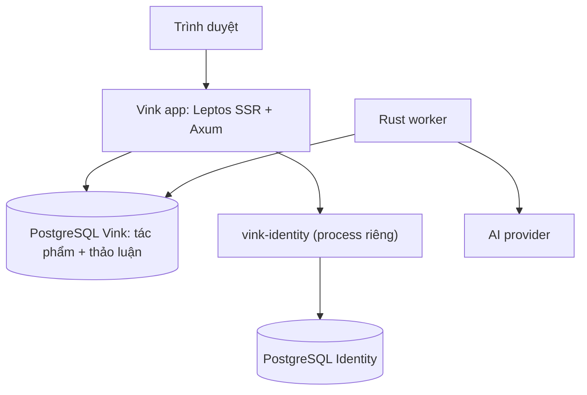

# Tech stack và kiến trúc Vink

**Phiên bản:** 0.3 · **Ngày:** 30/10/2026, cập nhật 03/11/2026 · **Trạng thái:** Khuyến nghị có điều kiện, chưa chốt phiên bản dependency hay topology production.

> **Cập nhật 03/11/2026 — owner thảo luận:** chủ sản phẩm chọn **Vink tự sở hữu bình luận**
> bằng Rust core và PostgreSQL của App ([ADR ownership](discussion-ownership.md)).
> Discourse chỉ là nguồn tham khảo về thiết kế, API, kiểm duyệt và trải nghiệm cộng đồng;
> không là dependency runtime, nơi lưu bình luận, nguồn xác thực hay plugin cần triển khai.
> Phần so sánh A/B/C bên dưới được giữ làm lịch sử lựa chọn.

> **Cập nhật 10/11/2026 — quyết định sản phẩm:** stack không đổi. Thay đổi là phạm vi và luật
> nghiệp vụ ([DecisionDelta](product-decisions-20261110.md)): mạng xã hội bài ngắn (không nhiều
> chương, chưa có Tạp Chí), hai audience, trợ lý AI là luồng duyệt mặc định với quản trị viên ở
> trên, username + mật khẩu là đăng nhập chính, bộ sưu tập, hashtag, Đề xuất và Top 100. Các câu
> bên dưới nói “người duyệt”, “human queue”, “Tạp Chí”, “nhiều chương” hay “mã email” được giữ làm
> lịch sử; hướng đích ở các đặc tả được DecisionDelta dẫn tới. Không thêm Redis, search service hay
> provider AI nào vì các quyết định này.

## 1. Khuyến nghị chính

Vink sở hữu **cả nội dung văn học lẫn thảo luận** (hướng C ở mục 2, áp dụng cho bình luận theo quyết định 03/11/2026). Khởi đầu bằng **một ứng dụng Rust có các module rõ ràng**, chạy Leptos SSR và Axum, cùng một worker nền. Không cần tách BFF, Literary API, Curation và Moderation thành bốn dịch vụ mạng.

Stack đề xuất:

| Thành phần | Lựa chọn khởi điểm | Vì sao phù hợp |
| --- | --- | --- |
| Web đọc, tạp chí, bàn viết | Leptos SSR + hydration có chọn lọc + CSS tokens M3 Expressive | Giữ kinh nghiệm Rust/Leptos; HTML nội dung và metadata có sẵn từ server |
| Editor | ProseMirror hoặc lớp bọc phù hợp, đóng gói thành module JavaScript riêng | Tập trung kiểm chứng nhập tiếng Việt, cấu trúc văn bản và phục hồi bản thảo |
| Web/API/application | Axum + Tokio trong một deployable | Giảm số ranh giới mạng trong sản phẩm mới |
| Nghiệp vụ | Các module Rust thuần cho revision, publication, moderation policy, curation | Tách quy tắc khỏi HTTP, SQL và AI provider |
| Persistence Vink | PostgreSQL + SQLx + migrations có phiên bản | Giao dịch, ràng buộc và truy vấn do Vink sở hữu |
| Job Vink | PostgreSQL jobs + transactional outbox/inbox | Khởi điểm ít thành phần, có thể gắn việc gửi job vào giao dịch nghiệp vụ |
| Thảo luận | Module `discussion` trong `vink-app`: Rust core thuần + PostgreSQL của App | Một owner ghi/kiểm duyệt; bình luận gốc + một danh sách phản hồi phẳng; tác giả bật/tắt bình luận theo tác phẩm |
| AI | Adapter provider + worker giới hạn quyền | Đổi model mà không đổi luật xuất bản |
| Xác thực | Vink principal/session độc lập; D-05 đề xuất authority native mã email + phiên opaque (Provisional, [ADR](auth-authority.md)); 10/11/2026: hướng chính là username + mật khẩu trên cùng authority native (backend Identity + App đã có đăng ký/đăng nhập mật khẩu #152 và enrollment #168; Web UI /toi hiện vẫn dùng mã email, UI mật khẩu và recovery O-11 còn là gap) | Tránh ghép session/password với Cantos |
| Xác minh | Rust/integration tests + contract fixtures + cargo xtask nhỏ + Quint có chọn lọc | Kiểm cả quy tắc và hành vi tại ranh giới thực tế |

Đây là đề xuất kiến trúc. Khả năng cụ thể của Leptos SSR/Axum, SQLx và editor có nguồn chính thức [T1], [T4], [T5]; việc chúng đáp ứng trải nghiệm Vink phải được thử nghiệm.

## 2. Ba hướng vẫn đáng cân nhắc

| Hướng | Nội dung nằm ở đâu? | Ưu điểm chính | Chi phí chính | Nên chọn khi |
| --- | --- | --- | --- | --- |
| A. Discourse-first | Topic/Post là nơi lưu chính; plugin bổ sung metadata | Đưa cộng đồng và quản trị vào hoạt động nhanh | Phải điều chỉnh vòng đời sáng tác và UX quanh mô hình diễn đàn | Muốn kiểm chứng cộng đồng trước, chấp nhận UI gần Discourse và chưa cần publication riêng |
| B. Hybrid | Work/Chapter/Revision ở Vink; discussion ở Discourse | Làm chủ trải nghiệm văn học, vẫn tận dụng engine cộng đồng | Hai hệ sinh thái, bridge identity, đồng bộ và hai mặt quản trị | Ownership nội dung và UX riêng là giá trị cốt lõi |
| C. Rust-native | Nội dung, bình luận và workflow đều ở Vink | Ít ranh giới sản phẩm hơn, toàn quyền quyết định domain | Tự xây moderation tools, spam defense, notification, admin và vận hành cộng đồng | Discourse chỉ còn đem lại ít giá trị, hoặc có đội chịu trách nhiệm xây toàn bộ |

Ở A, tên stack chính xác là **Rails + Ember.js + theme tùy biến/Horizon + PostgreSQL + Redis**. Horizon là theme, không phải framework thay Ember. B vẫn phải vận hành hệ Discourse dù frontend công khai của Vink dùng Leptos. [D1], [D2]

Không khẳng định B luôn rẻ hơn C. Nếu cuối cùng chỉ dùng Discourse cho một ô bình luận đơn giản và phải thay gần hết moderation UI, chi phí bridge có thể không còn hợp lý. Ngược lại, nếu dùng thật sự review queue, flags, staff tools và cộng đồng thảo luận, B có lý do mạnh để tồn tại.

**Kết quả 03/11/2026:** thảo luận theo hướng C — Vink sở hữu bình luận, replies và quyết định kiểm duyệt bình luận; nội dung văn học vẫn ở Vink như B. Vink nhận trách nhiệm tự xây tiền kiểm, báo cáo/khiếu nại, chống lạm dụng và thông báo (danh sách ở [ADR ownership](discussion-ownership.md#trách-nhiệm-phải-tự-xây)). Không vận hành Discourse; phần trên là lý do lịch sử của lựa chọn.

## 3. Những gì thực sự học từ Cantos

Đối chiếu `develop` tại commit **a8e2b6f40b58e0e72a2bdab2d4f44240cb6a0330**, ngày 30/10/2026. Nguồn repo mô tả code và trạng thái acceptance tại thời điểm đó; không thay cho kiểm tra production.

| Quan sát có bằng chứng | Áp dụng vào Vink | Điều không nên suy ra |
| --- | --- | --- |
| ADR 0046 đã retired `packages/contracts`; service sở hữu schema, consumer sở hữu DTO/binding [C1] | Mỗi API có một chủ schema, fixture và kiểm tra drift | Không cần một contracts crate dùng chung Vink–Cantos |
| Cantos khuyến khích modular monolith, chỉ thêm service/crate khi có nhu cầu [C3] | Chia module trước, chia deployable sau | Domain isolation không đồng nghĩa microservices |
| Theatre/Studio Web dùng Leptos CSR; `ssr` trong manifest được đọc là dev-dependency native [C2], [C2S] | Kế thừa kinh nghiệm Leptos và UI | SSR/hydration/hosting Vink vẫn là công việc mới |
| Server/Axum và Identity có owner dữ liệu riêng [C4], [C6] | Quy tắc nghiệp vụ và quyền sở hữu dữ liệu phải rõ | Không sao chép toàn bộ topology Identity riêng ngay từ MVP |
| Store hiện dùng embedded `turso = 0.8.3` [C5] | Học transaction discipline và owner boundary | Không mô tả runtime hiện tại là libsql hay dùng adapter đó cho PostgreSQL |
| Web session là cookie; native là opaque Bearer; Identity không cung cấp OIDC công khai [C6] | Giữ secrets phía server, phân biệt authentication và quyền nghiệp vụ | Không thể dùng Cantos như SSO provider sẵn có |
| ADR 0054 tách immutable publication generation khỏi editing head; rollout còn theo từng phần [C7] | Bản đang đọc phải tách khỏi bản đang sửa | Không nói Cantos đã hoàn tất toàn bộ luồng này trên production |
| Quint gate là mô phỏng có giới hạn; có qualification lane thủ công, không phủ mọi PR/lifecycle [C8], [C9] | Mô hình hóa các race quan trọng, ghi rõ phạm vi bằng chứng | Model PASS không là chứng minh toàn hệ thống hoặc database đúng |

UI System, cách đặt trạng thái và công cụ xtask là tài liệu tham khảo. Nếu tái sử dụng code, cần kiểm tra dependency, quyền sử dụng và mức tương thích với Vink; không mặc định import trực tiếp repository Cantos.

## 4. Topology khởi điểm

App và worker dùng chung code application/persistence thuộc Vink; worker nhận job có kiểu và gửi kết quả qua luật chuyển trạng thái. Worker không được tự đặt con trỏ xuất bản tùy theo văn bản do model trả về.

SSR chạy trong server có thể gọi application service nội bộ. Không cần vòng HTTP quay lại chính mình. Browser chỉ nhận DTO công khai và gọi endpoint được phân quyền; domain không import kiểu dữ liệu HTTP, SQL hoặc AI SDK.

## 5. Quyền sở hữu dữ liệu

| Dữ liệu/hành vi | Chủ sở hữu | Bản sao hoặc ánh xạ được phép |
| --- | --- | --- |
| Work, nội dung chương, bản nháp, revision, publication | Vink | Không có bản sao ở hệ thảo luận ngoài |
| Quyết định duyệt tác phẩm, appeal, curation | Vink | Dashboard Vink |
| Bình luận, replies, quyết định kiểm duyệt bình luận, trạng thái bật/tắt bình luận theo tác phẩm | Vink (module `discussion`, database App) | Projection/cache chỉ là bản dựng lại được, không có quyền ghi |
| Định danh ứng dụng, bút danh và hồ sơ tác giả Vink | Vink | Subject của auth authority được map theo ID bất biến |
| Credential và bằng chứng đăng nhập | Auth authority được chọn | Vink nhận identity fact/session; không đồng bộ password |
| Lưu tác phẩm, theo dõi tác giả | Vink trong phạm vi sản phẩm văn học | Một owner, không bản sao cạnh tranh |
| Thông báo về duyệt/xuất bản | Vink | Có thể tổng hợp vào một inbox UI sau |
| Thông báo reply/mention | Vink (chưa triển khai) | Phát từ outbox của thảo luận; trạng thái đã đọc có owner rõ |
| Audio và trạng thái sản xuất Cantos tương lai | Cantos | Vink lưu liên kết, snapshot nguồn và quyền chuyển thể |

Không có database Discourse trong topology. App và Identity giữ database/role riêng trên cùng
cluster PostgreSQL ([ranh giới](identity-postgres-boundaries.md)); không có quyền ghi chéo. Tách
thảo luận thành process riêng chỉ khi có bằng chứng isolation/scaling theo ADR ownership.

## 6. Mô hình nội dung ở mức định hướng

Vink cần phân biệt **tác phẩm**, **đơn vị văn bản**, **bản đang soạn**, **snapshot đã gửi duyệt** và **bản đang công khai**. Với tiểu thuyết, đơn vị văn bản là chương; với thơ/truyện ngắn, UI có thể chỉ hiện một thân bài. Tên bảng và cách dùng chung mô hình này sẽ chốt trong thử nghiệm schema, không ép người dùng thấy “Chương 1” dưới một bài thơ.

Luồng khái niệm: Work quản lý tác phẩm; Chapter/body chứa các revision; Publication trỏ tới snapshot đủ điều kiện. Revision đã gửi duyệt phải bất biến. Autosave làm việc trên working draft có version riêng; tạo snapshot rõ tại các mốc lưu/gửi duyệt, không tạo một bản ghi revision lớn cho mọi phím gõ.

Mỗi kết quả duyệt gắn với đúng `revision_id`, `content_hash`, phiên bản policy và phiên bản quyết định. Revision mới, callback muộn, quyết định người duyệt và thao tác rút bài không được vô tình ghi đè nhau. Metadata công khai như tiêu đề, tóm tắt và nội dung cũng phải thuộc phạm vi snapshot hoặc chính sách kiểm duyệt đã xác định.

**Thread thảo luận gắn với work/chapter ổn định**, không gắn khóa duy nhất với mỗi lần xuất bản. Bảng `discussion_threads` của Vink giữ đúng một thread cho mỗi tác phẩm (chapter khi có requirement). Chuyển từ revision 1 sang revision 2 không tạo một thread mới hoặc làm mất bình luận cũ; UI có thể chỉ ra phiên bản ngữ cảnh khi cần.

### Vì sao không dùng Topic/Post làm nguồn tác phẩm chính?

Lý do ưu tiên Vink-owned content là quyền kiểm soát publication, bản thảo song song, export, curation và dữ liệu nhiều chương. Cơ chế sửa Post và PostRevision mặc định của Discourse khác với một working draft độc lập bên cạnh snapshot đang xuất bản. [D5], [D16]

Điều này không chứng minh Discourse không thể được mở rộng để làm content engine. Nếu chọn A, cần đo và thử mô hình thực tế. Không có benchmark trong nghiên cứu này để kết luận custom fields chắc chắn chậm; cũng chưa có thử nghiệm để nói pipeline render Discourse luôn phá neo ghi chú.

### Chuẩn bị cho ghi chú bên lề

Lưu tài liệu có cấu trúc, schema version, snapshot revision và cân nhắc block ID từ đầu. Một neo có thể cần block ID cộng đoạn trích, prefix/suffix và vị trí trong phiên bản. Block ID một mình không giải quyết tách đoạn, gộp đoạn hoặc xóa đoạn. Khi không tìm được neo đáng tin cậy, giữ ghi chú ở phiên bản gốc hoặc đánh dấu mất neo; không tự gán sang đoạn khác. Pilot chỉ cần schema/version tối thiểu và editor round-trip đáng tin cậy; UI margin notes và phục hồi neo triển khai sau.

## 7. Frontend và editor

### Leptos SSR là lựa chọn có chủ đích

Trang tác phẩm, tác giả và Tạp Chí cần HTML nội dung, canonical URL, metadata chia sẻ và liên kết để đọc ngay từ server. Leptos hỗ trợ SSR với Axum; server build và browser hydration build là hai mục tiêu biên dịch khác nhau. [T1], [T2]

Public SSR phải đọc publication đã được phép hiển thị. Không serialize working draft hoặc field riêng vào HTML/hydration. Cache công khai cần version và cơ chế vô hiệu hóa khi rút bài; response có dữ liệu theo tài khoản không vào shared cache. Một SSR page đọc thành công chưa đủ chứng minh mọi endpoint tải lại/hydrate giữ cùng quyền.

Leptos islands là một lựa chọn để giảm phần tương tác phải hydrate, nhưng không bắt buộc dùng toàn bộ app ở chế độ islands. Cần cân đối routing, navigation và editor qua benchmark thực tế. [T3]

### Giữ Leptos không có nghĩa tự viết editor bằng Rust

| Phương án editor/frontend | Khi có lợi | Điều phải thử |
| --- | --- | --- |
| Leptos shell + ProseMirror module JavaScript | Giữ stack Rust cho app, dùng editor có schema/transaction sẵn | Lifecycle mount/unmount, IME, undo, paste, autosave, mobile, schema bridge |
| Editor văn bản/Markdown gọn trong Leptos | Pilot chỉ cần soạn cơ bản, tác giả chấp nhận Markdown | Hiển thị thơ, preview, paste, dễ sử dụng và chuyển đổi về sau |
| SvelteKit hoặc frontend JavaScript tương đương + Axum API | Đội frontend/editor làm việc hiệu quả hơn trong hệ JavaScript hoặc spike Leptos không đạt | Thêm ngôn ngữ, contract sinh/đối chiếu, SSR và design parity |

**Mặc định đề xuất:** Leptos shell + editor JavaScript giới hạn phạm vi. Đây là một ứng viên cần thử, không phải integration đã có sẵn. ProseMirror có document schema và JSON serialization; Vink vẫn phải định nghĩa schema, validation server, sanitation và migration. [T4] Leptos có đường tích hợp JavaScript/Web APIs, nhưng tài liệu đó không chứng minh editor cụ thể đã vận hành tốt trên Vink. [T10]

Không đồng thời lưu Markdown, HTML và editor JSON như ba nguồn chân lý. Chọn một dạng canonical có schema version; HTML và text phục vụ đọc/search là sản phẩm dẫn xuất có thể tái tạo. Cần kiểm thử xuống dòng, dấu tiếng Việt, dán từ Word/Docs, undo sau lưu, refresh và xung đột hai tab.

M3 Expressive là design system do Vink triển khai qua semantic tokens và component states. Nó không tự có vì chọn Leptos. Tách component đọc dài khỏi navigation, form và editor toolbar; accessibility và typography là tiêu chí nghiệm thu.

## 8. Cấu trúc Rust và contracts

Đề xuất bố trí ban đầu theo trách nhiệm; chưa cần tạo một crate cho mỗi hàng:

| Vị trí minh họa | Vai trò |
| --- | --- |
| `apps/vink-web` | View Leptos và DTO/client theo nhu cầu UI |
| `services/vink-app` | Axum, server SSR composition, application modules (gồm `discussion`), persistence adapters |
| `services/vink-app/contracts` | Schema API do Vink cung cấp, fixtures, ví dụ lỗi và versioning |
| `services/vink-worker` hoặc binary thứ hai cùng package | Worker moderation, outbox, reconcile; tách process để không giữ request chờ AI |
| `packages/editor` | Editor JavaScript, bridge document schema, build và tests chuyên biệt |
| `specs/behavior` và `xtask` | Các model được chấp nhận và lệnh verify nhỏ, có phạm vi rõ |

**Hiện thực ở skeleton (30/10/2026):** đã có `apps/vink-web`, `services/vink-app` (worker là binary thứ hai cùng package), `services/vink-app/contracts/http/v1` và `xtask`; `packages/editor` và `specs/behavior` chưa tồn tại; không có plugin Discourse theo quyết định 03/11/2026. Chi tiết và lý do ở [docs/development](../development/README.md). Đây là giả định bootstrap, không chốt D-03/D-04.

Domain rules không phụ thuộc Axum, SQLx, Leptos hay SDK model. Application layer điều phối; adapters thực hiện I/O. `vink-app` là composition root, phụ thuộc view package và application core. `vink-web` không import service crate; SSR nhận facade qua interface/context do composition root cung cấp. Nếu app và worker cần dùng chung core, dùng binary thứ hai cùng package hoặc một thư viện server-only có owner rõ. Browser build chỉ chứa view/client types, không link persistence/secrets. Tách domain crate chỉ khi có consumer hoặc lợi ích kiểm chứng thực tế.

API công khai bắt đầu bằng JSON có schema/error model rõ. Mỗi provider giữ canonical schema và fixtures; mỗi consumer sở hữu kiểu dữ liệu cần dùng và kiểm tra drift. Không cần gRPC/Protobuf cho mọi API, không tạo contracts crate toàn cục Vink–Cantos. Leptos server functions là transport adapter cho use case, không tạo luật nghiệp vụ thứ hai cạnh REST. Bài học ownership đến từ ADR 0046; bố trí Vink là đề xuất riêng. [C1]

## 9. Thảo luận do Vink sở hữu

Quyết định 03/11/2026 ([ADR ownership](discussion-ownership.md)): module `discussion` trong
`vink-app` là owner duy nhất ghi, đọc và kiểm duyệt bình luận. Discourse không chạy trong hệ
thống; chỉ được đọc như tài liệu tham khảo. Các bài học dưới đây vẫn áp dụng, nay do Vink tự bảo đảm:

- **Hai tầng:** bình luận gốc và một danh sách phản hồi phẳng; `reply_to` giữ ngữ cảnh, không
  thêm cấp. Server tải target trong đúng thread rồi chuẩn hóa root, không nhận root do client gửi.
- **Tiền kiểm ở mọi đường ghi:** bình luận mới ở trạng thái chờ duyệt, không lộ qua list, đếm,
  preview, cache hay thông báo. Sửa bình luận công khai bị chặn cả UI/API cho tới khi có gate
  giữ bản đã duyệt (D-08). Không có đường email/import.
- **Quyết định kiểm duyệt gắn version:** quyết định chỉ áp đúng bình luận và version đã xem;
  quyết định trễ hoặc trùng không ghi đè quyết định mới hơn và không hồi sinh bình luận đã gỡ.
- **Quyền tác giả tác phẩm tách khỏi kiểm duyệt:** tác giả bật/tắt bình luận trên tác phẩm của
  mình; không sửa, xóa hay duyệt bình luận của người khác. Người viết bình luận gỡ được bình
  luận của chính mình. Quyền kiểm duyệt đến từ authority hệ thống, không suy từ quyền sở hữu tác phẩm.
- **Idempotency và mất phản hồi:** lệnh ghi mang khóa idempotency; cùng khóa cùng nội dung trả
  kết quả đã có, khác nội dung bị từ chối. Timeout là kết quả chưa rõ, đối soát trước khi gửi lại.
- **Outbox cho hiệu ứng sau commit:** thông báo, projection, ranking đọc từ outbox/inbox bền
  vững; outbox không biến side effect ngoài thành exactly-once.

Mẫu Discourse đáng tham khảo khi thiết kế: hàng đợi review có version, lý do gỡ, flag/report,
trust level và rate limit. Mỗi chức năng được đưa vào phạm vi phải có requirement, owner và kiểm
chứng riêng ở Vink; không suy ra chúng đã có vì Discourse có.

## 10. Identity và liên thông tài khoản

**Vink sở hữu principal của ứng dụng không đồng nghĩa phải tự viết hệ thống mật khẩu.** Dùng `vink_user_id` ổn định cho dữ liệu văn học và thảo luận, tách khỏi username, email và subject của nhà cung cấp đăng nhập.

| Hướng xác thực | Đánh đổi | Đề xuất sử dụng |
| --- | --- | --- |
| Auth provider độc lập được duy trì, Vink giữ session ứng dụng | Có thêm dependency nhưng giảm phần credential lifecycle tự xây | Ưu tiên khảo sát nếu Vink độc lập là mục tiêu dài hạn |
| Native auth do Vink quản lý | Kiểm soát UX và hạ tầng, nhưng phải làm verify/reset/session/security lifecycle | Chỉ chọn khi có người chịu trách nhiệm; học Cantos nhưng không mặc định sao chép |

Spike S-03 ngày 07/11/2026 so cả hai hàng trên với Keycloak và Supabase/Clerk và đề xuất (Provisional)
hướng native thu hẹp: đăng nhập bằng mã email một lần, không mật khẩu, phiên opaque do Identity giữ
([ADR D-05](auth-authority.md)). Điều kiện “có người chịu trách nhiệm” ở trên là một blocker trước
khi Accepted.

Discourse/DiscourseConnect không còn là phương án xác thực vì Discourse không chạy trong hệ
thống. Liên kết Vink–Cantos tương lai cần người dùng chứng minh quyền sở hữu ở cả hai phía,
không tự gộp theo email trùng.

Browser Vink dùng cookie HttpOnly/Secure với CSRF/Origin policy phù hợp topology. Chọn một authority cho trạng thái khóa tài khoản; ghi bình luận kiểm lại trạng thái đó tại commit.

Người thực hiện mọi lệnh thảo luận được lấy từ session server-side; không nhận user ID, role hay tên hiển thị từ browser. Quyền kiểm duyệt là authority riêng, tách khỏi quyền sở hữu tác phẩm. Không đưa secret vào bundle WASM, HTML SSR hay mã JavaScript.

Cantos Identity xác minh email/password và cung cấp authentication facts qua RPC riêng; Cantos Server tạo và quản lý application sessions. Hệ thống này chưa cung cấp SSO/OIDC dùng ngay cho Vink. Không chia sẻ password store, cookie, session table hoặc database. Nếu sau này cần một hệ thống đăng nhập chung, đó là ADR tích hợp riêng. [C6]

## 11. PostgreSQL, jobs, search và assets

### Transactions và schema

SQLx cung cấp driver PostgreSQL, transactions và cơ chế migrations; schema Vink vẫn phải có ràng buộc nghiệp vụ riêng. [T5] Dùng foreign keys, unique constraints, kiểm tra owner và version trong giao dịch phù hợp. Một đoạn Rust kiểm trước rồi ghi sau không thay được điều kiện cạnh tranh tại database.

Tách working draft có optimistic concurrency khỏi revision bất biến. Publication trỏ snapshot cụ thể; cập nhật pointer, audit và outbox trong cùng transaction. Tránh biểu diễn một tác phẩm bằng một trường trạng thái chứa mọi tổ hợp moderation, publication, audience và curation.

### Hàng đợi nền

PostgreSQL `FOR UPDATE SKIP LOCKED` có thể hỗ trợ nhiều consumer lấy công việc, nhưng tài liệu chính thức chỉ rõ nó không phù hợp như cách đọc nhất quán chung. [T6] Job cần trạng thái, attempts, lease, deadline và fencing token/version.

Claim job trong transaction ngắn rồi giải phóng khóa trước khi gọi AI/network. Khi worker chết, watchdog có thể thu hồi lease; kết quả trả muộn chỉ được ghi nếu lease/revision/decision version còn hợp lệ. Retry lỗi tạm thời có backoff và giới hạn; nội dung mơ hồ hoặc lỗi hết ngân sách chuyển human review.

Chỉ thêm broker hoặc Redis cho Vink khi có nhu cầu throughput, fan-out hoặc độ trễ được đo rõ. Không thêm vector database vì có AI moderation; tác vụ phân loại nội dung không tự đòi hỏi vector search.

### Tìm kiếm tiếng Việt

Khởi điểm với PostgreSQL cho tên tác phẩm, tác giả, tags và văn bản đã công khai; khảo sát full-text search, `unaccent` và tìm gần đúng theo corpus thực tế. `unaccent` loại dấu, không tự giải quyết tách từ, ngữ nghĩa hoặc xếp hạng tiếng Việt. [T7]

Thử cả truy vấn có/không dấu, bút danh, lỗi gõ, tên trùng và nội dung dài. Chỉ cân nhắc search engine riêng khi chất lượng/ranking hoặc tải truy vấn không đạt yêu cầu. Search phải loại nội dung riêng và bản đã bị rút ngay theo cùng policy public read.

### Assets

Ảnh và tệp lớn dùng object storage theo nhu cầu; PostgreSQL giữ metadata, owner và quyền sử dụng. Không cần tích hợp audio pipeline trong MVP. Icon/design assets và ảnh người dùng cần policy định dạng riêng, tránh suy ra mọi quyết định định dạng của Cantos đều phù hợp Vink.

## 12. Vận hành và chi phí

SSR cần server runtime; không coi một static hosting bundle là triển khai SSR hoàn chỉnh. Một VPS/container cho app và worker là ứng viên pilot; reverse proxy/CDN có thể đứng trước nội dung công khai. Chưa cần Kubernetes hay nhiều vùng triển khai trước khi có yêu cầu cụ thể.

Giữ cấu hình/secrets tách theo môi trường, staging có dữ liệu thử. App Rust và schema contract có ma trận tương thích với consumer; migration thảo luận chạy lại các tình huống integration quan trọng trước rollout.

Backup cần bao phủ database App và Identity, cấu hình cần phục hồi và assets. Restore phải kiểm tra publication pointers, account/thread mappings, receipt lệnh thảo luận, job đang chạy và outbox còn chờ; không phát lại mù các side effect cũ. RPO/RTO, retention và mục tiêu hiệu suất được đo/chốt trước public beta, chưa có số cam kết trong bộ tài liệu này.

Theo dõi tối thiểu: lỗi public read, autosave thất bại, tuổi job/human queue, backlog outbox, xung đột version, tuổi hàng đợi duyệt bình luận, số quyết định bị người duyệt đảo và chi phí AI theo mục đích. Trace ID nối app–worker–adapter; logs tránh chứa toàn văn nháp hoặc secrets.

Ước tính chi phí nên gồm **hạ tầng + model + giờ người duyệt tác phẩm và bình luận**. Chi phí model phụ thuộc lượng bài/bình luận, độ dài, model/policy, retry và tỷ lệ chuyển người. Chưa chọn provider, chưa quote giá hoặc hứa một thời gian phản hồi cố định.

## 13. Verification vừa đủ và có bằng chứng

| Lớp | Điều cần chứng minh | Cách kiểm |
| --- | --- | --- |
| Pure domain | Không đăng nhầm revision, không vượt quyền, tách curation | Unit/property tests và một số model Quint |
| PostgreSQL | Constraint, transaction/CAS, job lease, concurrent publish/withdraw | Integration tests trên PostgreSQL thực |
| Thảo luận | Hai tầng, tiền kiểm, quyền tác giả/kiểm duyệt, idempotency, thu hồi | Rust core + PostgreSQL thực + API/browser |
| Web/editor | IME, paste, autosave, thơ, SSR/hydration, accessibility | Browser tests và kiểm tra thực tế trên thiết bị mục tiêu |
| Failure recovery | AI timeout, mất phản hồi lệnh ghi, job trùng/đảo thứ tự, restore | Kịch bản lỗi có kết quả và log quan sát |

Quint phù hợp để mô hình hóa safety properties như “bản chưa duyệt không công khai”, “callback cũ không thắng quyết định mới” và “tuyển chọn ghim đúng revision”. Liveness như “không chờ mãi” cần mô hình thời gian/scheduler và giả định tiến triển; không chỉ thêm một boolean invariant. Model checking và sampled simulation có phạm vi khác nhau. [T8]

Đề xuất một `cargo xtask verify` nhỏ điều phối các gate đã có. Nếu chạy Quint, lưu tool pin, seed, bounds và kết quả; báo riêng phần chưa chạy. Không sao chép toàn bộ toolchain/CI Cantos hay coi model PASS là bằng chứng behavior đã triển khai. [C8], [C9]

## 14. Khi nào thay đổi stack?

- **Thảo luận đã chọn C (03/11/2026).** Xem lại chỉ khi chi phí tự vận hành kiểm duyệt,
  báo cáo, khiếu nại và chống lạm dụng vượt khả năng đội sau khi đo trong pilot. Đổi owner khi
  đã có dữ liệu cần ADR mới, export có version, đối soát và không dual-write.
- **Đổi frontend, giữ Axum/PostgreSQL** nếu editor và tốc độ phát triển là điểm nghẽn. Ownership và contracts không phụ thuộc Leptos; đây là lý do để giữ boundary rõ từ đầu.

Không cần chốt mọi version trong vision. Sau các spike, ghi release/tag, dependency lockfile, model/provider config và ma trận tương thích vào ADR thực thi. Các quyết định cần chốt và tiêu chí go/no-go nằm trong [decisions.md](decisions.md).

## Nguồn tham chiếu

Danh mục đầy đủ và giới hạn bằng chứng: [sources.md](../references/sources.md).

[C1]: https://github.com/loveoverflowcom/cantos/blob/a8e2b6f40b58e0e72a2bdab2d4f44240cb6a0330/docs/decisions/0046-service-owned-contracts.md
[C2]: https://github.com/loveoverflowcom/cantos/blob/a8e2b6f40b58e0e72a2bdab2d4f44240cb6a0330/apps/cantos-theatre/web/Cargo.toml
[C2S]: https://github.com/loveoverflowcom/cantos/blob/a8e2b6f40b58e0e72a2bdab2d4f44240cb6a0330/apps/cantos-studio/web/Cargo.toml
[C3]: https://github.com/loveoverflowcom/cantos/blob/a8e2b6f40b58e0e72a2bdab2d4f44240cb6a0330/AGENTS.md
[C4]: https://github.com/loveoverflowcom/cantos/blob/a8e2b6f40b58e0e72a2bdab2d4f44240cb6a0330/docs/architecture/overview.md
[C5]: https://github.com/loveoverflowcom/cantos/blob/a8e2b6f40b58e0e72a2bdab2d4f44240cb6a0330/packages/store-turso/Cargo.toml
[C6]: https://github.com/loveoverflowcom/cantos/blob/a8e2b6f40b58e0e72a2bdab2d4f44240cb6a0330/services/cantos-server/contracts/auth/identity-auth/v1/README.md
[C7]: https://github.com/loveoverflowcom/cantos/blob/a8e2b6f40b58e0e72a2bdab2d4f44240cb6a0330/docs/decisions/0054-publication-generation-and-access.md
[C8]: https://github.com/loveoverflowcom/cantos/blob/a8e2b6f40b58e0e72a2bdab2d4f44240cb6a0330/docs/decisions/0027-quint-executable-behavior.md
[C9]: https://github.com/loveoverflowcom/cantos/blob/a8e2b6f40b58e0e72a2bdab2d4f44240cb6a0330/.github/workflows/repository-checks.yml
[D1]: https://github.com/discourse/discourse/blob/fda60103f6db3ab23431062a930735eff857152d/README.md
[D2]: https://meta.discourse.org/t/introducing-horizon-our-newest-theme/369608
[D3]: https://meta.discourse.org/t/how-to-integrate-a-third-party-moderation-service-with-discourse/415566/2
[D4]: https://github.com/discourse/discourse/blob/fda60103f6db3ab23431062a930735eff857152d/app/controllers/posts_controller.rb
[D5]: https://github.com/discourse/discourse/blob/fda60103f6db3ab23431062a930735eff857152d/lib/post_revisor.rb
[D6]: https://github.com/discourse/discourse/blob/fda60103f6db3ab23431062a930735eff857152d/lib/new_post_manager.rb
[D7]: https://github.com/discourse/discourse/blob/fda60103f6db3ab23431062a930735eff857152d/app/models/reviewable_queued_post.rb
[D8]: https://github.com/discourse/discourse/blob/fda60103f6db3ab23431062a930735eff857152d/app/controllers/reviewables_controller.rb
[D9]: https://meta.discourse.org/t/setup-discourseconnect-official-single-sign-on-for-discourse-sso/13045
[D10]: https://meta.discourse.org/t/create-and-configure-an-api-key/230124
[D11]: https://meta.discourse.org/t/configure-webhooks-that-trigger-on-discourse-events-to-integrate-with-external-services/49045
[D12]: https://github.com/discourse/discourse/blob/fda60103f6db3ab23431062a930735eff857152d/script/import_scripts/base.rb
[D13]: https://github.com/discourse/discourse/blob/fda60103f6db3ab23431062a930735eff857152d/lib/email/receiver.rb
[D14]: https://github.com/discourse/discourse/blob/fda60103f6db3ab23431062a930735eff857152d/docs/INSTALL.md
[D16]: https://github.com/discourse/discourse/blob/fda60103f6db3ab23431062a930735eff857152d/app/models/post_revision.rb
[D17]: https://github.com/discourse/discourse/blob/fda60103f6db3ab23431062a930735eff857152d/app/models/reviewable_post.rb
[T1]: https://book.leptos.dev/ssr/index.html
[T2]: https://book.leptos.dev/ssr/22_life_cycle.html
[T3]: https://book.leptos.dev/islands.html
[T4]: https://prosemirror.net/docs/guide/
[T5]: https://docs.rs/sqlx/latest/sqlx/
[T6]: https://www.postgresql.org/docs/current/sql-select.html
[T7]: https://www.postgresql.org/docs/current/unaccent.html
[T8]: https://quint.sh/docs/checking-properties
[T10]: https://book.leptos.dev/web_sys.html
