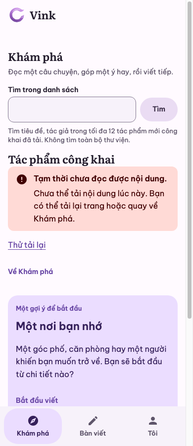
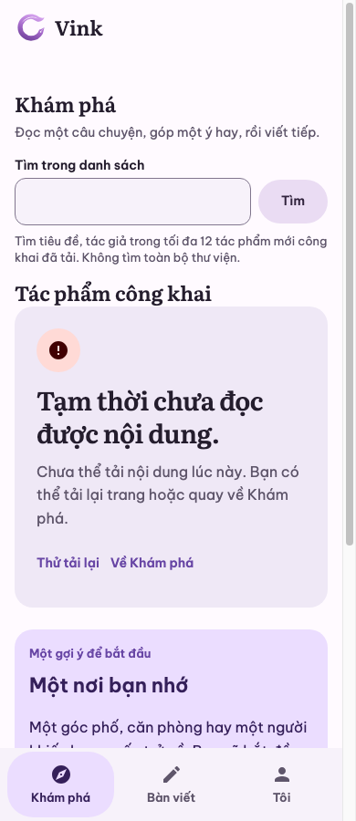
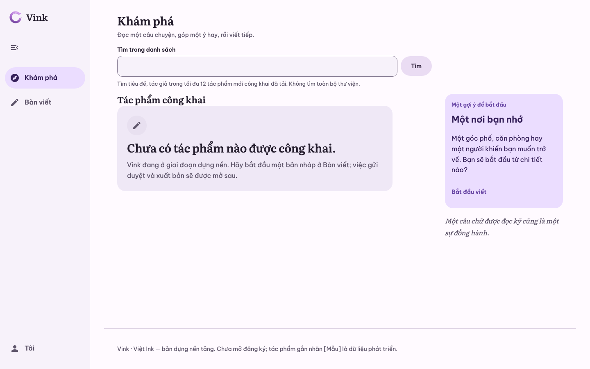
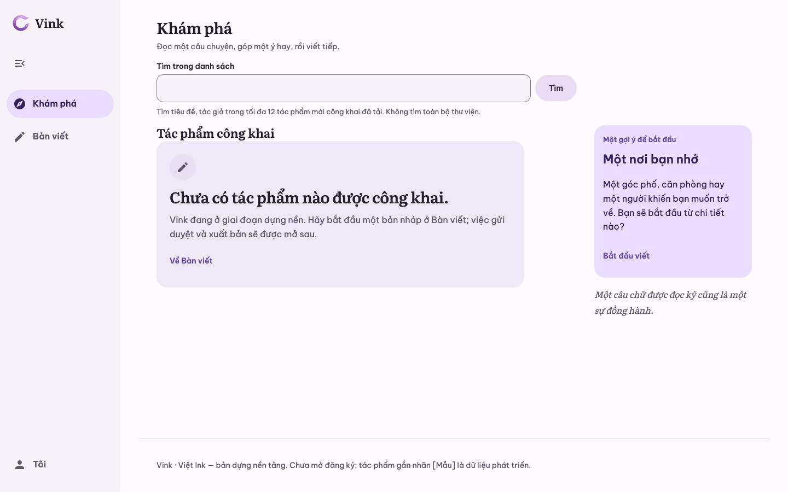
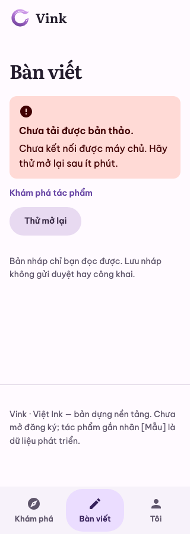
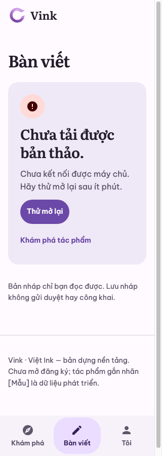

# UI-REPAIR-06/07 — state recovery, focus capture và skill CMP

Ngày 03/11/2026, nhánh `codex/ui-state-focus-cmp`, nền
`develop@8045d45` sau PR #47/UI-REPAIR-05. Người dùng yêu cầu gộp hai handoff vào
một PR và bổ sung skill CMP mobile bên cạnh Leptos Web. Handoff SudoLang và hai
ảnh so sánh là đầu vào để xác minh; ảnh prototype/historical capture không được
coi là baseline build mới hay quyền merge/upload.

## Xác nhận trước patch

Baseline chạy bằng `cargo xtask verify web` và `cargo xtask ui-preview leptos verify`
trên source nền; cả hai PASS. Đã mở ảnh runtime và giữ bản trước sửa tại
`target/ui-repair-06-07/before/`. Fixtures công khai/quyền/lỗi là synthetic hoặc
browser interception có nhãn; kiểm persist vẫn dùng PostgreSQL thật riêng.

| Finding | Source / runtime trước sửa | Severity | Kết luận |
| --- | --- | --- | --- |
| S06-01 | `pages/mod.rs::Unavailable`: InlineNotice rồi hai link riêng; ảnh Explore 390/light tái hiện recovery rời rạc | P2 | CONFIRMED |
| S06-02 | `Home`: StatePanel rỗng không action; lối Bàn viết chỉ ở context ngoài panel | P2 | CONFIRMED |
| S06-03 | Suspense dùng chữ; Explore/Desk có status, Reader thiếu role; chưa thấy bằng chứng vi phạm delay | P3 | PARTIAL: thêm semantics Reader, giữ loading chữ |
| S06-04 | Explore no-results không action; clear chỉ ở search phía trên. Desk có nút clear nhưng đứng ngoài panel | P2 | CONFIRMED |
| S06-05 | `DeskError`, `CreateState`, runtime 401/403/503/uncertain đang tách riêng và không replay POST | — | REJECTED nếu coi đây là bug đã gộp state; giữ regression |
| S07-01 | `Page.capture` chụp document tối đa 6000px; Grid/AvatarGroup 390 bắt đầu bằng danh mục dài | P2 evidence | CONFIRMED; không phải bug cần xóa menu gallery |
| S07-02 | Connector xác định đúng hai folder CMP Desktop/iOS nhưng không thấy ảnh qua truy vấn được phép; local có ảnh thật và sidecars | — | PARTIAL: khoảng trống evidence trên Drive, không chứng minh native code lỗi |

Review là self-review source/callsite/counterexample; không có approval độc lập.

## LayoutSpec trước → sau

```text
Explore
  Heading → Search (GET q, scope ≤12 đã tải)
  Community stream
    loading: chữ + status hiện có
    empty: StatePanel → link Bàn viết ngay trong actions
    no-results: StatePanel → link xóa q → focus search
    unavailable: StatePanel → tải lại GET hiện tại → link về Khám phá
  Context hiện có
Reader
  Loading có role status
  404: heading + explanation + return query/anchor trong panel
  503: heading + explanation + reload giữ path/query/hash + return
Desk
  Heading / create / privacy hiện có
  first-use: panel → đúng một CreateDraftButton
  no-results: panel → clear → focus search
  error 401 / 403 / 503: panel riêng → GET refetch → public return
  uncertain-create: warning panel → GET reconcile; không replay POST
Gallery
  Catalog → Controls → Specimen → Inspector giữ nguyên
  Raw PNG giữ tên runner, document-capped ≤6000px
  Opt-in focus: heading/scenario/scope + padding, chia tile theo viewport thật
  Manifest nối raw ↔ focus, source/context/hash/status; inspection độc lập
```

Ma trận Web: 1440/1024/834/390/320, light/dark, root text100/200. Action không bị
bottom bar che khi nhận focus. Sau visual review có bổ sung LayoutSpec: trong panel
hẹp, giảm padding ngang nút bằng token hiện có để giữ nguyên từ tiếng Việt. Thay đổi
nằm ở CSS owner của primitive, container query theo rem; không giảm cỡ chữ hay CTA.

## Owner và hành vi

- `StatePanel` Leptos nhận optional `children`, CMP nhận optional `actions`; typed
  recovery vẫn đứng trước slot. Caller giữ link, callback và disabled/pending.
  Test SSR và Compose kiểm slot cùng typed action, không duplicate dispatch.
- `pages/mod.rs`/`pages/desk.rs` chỉ đổi presentation/focus. Giữ resources,
  `CreateState`, `EditorSession`, API/error classification, giới hạn 12/100 và
  SSR status 404/503. `DeskError` của editor dùng cùng panel, không tự thêm retry ghi.
- Retry công khai là reload GET document thật. Link giữ path/query/hash; click
  thường gọi `Location.reload` vì link trỏ cùng URL có fragment chỉ cuộn. Modifier
  click vẫn là link native. Desk refetch không reload document; GET thành công mới
  mở tạo thêm theo state owner cũ. Lỗi GET đối chiếu giữ uncertain và chặn POST.
- Clear Explore đổi URL qua router, không tải thêm cards/manuscript; clear Desk
  chỉ chiếu lại ≤100 cards đã tải. Recovery trả focus về input/heading còn tồn tại,
  không lấy focus lúc tải dashboard đầu tiên.
- `preview/e2e/focus-capture.mjs` tính padding/clamp/tile và chụp vùng đang nằm trong
  viewport; CDP clip dùng tọa độ document với `captureBeyondViewport=false`.
  Không resize ngầm hay sửa UI để chụp. Ảnh cao chia tile cân bằng, không thu nhỏ.
  Bốn regression geometry, kiểm PNG/ảnh không trắng, identity/theme/DPR, bounds và
  phục hồi viewport/scroll/focused DOM node đi cùng smoke hiện có.
- Focus opt-in có 36 record: 6 ID × light/dark × (390/text100, 1440/text100,
  390/text200). Matrix raw mặc định giữ nguyên; không tạo tích 642 thứ hai.
  `focus-manifest.json` là subset `vink-preview-focus-v1`, không giả bộ là bundle
  format 1 hoàn chỉnh. Contract capture chỉ thêm các field/mode optional.
- [vink-cmp-mobile](../../.agents/skills/vink-cmp-mobile/SKILL.md) có metadata, owner/
  evidence reference và symlink Claude; index/Design/Fix định tuyến tới skill mới.
  Học phương pháp từ Cantos `ce8ac58`, giữ modules, commands, tokens và diagnostic
  boundaries Vink. Không nhập audio/auth/localization hay dựng native product app.

## Kiểm chứng và ảnh

Kết quả, source SHA-256, ảnh đại diện và coverage từng host được ghi trong
[manifest](evidence/ui-repair-06-07/manifest.json) và
[check-results](evidence/ui-repair-06-07/check-results.txt). Các timestamp là UTC+07
hoặc ISO UTC có offset. SHA trong capture dirty định danh base; fingerprint nguồn
và hash build artifacts xác định đúng đầu vào. Đây là bằng chứng local, không là
tuyên bố GitHub CI đã chạy.

| Boundary | Lệnh / môi trường | Kết quả cuối |
| --- | --- | --- |
| Repository | `cargo xtask verify quick`; skill YAML/link/diff; skill-creator validator qua PyYAML | PASS sau dọn cache; fmt/clippy/doctest/unit/contract/repository checks |
| App | `cargo xtask verify web`, PostgreSQL 17.11 tạm riêng, Chrome headless macOS | PASS main + after-restart; 845 PNG, gồm 220 recovery captures với kiểm nguyên từ ở CTA |
| Preview Web | `VINK_UI_FOCUS_CAPTURE=1 cargo xtask ui-preview leptos verify` | PASS; 654 raw captures + 36 focus records/72 tile, không lỗi console |
| CMP | `cargo xtask ui-preview cmp verify`, Microsoft JDK 17.0.19 | PASS; common/Desktop, slot dispatch và 423 PNG/sidecars |
| Android | `cargo xtask ui-preview android verify`, Pixel_7 `emulator-5560`, Android 17/API 37 | PASS; 3/3 instrumentation tests; 6 selected viewport captures |
| iOS | `cargo xtask ui-preview ios verify`, iPhone 17 Pro simulator iOS 26.5, UDID `AB3B8430-88BD-4C77-AE22-19AFBFDA0BE1` | PASS; 3/3 XCTest; 6 selected viewport captures |

Bulk giữ local tại `target/ui-repair-06-07/`, app `target/verify-web/screenshots/`,
preview `target/ui-preview/leptos/captures/`, CMP `preview/build/captures/`.
Chỉ ảnh đại diện cùng metadata được đưa vào Git. Không upload Drive hay đổi index/
quyền chia sẻ trong task này; hai folder tham chiếu được đọc metadata, không suy
upload thành công từ local PASS. CMP off-screen, Web responsive và native viewport
là các host riêng, không thay ảnh cho nhau.

Đã mở 220 recovery captures qua 19 contact sheet, 72 tile focus qua 6 sheet và
12 native captures qua một sheet; mở riêng ảnh đại diện ở kích thước gốc. Overview
không thay kiểm từng glyph ở mọi ảnh rộng; DOM Range kiểm nguyên từ ở mọi CTA trong
ma trận. Đã mở sáu recipe CMP off-screen, không coi toàn bộ 423 PNG là đã inspect.
Render mẫu `navigation.rail/default` ở 390/text200 giữ rail rộng cố định nên cột
nội dung rất hẹp; focus capture phơi đúng hạn chế recipe hiện có, không sửa layout
gallery chỉ để có ảnh đẹp và không gọi capture PASS là visual QA của mọi specimen.

| Cùng fixture, viewport, theme và cỡ chữ | Trước | Sau |
| --- | --- | --- |
| Explore unavailable, 390/text100/light |  |  |
| Explore empty, 1440/text100/light |  |  |
| Desk 503, 320/text100/light |  |  |

Ảnh raw và focus gallery là hai capture cùng specimen/context được liên kết trong
manifest, không phải pixel-diff trước/sau sản phẩm. Focus có thể nhiều tile; raw có
giới hạn chiều cao, nên không được coi raw là bản đầy đủ của mọi specimen.

## Phát hiện trong quá trình kiểm

Giữ nguyên kết quả FAIL của runner, không đổi thành NOT_RUN:

1. CMP lượt đầu FAIL: test mới thiếu `VinkPreferences`; sửa test và CMP verify PASS.
2. Web lượt 1/2 FAIL ở helper: thanh dưới ẩn có rect top=0; focus cũ sau đổi cỡ chữ
   không tự cuộn. Sửa oracle để xét visibility và nhận focus lại; không nới target.
3. Web lượt 3 FAIL khi retry Reader có hash chỉ cuộn. Sửa intent reload thật và
   thêm marker kiểm document mới, giữ query/hash.
4. Focus lượt đầu runner PASS nhưng visual review REJECTED một ảnh text200 bị mất
   đầu specimen do CDP chụp ngoài viewport/reflow. Đổi sang scroll/tile; probe sai hệ
   tọa độ FAIL vì ảnh trắng, được sửa bằng tọa độ document. Kiểm riêng 36/36 PASS
   rồi chạy lại toàn bộ preview. Artifact sai được giữ ở `rejected/`.
5. Visual review phát hiện CTA Desk empty 320/text200 vỡ giữa từ sau khi đưa vào
   panel. Sửa padding theo container; thêm segmentation tiếng Việt + DOM Range,
   bắt buộc có từ được kiểm, bên cạnh oracle không tràn ngang.
6. Hai probe local khác không là gate: một trỏ static server đã đóng, một thiếu
   output folder; giữ lỗi ở log, dùng server/folder đúng để kiểm lại.
7. Quick cuối lượt đầu FAIL ở unit/contract vì `No space left on device`, sau khi
   fmt, clippy và doctest PASS. Dọn build cache riêng của bốn crate UI bằng
   `cargo clean -p`, giữ source và bundle evidence, rồi chạy lại quick.

Giới hạn: kiểm field Android là Compose input chương trình, iOS XCTest gõ ASCII;
chưa chạy OS IME tiếng Việt, TalkBack/VoiceOver, thiết bị vật lý, Safari/Firefox.
Preview text200 không thay OS text scale/Dynamic Type; native font hệ thống không
chứng minh branded-font parity. Không nghiệm thu auth, save backend native,
publication, predictive back hay toàn bộ catalog trên native.
