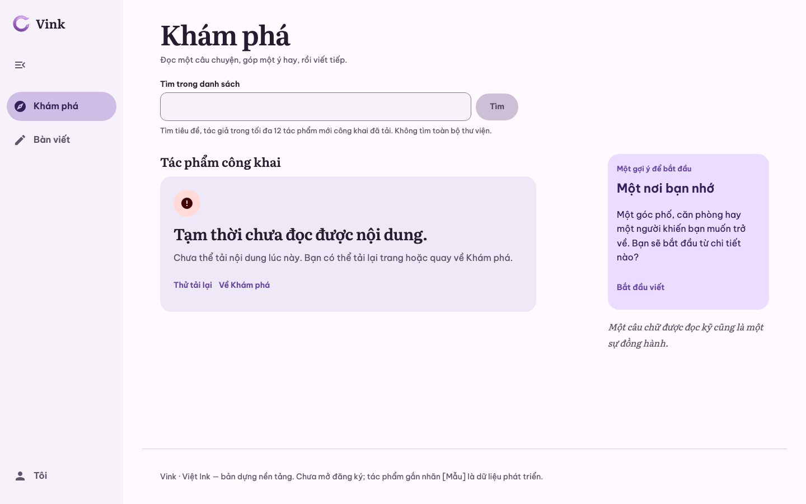
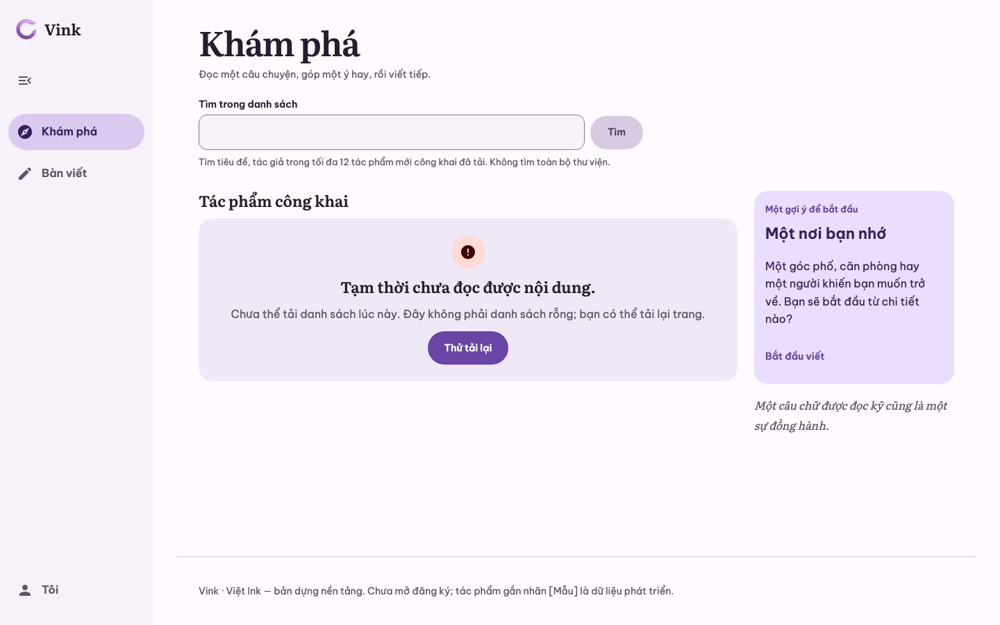
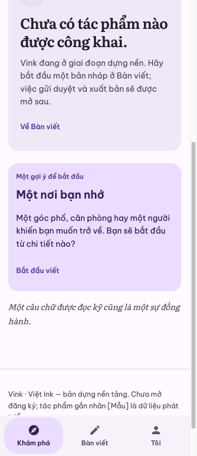
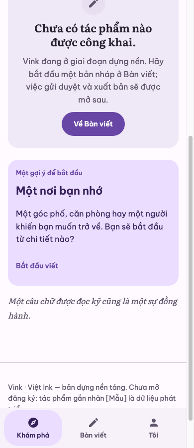
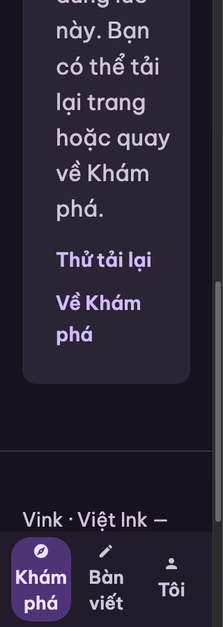
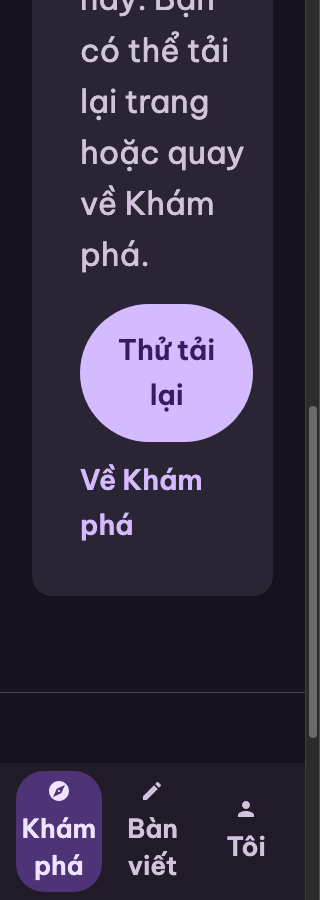

# UI-REVIEW-19 — Error & Recovery Views

Ngày 04/11/2026, nhánh `codex/review-recovery-views`, nền `develop@c6aa486` (sau PR #62).
Phạm vi: Explore, Reader và Bàn viết ở các trạng thái 404, 401/403, 503, loading, empty,
no-results, retry. Ảnh thiết kế là mốc tham chiếu (trạng thái duyệt không rõ); ảnh triển khai
cũ chụp trước UI-REPAIR-06/07 nên chỉ là baseline lịch sử, không được coi là finding chưa sửa.

## Nguồn ảnh

| Vai trò | Ảnh |
| --- | --- |
| Design | [Explore Error State](https://drive.google.com/file/d/11riBuuY7SXom_hd30R6TIFO9vBdhsP_p/view) · [Explore Empty State](https://drive.google.com/file/d/1etmbPdO9nv2QM6DoEvD9QNa2u6UfJUGq/view) · [Explore No Results](https://drive.google.com/file/d/1BRkGzYAURwzSY95-O9BklHhPA5LI8YBy/view) |
| Old baseline | [Explore unavailable desktop](https://drive.google.com/file/d/1Mi_z1FMD3DY1dCfnIIctncmtIQY-VSuh/view) · [Explore unavailable 320](https://drive.google.com/file/d/119R3LczZ2HK2Z-c437W84BlRfOV1PNod/view) · [Desk error 320](https://drive.google.com/file/d/1wZaC5qnmAH6yEQxqEqQxJL5lkkkGuLQ7/view) |
| Current Before | `cargo xtask verify web` trên `c6aa486`: 220 ảnh `recovery-*` (11 state × 1440/1024/834/390/320 × chữ 100/200 × sáng/tối), giữ local tại `target/review-19/before/` |
| After | Cùng runner, fixture, viewport, theme và cỡ chữ trên nhánh này, `target/review-19/after/` |

Old baseline (InlineNotice + link rời ngoài panel, Desk notice đỏ) đã được UI-REPAIR-06/07 sửa;
develop hiện tại không còn các biểu hiện đó nên chúng không được báo lại.

## Findings

| ID | Vùng / state | Quan sát trên develop hiện tại | Căn cứ | Severity | Kết luận |
| --- | --- | --- | --- | --- | --- |
| R19-01 | Explore empty / no-results / unavailable, Reader 404 / 503 | Mọi recovery là link Standalone cỡ nhãn, không có CTA chính; Desk cùng primitive lại dùng nút Filled | `shared/states.md` anatomy "Primary recovery → Secondary actions"; typed action 0 = Filled; cả ba ảnh thiết kế có một CTA chính | P3 | CONFIRMED, đã sửa |
| R19-02 | Explore unavailable | Ngoài "Thử tải lại" còn "Về Khám phá" trỏ `/` hoặc `/?q=` — chính route đang đứng; router không rời trang, `works_resource` khóa `()` nên không tải lại | Nguồn `pages/mod.rs`, `api.rs`; ảnh thiết kế chỉ có "Thử lại" | P3 | CONFIRMED (nguồn), đã bỏ link trên Explore; Reader 503 giữ |
| R19-03 | Explore empty / unavailable | Cùng luồng `#community-stream` nhưng empty/unavailable căn trái, rộng theo measure; no-results căn giữa, rộng cột, heading cỡ Title (quy ước của `1f888f2`) | Thiết kế dùng một cách trình bày cho cả ba; đổi state làm panel nhảy hình học | P3 | CONFIRMED, đã sửa trong CSS app |
| R19-04 | Icon trạng thái lỗi | Chip tròn nền `error-container`; thiết kế dùng ô vuông tonal tím cho cả lỗi | `states.md`: màu theo role, giữ error semantics | — | REJECTED (lệch có chủ ý) |
| R19-05 | Copy / control | Thiết kế ghi "bài viết", "Xóa bộ lọc", có filter chip và ô tìm trên top bar | Sản phẩm dùng "tác phẩm", Explore chỉ có tìm trong ≤12 tác phẩm đã tải, chưa có filter | — | REJECTED (tính năng chưa tồn tại) |
| R19-06 | Desk 401 / 403 / 503 / uncertain / empty / no-results | Panel riêng từng lỗi, nút Filled + link phụ, không replay POST, 401 không giả đăng nhập | Smoke hiện có + ảnh 320–1440 | — | PASS |
| R19-07 | Loading | Chữ + `role=status`, tách khỏi empty/unavailable | S06-03 đã chốt giữ loading chữ | — | PASS |

Reader 404/503 giữ căn trái (H1 của trang, `states.md` căn trái); chỉ nhận nhấn mạnh CTA từ R19-01.

## LayoutSpec trước → sau

```text
Explore #community-stream
  H2 "Tác phẩm công khai" (+ đếm khi có list)
  Recovery panel [empty | no-results | unavailable] — cùng cách trình bày: căn giữa, rộng cột, heading Title
    Symbol (tone theo role) → Heading → Message → Primary recovery
      empty: "Về Bàn viết" · no-results: "Xóa tìm kiếm" → focus ô tìm · unavailable: "Thử tải lại" (reload GET, giữ query/hash)
    unavailable: bỏ "Về Khám phá" (cùng route); copy nói rõ đây không phải danh sách rỗng
Reader 404: Primary "Về Khám phá" (giữ q + anchor)
Reader 503: Primary "Thử tải lại" → link phụ "Về Khám phá"
Desk: không đổi
StatePanel (Web): không có typed action thì link Standalone đứng đầu slot nhận nhấn mạnh Primary
  (container/content role + state layer như Button Filled); link sau giữ kiểu phụ.
  CMP: caller tự truyền VinkButton Filled; không đổi API.
```

Primary vẫn là `<a href>` thật để retry/điều hướng chạy trước hydrate và giữ modifier-click; không
thêm biến thể API, không đổi resource, error classification, SSR status 404/503 hay `CreateState`.

## Kiểm chứng

Bằng chứng local trên macOS, PostgreSQL 17.11 tạm, Chrome headless; không phải GitHub CI.

| Boundary | Lệnh / môi trường | Kết quả |
| --- | --- | --- |
| Baseline | `cargo xtask verify web` trên `c6aa486` | PASS; 220 ảnh recovery làm Current Before |
| Repository | `cargo xtask verify quick` | PASS (tokens, fmt, clippy server/browser/preview, doctest, unit/contract, repository checks) |
| App | `cargo xtask verify web` sau patch | PASS main + after-restart; 220 ảnh recovery; mọi action đầu panel có nền nhấn mạnh ở 11 state × 5 viewport × chữ 100/200 × sáng/tối; Explore outage chỉ còn reload |
| Bàn phím | `vink-app serve` với bundle sau patch, Browser pane | Tab tới CTA Reader 404 (sáng) và Explore no-results (tối): `:focus-visible`, vòng 3px có offset; Enter giữ `?q=` + anchor khi về Khám phá; clear đưa URL về `/` và focus vào ô tìm |
| So ảnh | 220 cặp Before/After cùng tên | Explore/Reader 100/100 thay đổi; Desk: khác biệt còn lại sau ngưỡng chỉ là timestamp `UTC` của fixture |

Retry Explore/Reader (reload GET giữ path/query/hash), 401 không giả đăng nhập, uncertain create
không replay POST, loading tách khỏi empty/unavailable tiếp tục được smoke hiện có kiểm và PASS.

| Cùng fixture, viewport, theme và cỡ chữ | Before | After |
| --- | --- | --- |
| Explore unavailable, 1440/text100/light |  |  |
| Explore empty, 390/text100/light |  |  |
| Reader 503, 320/text200/dark |  |  |

Ảnh được chụp sau khi runner focus action cuối/đầu bằng script (không phải modality bàn phím), nên
vòng focus không hiện trong ảnh; vòng focus được kiểm riêng bằng Tab thật ở trên.

## Ngoài phạm vi, chưa sửa

- Submit ô tìm Explore tạo URL `?q=…&=`: `leptos::form::form_data_from_event` (leptos 0.8.22)
  append cả nút submit không tên, trái với HTML. Có sẵn trên develop, không thuộc recovery views;
  sửa ở PR riêng `codex/explore-search-url` bằng `on_form_data` bỏ cặp tên rỗng, kèm smoke kiểm
  URL chỉ có `q` khi bấm "Tìm" và khi Enter.
- Chưa chạy CMP/Android/iOS: patch chỉ đổi CSS Web và caller Leptos, API `StatePanel` không đổi.
- Chưa kiểm Safari/Firefox, screen reader, OS text scale; text200 là cỡ chữ gốc của trang.
