# Đọc trạng thái xuất bản từ metadata — #230

`GET /api/v1/works/{id}/publication/state` (alias `/publication/me`) đọc đủ lịch sử metadata,
không lấy, deserialize, NFC hay hash manuscript của các revision. Đây là projection riêng cho
chủ tác phẩm; **không phải bằng chứng toàn vẹn body hoặc quyền approve/publish**.

- Sản phẩm: giữ `USER-02@r1`, `ADM-06@r1`, `USER-09@r1` `PRODUCT_CONFIRMED`; WR-04 vẫn
  `DEFERRED`. Snapshot CLI `6e77cb0a7f4eb67033c6e0df6d8a670a84eb61b3095a307ad0615b771c91dd9b`.
- Kiến trúc: không đổi trạng thái ADR, authority hoặc hash v1. Không thêm cache/schema/index.
- Triển khai: `persistence-api`; Web dùng DTO hiện hành, không đổi UI. Các command/worker giữ
  loader nội dung đầy đủ. Đây không phải batch `GET /api/v1/author/works` (#214/#222).
- Base được fetch và đối chiếu `ls-remote`: `develop@20ed13e160150c86f82ed5a185f73777441c3a4b`,
  không giả định HEAD từ tên PR #246. Source đo sau: `0147bda43ea3821cec17b1cbbde2a9539e7d3805`.

<!-- vdr: active USER-02@r1 -->
<!-- vdr: active ADM-06@r1 -->
<!-- vdr: active USER-09@r1 -->

## Lựa chọn và compatibility

**CHOICE-01 A**: projection typed cho owner-state. `PublicationState` chứa
`PublicationFacts<ContentHash>`, `ModerationState` chứa facts kiểm duyệt. Cả hai chỉ có
`restore`/`facts`; không thể chuyển thành `Publication`/`WorkModeration` dùng cho lệnh. Generic
facts chia sẻ nguyên kiểm tra restore với aggregate đầy đủ: lifecycle, audience, generation,
intent/pointer/hidden/withdrawn/ever-public, decision/provenance/policy và job digest.
Không tạo một bộ luật trạng thái SQL thứ hai. Các quyết định, transition và model không đổi;
refactor validator được kiểm bằng các domain transition làm oracle và regressions hiện có.

SQL revision riêng chọn `id,title,NULL::jsonb AS document,content_hash,metadata_snapshot_id,created_at`.
NULL là placeholder decoder, không đọc column document. Các query owner/publication/revisions/
moderation/jobs nằm trong một transaction `REPEATABLE READ, READ ONLY`; không giữ write lock.
Thiếu/khác owner cùng trả 404; actor vẫn lấy từ session; route và lỗi vẫn `no-store`.
Read không thêm standing fence mới; lệnh vẫn kiểm current standing sau commit locks, trước receipt.

**CHOICE-02 A**: giữ toàn bộ response history, thứ tự `created_at ASC,id ASC`, cả legacy metadata
NULL. Field/alias/error/fixture HTTP v1 và DTO consumer giữ nguyên. `content_hash` là binding đã lưu,
không còn ngầm thể hiện vừa audit body history. `title`, metadata ID, timestamp đều lấy cùng hàng;
thiếu tuple là internal error, không chế timestamp. Không migration/backfill/truncate/delete.
Response và bộ nhớ metadata vẫn O(N); các phép dò/kiểm duplicate hiện có còn O(N²). Case 300
revision chỉ là phép thăm dò có giới hạn, không chứng minh history tùy ý rẻ. Pagination/cursor và
exact-content loader cho commands là scope tiếp theo nếu có evidence/contract riêng.

## Caller và ranh giới integrity

| Caller/owner tại execution base | Dữ liệu cần và kiểm tra còn lại |
| --- | --- |
| HTTP `get_author_publication_state` → application/port `load_author_publication_state` | Owner + header publication + đủ revision metadata/hash + quyết định/provenance + jobs. Projection đọc cùng snapshot, dùng chung restore invariants, không body, không ghi và không cấp authority. `can_appeal` chỉ là gợi ý UI; filing recheck riêng. |
| `capture_snapshot` | Không gọi paired loader: đọc draft hiện tại trong transaction, kiểm version/standing/receipt, parse/NFC/`RevisionContent::new`, hash v1, capture/bind metadata rồi insert immutable revision. Retry dùng receipt cũ. |
| `request_public`, `set_private` (`persistence/publication.rs`) | `load_paired_state` **full body mọi revision** + `Publication::restore`/`WorkModeration::restore`, current generation/policy, standing/receipt và lock graph hiện có. Không nhận read-state. |
| `open_intervention_case`, `conclude_case` (`persistence/moderation.rs`) | Full paired loader, current authority/recusal/standing, snapshot/hash/decision và case version; conclusion mới có thể đổi public pointer. |
| `finish_job` (`persistence/evaluation.rs`) | Full paired loader dưới work locks, claim/lease generation, policy/digest/decision fence, automation mode, late-result/admin precedence và private withdrawal. |
| `appeals::file`, `appeals::conclude` | Full paired loader; exact adverse subject/version, standing/admin/current authority, appeal state; lưu decision/pointer/audit cùng transaction. |
| Public API/Reader/SSR qua `PublicationStore::publication` (`persistence/discovery.rs`) | Chỉ revision đang được publications trỏ, join cùng work và một read snapshot, parse title/document và metadata digest. #230 bổ sung tính hash v1 của **đúng body trả ra** so stored hash; corrupt body trả internal trước DTO/ETag, không trả body hoặc 304. Không đọc history. |
| Case-detail/appeal-snapshot reads hiện có | Chọn đúng revision/work/hash đã bind và deserialize `DocumentData`; không phải validation domain hay cryptographic audit mọi body. Full paired loader vẫn kiểm hash lại tại conclusion trước mọi approval. #230 không thay các read này hay bật provider. |
| PostgreSQL schema | Immutable revision UPDATE trigger; hash syntax CHECK; composite FK `(work_id,revision_id)` cho intent/pointer/moderation/job và `(work_id,metadata_snapshot_id)` cho revision. Legacy NULL được giữ. Không bypass bằng projection. |

Tóm tắt luồng tin cậy:

```mermaid
flowchart LR
  D[Draft + metadata version] -->|standing / versions / hash v1| R[Immutable revision + binding]
  R -->|metadata SQL + shared invariants| S[Owner state summary]
  S --> U[Hiển thị / đề nghị intent]
  U --> C[Command / review / worker]
  R -->|full content / recompute hash| C
  C -->|authority / standing / generation / policy / receipt| P[Public pointer]
  P -->|same-work exact revision + recompute hash| B[Public body / ETag]
```



Projection không phát hiện bit rot chỉ nằm trong body history. Đó là ranh giới chủ ý: dữ liệu được
đóng băng lúc capture; quyền được kiểm lại khi quyết định; body được kiểm lúc phục vụ public.
Hash là kiểm tra nhất quán, không phải chữ ký/authentication của người sửa database.

## Đo trước/sau trên PostgreSQL thật

Reuse [corpus #229/#232](long-document-budget.md) (merge `a81333c71faf6033014a00ec26c9f7b90109d1d9`) và
[`tests/support/document_budget.rs`](../../services/vink-app/tests/support/document_budget.rs), seed 229.
Harness opt-in cùng owner, không framework mới:
[`publication_state_budget.rs`](../../services/vink-app/tests/postgres/publication_state_budget.rs).
Mỗi dataset đi qua `create_draft`/`save_draft`/`capture_snapshot` thật; đổi title để có revision mới.
Không fixture public giả, evaluator, browser hay dữ liệu manuscript riêng.

```sh
# Cluster scratch riêng; thay role/path/port phù hợp máy. Không dùng DB cá nhân/production.
initdb -D /tmp/vink-230-pg-data -A trust --no-locale --encoding=UTF8
pg_ctl -D /tmp/vink-230-pg-data -l /tmp/vink-230-pg.log \
  -o '-h 127.0.0.1 -p 55530 -k /tmp -c shared_buffers=128MB -c max_connections=60' start
export DATABASE_URL='postgres://manhblue@127.0.0.1:55530/postgres'
export VINK_TEST_DATABASE_URL="$DATABASE_URL"
# Chỉ trong cluster scratch, ghi SQL không ghi parameter values.
psql "$DATABASE_URL" -c "ALTER ROLE manhblue SET log_statement='all'" \
  -c "ALTER SYSTEM SET log_parameter_max_length=0" -c 'SELECT pg_reload_conf()'
export CARGO_PROFILE_DEV_DEBUG=0 CARGO_PROFILE_TEST_DEBUG=0 CARGO_INCREMENTAL=0 CARGO_BUILD_JOBS=3
export VINK_PUBLICATION_STATE_OUTPUT=/tmp/vink-230-evidence/after
cargo test --locked -p vink-app --test postgres publication_state_budget::publication_state_budget -- --ignored --exact --nocapture --test-threads=1
cargo xtask verify quick
cargo xtask verify postgres
```

Baseline dùng runtime nguyên vẹn `20ed13e` cộng đúng benchmark mới (chưa đổi loader), sau dùng
`0147bda`; cùng flags/serializer/seed và cluster, mỗi SQLx run tạo fresh database/migrations.
Mac Apple M4/24 GiB, macOS 15.6; Rust 1.99.1, PostgreSQL 17.11 Homebrew, pglz, shared_buffers
128 MB. Đo application `Vink<PgStore>`, gồm pool/transaction/SQL/restore, không network HTTP.
Một first sample và ba warm samples ở mỗi checkpoint, median warm là mô tả, không p95/SLA.
First không phải PG/OS cold cache. Baseline có build/focused test khác chạy cùng host trong một
phần cửa sổ, nên số latency có nhiễu; lượt sau không chạy build/test khác trong phần đo.
Cả hai là dev unoptimized, không suy latency production/mobile hoặc cải thiện release từ tỷ lệ này.

Mỗi dataset 1/10/100 revision; thêm 300 revision × 300 scalar. Giữ count/shape/metadata độc lập
với size (30k/200k Việt NFC), và thêm stress nhiều block 200k. Lịch sử count và ordering không bị
cap; response byte trước/sau chỉ lệch vài byte ở timestamp có độ dài phần thập phân khác nhau.
Chi phí body giảm được xác nhận riêng bằng role thật không có quyền SELECT document, body schema hỏng vẫn đọc summary, SQL log runtime, và plans.

Raw evidence/measurements và kết quả checks nằm ở
[`evidence/publication-state-230/`](evidence/publication-state-230/README.md).
`pg_column_size` là byte lưu của column; `octet_length(document::text)` là JSONB text logical sau
output, **không phải tổng byte wire PostgreSQL**, RSS hay heap/TOAST toàn relation. EXPLAIN SELECT
không buộc decode/output toàn JSONB; không dùng SQL execution time đó thay thời gian app.
Report ghi plans `ANALYZE,BUFFERS`, không coi một lần plan là distribution.

Median ba warm sample, ms; byte body logical được SELECT ở runtime cũ / mới (không phải byte wire):

| Corpus (scalar sau NFC) | Revision | Trước ms | Sau ms | Response B trước / sau | Body JSONB text B trước / sau |
| --- | ---: | ---: | ---: | ---: | ---: |
| vi_nfc 30,000 | 1 | 7.305 | 0.475 | 473 / 473 | 67,877 / 0 |
| vi_nfc 30,000 | 10 | 65.888 | 0.548 | 3641 / 3641 | 678,770 / 0 |
| vi_nfc 30,000 | 100 | 658.284 | 1.578 | 35310 / 35308 | 6,787,700 / 0 |
| vi_nfc 200,000 | 1 | 45.341 | 0.403 | 474 / 474 | 452,062 / 0 |
| vi_nfc 200,000 | 10 | 441.081 | 0.546 | 3650 / 3651 | 4,520,620 / 0 |
| vi_nfc 200,000 | 100 | 4386.580 | 1.647 | 35413 / 35413 | 45,206,200 / 0 |
| tiny_blocks 200,000 | 1 | 247.713 | 0.561 | 479 / 479 | 3,600,033 / 0 |
| tiny_blocks 200,000 | 10 | 2375.243 | 0.653 | 3699 / 3700 | 36,000,330 / 0 |
| tiny_blocks 200,000 | 100 | 24175.783 | 1.664 | 35910 / 35905 | 360,003,300 / 0 |
| vi_nfc 300 | 1 | 0.512 | 0.507 | 471 / 471 | 754 / 0 |
| vi_nfc 300 | 10 | 1.236 | 0.467 | 3620 / 3620 | 7,540 / 0 |
| vi_nfc 300 | 100 | 8.477 | 1.470 | 35112 / 35115 | 75,400 / 0 |
| vi_nfc 300 | 300 | 25.439 | 3.652 | 105084 / 105094 | 226,200 / 0 |

Với 100 revision, tăng riêng body Việt 30k → 200k làm baseline 658 → 4.387 ms,
projection 1.58 → 1.65 ms. Case nhiều block 200k: 24.176 → 1.66 ms. Số row giữ nguyên,
full statement chọn body của N revision; summary chọn 0 body. GET mới vẫn có 5 SELECT
(owner, publication, revisions, moderation, jobs) và thêm 1 SET cho snapshot; BEGIN/COMMIT
không tính là SELECT. SQL log và phép kiểm privilege là evidence runtime độc lập với EXPLAIN.
Response 300 revision khoảng 105 KiB, còn tăng theo history. Không kết luận metadata history
vô hạn đã được tối ưu hoặc chọn pagination mới từ ba mẫu.


## Verification và acceptance

<!-- CHECK_RESULTS -->

Boundary Web/browser/OS IME và production latency: **NOT_RUN**; không đổi UI/DTO, không có claim
browser mới. Model/Kani riêng: **NOT_RUN**; không đổi transition/authority, domain/DB regressions
là evidence ở đây. GitHub CI: **NOT_RUN theo yêu cầu**; không đọc/chờ/poll/rerun Actions/status/log.

| AC | Evidence / giới hạn |
| --- | --- |
| 01 | Inventory và trust map ở trên, phân biệt batch dashboard; tất cả 8 call sites paired loader tại base được kiểm. |
| 02 | Typed summary, SQL log; PostgreSQL role không SELECT document vẫn trả đủ 106 rows; corrupt schema không parse trên GET. |
| 03 | Domain differential oracle + publication/work-moderation/appeal regressions; snapshot race trước/sau commit, public r1 + pending/rejected r2, hidden/withdrawn/private và metadata binding. |
| 04 | Existing HTTP auth/no-store, conditional 404, standing, version/generation, receipts, concurrency/rollback regressions trong PostgreSQL lane. |
| 05 | Full content guards giữ ở command/worker; public exact-body hash; corruption test rollback, FK cross-work, mismatched job digest và late evaluator regressions. |
| 06 | 106 rows với ties/legacy NULL, benchmark 300, HTTP/consumer fixtures giữ nguyên; không schema migration mới, upgrade/backout cũ chạy lại. |
| 07 | Raw before/after cùng corpus/flags; app samples, SQL runtime statements/counts, rows/logical byte và EXPLAIN BUFFERS. Không đo byte wire hoặc latency production. |
| 08 | Source SHA/commands/ran checks ở evidence; các boundary chưa chạy được ghi rõ. Không chapter/CAS/offline/provider. |

## Finding ngoài projection: re-review dưới policy mới

**FAIL runtime, pre-existing theo source; chưa sửa trong #230.** Sau approve → set-private →
policy tăng → request-public lại bản cũ, domain `decide_author_with` tạo decision version 3,
`pending`/NULL provenance; constraint `work_revision_moderation_pending_check` vẫn bắt version 1.
Request rollback và trả Internal, không tạo approval sai. Domain transition và migration chứa
constraint đều byte-identical với `20ed13e` ([source proof](evidence/publication-state-230/known-policy-rereview.json));
full-flow trên baseline chưa chạy (**NOT_RUN**), không gán phép tái hiện branch mới cho baseline.

[Reproducer giữ nguyên](evidence/publication-state-230/known-policy-rereview.rs.txt), tái hiện trên
`77f177e`. Đây là gap của luồng tái sử dụng approved cũ, không phải đường đọc trạng thái. Sáu
regression của projection vẫn phải PASS; stale-policy **khi job đang pending**, private/late-result
được kiểm riêng. Cần migration bổ sung với upgrade/backout riêng để sửa mismatch; không reset
version hay bỏ constraint provenance trong tối ưu loader. Không tuyên bố toàn bộ moderation
policy re-review đã hoạt động và không tự tạo/đóng issue tiếp theo.

## Bảo toàn và vận hành cục bộ

Checkout riêng tại `2026-11-16/task-4/vink`. #204 ở `~/Projects/loveoverflow/vink-204` giữ
HEAD/diff và hash của 30 file thay đổi; inventory trước/sau được đối chiếu, không stash/reset/pull
checkout đó. Hai PostgreSQL cũ và Chrome #204 không nhận signal. Chỉ `cargo clean --profile dev`
ở checkout #246 (`task-3/vink`) sau khi không có Cargo/rustc/rust-analyzer hoặc file mở dưới
`target/debug`; xóa 3.8 GiB artifact tái tạo, giữ `target/site`, `target/ui-preview`, evidence và
database. Cluster #230 riêng dừng sau verification, data/log/evidence giữ ngoài target.
