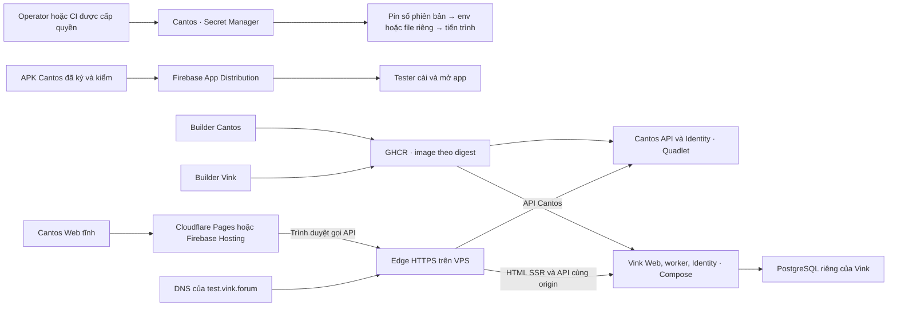

# Đọc luồng triển khai Cantos để chuẩn bị VPS test Vink

**Lịch sử vận hành public test.** Quy trình hiện hành và điều kiện ngừng host nằm trong [release production](../../infra/production/cloudflare-edge.md). Compose, fixture và qualification Auth cô lập vẫn dùng được.



Sơ đồ nối bốn luồng cần đọc. Nhánh Cantos dựa trên source và ghi nhận lịch sử, còn nhánh Vink
là topology đã chạy thử trên VPS chung. [Runbook test Vink](../../infra/test/README.md) sở hữu các bước
vận hành. [Báo cáo triển khai thực](test-container-evidence.md#triển-khai-thực-trên-vps-ngày-15112026)
ghi source, digest, overlay Compose, Caddy và kiểm tra DNS/HTTPS ngày 15/11/2026.

Hai ref `origin/develop` được đối chiếu với remote ngày 15/11/2026. Các link Cantos pin SHA
`a1fca178f9a284c8177d60601d856fc64dae1953`. Mã Vink được đọc tại
`a677b0d4b5c53104ae03961a2d24c73d1d9f2ec5`. Lệnh `cargo xtask` chạy từ root repo tương ứng.
Các lệnh gắn nhãn **operator** chỉ dùng khi có đích thực và phạm vi vận hành đã được giao.

## 1. Từ Google Cloud đến cấu hình của tiến trình

**Đầu vào → đầu ra.** Project, operator hoặc CI identity, tên secret và phiên bản đã duyệt →
giá trị env hoặc file riêng cho đúng consumer lúc khởi động. Hostname, origin, project ID và
đường dẫn mount có thể nằm trong cấu hình công khai. DB URL có mật khẩu, khóa ký và token
thuộc phần bí mật. Inventory Cantos ghi tên, môi trường, consumer, contract, định dạng và kiểu
bàn giao `env`/`file`. [Inventory Cantos](https://github.com/loveoverflowcom/cantos/blob/a1fca178f9a284c8177d60601d856fc64dae1953/infra/google-secret-manager/inventory.toml).

- `secrets inventory` đọc và kiểm TOML rồi in mapping tại chỗ. `secrets status` kiểm account
  và liệt kê metadata version qua `gcloud` theo project/account. `secrets import` kiểm input theo
  contract, đọc metadata, tạo secret nếu thiếu và thêm phiên bản qua stdin khi version cao nhất
  còn khớp `--expect-latest`. Cờ này từ chối nếu trạng thái đọc lại khác giả định của operator. Nếu kết quả thêm version
  là `UNCERTAIN`, đọc lại metadata và đối chiếu trước khi quyết định có chạy lại hay không.
  [`secrets::run` và `run_import`](https://github.com/loveoverflowcom/cantos/blob/a1fca178f9a284c8177d60601d856fc64dae1953/xtask/src/secrets/mod.rs#L116-L250),
  [`flow::import/status`](https://github.com/loveoverflowcom/cantos/blob/a1fca178f9a284c8177d60601d856fc64dae1953/xtask/src/secrets/flow.rs#L92-L333).
- `gcloud secrets versions access` nằm ở phần **Delivery to consumers → VPS** và **SSH
  retrieval**. Ví dụ VPS dùng workstation hoặc deploy job đã duyệt để chuyển payload của phiên
  bản số vào Podman secret, sau đó Quadlet mount file cho `CANTOS_PLAYBACK_KEY_FILE`. Ví dụ SSH dùng
  chính tài khoản operator lấy phiên bản số vào file riêng cục bộ. `pinned_version` là trường
  tùy chọn trong inventory Git, dùng số và được review, còn `latest` dùng để tra cứu. Bản đọc
  hiện tại chưa có pin đã điền. Số `3` trong ví dụ playback là minh họa.
  [Hai lệnh access và quy tắc pin](https://github.com/loveoverflowcom/cantos/blob/a1fca178f9a284c8177d60601d856fc64dae1953/docs/deployment/google-secret-manager.md#L299-L369).
- Tách các bằng chứng `IMPORTED` (có version), `VERIFIED_ACCESS` (đúng reader đọc được bản đã
  pin) và `RUNTIME_BOUND` (đã cài bản pin và tiến trình khởi động với binding ấy). Bằng chứng cuối
  cần đối chiếu tên/phiên bản với cấu hình mount/env và kiểm tra chức năng tương ứng trong runtime.
  CircleCI hiện lấy `FIREBASE_SERVICE_ACCOUNT_JSON` từ context `production-web` và
  `CLOUDFLARE_API_TOKEN` từ `cloudflare-web`. Kế hoạch WIF thay JSON dài hạn bằng CircleCI OIDC
  giới hạn project/ref/context, impersonate service account Hosting, và cho job Cloudflare đọc
  riêng bản pin của token. WIF và các binding đó vẫn `NOT_RUN` trong runbook Cantos. GitHub
  workflow native OCI dùng `GITHUB_TOKEN` cho GHCR.
  [CircleCI](https://github.com/loveoverflowcom/cantos/blob/a1fca178f9a284c8177d60601d856fc64dae1953/.circleci/config.yml),
  [Kế hoạch bàn giao và WIF](https://github.com/loveoverflowcom/cantos/blob/a1fca178f9a284c8177d60601d856fc64dae1953/docs/deployment/google-secret-manager.md#L274-L320).

```sh
# Cantos · offline, tài khoản giả, stdin rỗng
cargo xtask secrets inventory
cargo xtask secrets import --project cantos-a348b --account operator@example.org \
  --secret cantos-prod-server-playback-key --stdin --expect-latest none --dry-run </dev/null

# Operator · chỉ đọc metadata từ Google Cloud, cần tài khoản đã được cấp quyền
cargo xtask secrets status --project cantos-a348b --account "$OPERATOR_EMAIL" --environment prod
```

**Ánh xạ sang Vink.** `render-env` xuất cấu hình công khai cho Compose. Compose nạp
`app-runtime.env` và `worker-runtime.env` riêng, mỗi tiến trình đọc `DATABASE_URL` khi load config.
Giá trị minh họa cho App là `postgresql://vink_app_runtime:<RUNTIME_PASSWORD>@postgres:5432/vink`.
Identity đọc `VINK_IDENTITY_DATABASE_URL` từ `identity-runtime.env`. App và Identity migrator
chỉ đọc `VINK_MIGRATE_DATABASE_URL` / `VINK_IDENTITY_MIGRATE_DATABASE_URL` trong file one-shot
tương ứng. `provision.env` chỉ vào bước provision. Postgres đọc bootstrap password từ file qua
`POSTGRES_PASSWORD_FILE` khi khởi tạo volume trống. Nếu sau này bật SMTP, Identity đọc file
owner-only ở đường dẫn `VINK_IDENTITY_SMTP_PASSWORD_FILE`. Manifest hiện tại giữ đăng nhập
`disabled`. Nếu operator dùng một secret store, ghi resource, phiên bản số và consumer vào kế
hoạch bàn giao riêng rồi đối chiếu khi chạy. Compose Vink hiện chỉ nhận env/file đã chuẩn bị.
[Compose](../../infra/test/compose.yaml),
[App loader](../../services/vink-app/src/config.rs),
[Identity loader](../../services/vink-identity/src/config.rs),
[Auth operations](auth-operations.md).

**Lỗi điển hình.** `secrets status` thấy version enabled nhưng process vẫn lỗi đọc credential.
Kiểm UID/mode/path trong namespace của consumer với secret dạng file. Với Vink, xác nhận DB URL
vào đúng service và `/health/ready` báo schema `current`, role `restricted`. `pg_isready` chỉ
cho biết PostgreSQL nhận kết nối. Trên VPS thử, các file env/secret được chuẩn bị cục bộ cho
Vink và readiness DB đã đạt. Tải cấu hình hoặc secret từ Google Cloud vẫn `NOT_RUN`.

## 2. APK Cantos và App Distribution

**Đầu vào → đầu ra.** Channel, Firebase Android App ID, signer, HTTPS API origin và người nhận
→ APK được kiểm trên đúng byte đã staging, release trên Firebase, receipt, rồi bằng chứng tester
cài và mở bản đó.

| Channel | APK và package | Signer |
| --- | --- | --- |
| `development` | `:androidApp:assembleDebug` · `com.cantos.theatre.dev` | Debug certificate khớp `CANTOS_FIREBASE_DEVELOPMENT_CERT_SHA256` |
| `production` | `:androidApp:assembleRelease` · `com.cantos.theatre`, R8/resource shrinking | Khóa release operator và fingerprint `CANTOS_FIREBASE_PRODUCTION_CERT_SHA256` |

1. `distribute::execute` chọn policy. `flow::destination` dùng `firebase apps:sdkconfig` để
   đọc đăng ký và so khớp Android package trước khi build. Firebase project ID, Firebase Android
   App ID dạng `1:<project-number>:android:<hex>` và Android `applicationId` là ba định danh.
2. Build đưa `--api-origin` qua `-Pcantos.apiOrigin` vào placeholder manifest `CantosApiOrigin`.
   `flow::inspect` lấy đúng một APK từ `output-metadata.json` của Gradle, stage bản riêng rồi
   kiểm package, version, debuggable, chữ ký và cấu hình trên bản stage. Release kiểm thêm
   audit marker/mapping và binding với audit evidence. `prepare` ghi intent receipt trước
   `distribute` gọi `firebase appdistribution:distribute` một lần. Chính lời gọi này
   **bắt đầu ghi lên Firebase** và có thể gửi thông báo cho tester.
3. Development lấy Unix seconds cho `versionCode` và 12 ký tự SHA của HEAD (thêm `-dirty` khi
   phù hợp) cho `versionName`. APK lỗi thời có thể bị chặn ngay lúc so kết quả `aapt2`. Với bản
   development đã cài, so `adb shell dumpsys package com.cantos.theatre.dev | grep version`
   với receipt. Production giữ policy version hiện có, nên còn cần đối chiếu SHA nguồn và hash
   APK trong receipt. Cài và mở app trên thiết bị là một kiểm tra riêng.

Nguồn đọc theo thứ tự [`request::resolve`](https://github.com/loveoverflowcom/cantos/blob/a1fca178f9a284c8177d60601d856fc64dae1953/xtask/src/distribute/request.rs#L397),
[`Flow::go`, `destination`, `inspect` và `distribute`](https://github.com/loveoverflowcom/cantos/blob/a1fca178f9a284c8177d60601d856fc64dae1953/xtask/src/distribute/flow.rs#L87-L659),
[`distribute_command`](https://github.com/loveoverflowcom/cantos/blob/a1fca178f9a284c8177d60601d856fc64dae1953/xtask/src/distribute/firebase.rs#L49-L89),
[Gradle](https://github.com/loveoverflowcom/cantos/blob/a1fca178f9a284c8177d60601d856fc64dae1953/apps/cantos-theatre/mobile/androidApp/build.gradle.kts#L39-L77),
[build identity](https://github.com/loveoverflowcom/cantos/blob/a1fca178f9a284c8177d60601d856fc64dae1953/xtask/src/distribute/identity.rs)
và [runbook Firebase Cantos](https://github.com/loveoverflowcom/cantos/blob/a1fca178f9a284c8177d60601d856fc64dae1953/apps/cantos-theatre/mobile/docs/firebase-distribution.md).

```sh
# Cantos · App ID, origin và nhóm đều là giá trị minh họa
cargo xtask distribute firebase cantos-theatre --channel development \
  --api-origin https://api.example.org --app-id 1:1234567890:android:0123456789abcdef \
  --groups docs-qa-placeholder --dry-run
```

**Lỗi điển hình.** Upload timeout có thể đã tạo release trước khi mất ACK. Mở **App Distribution**
trong đúng project và Android app, so build version, thời điểm, release link từ receipt nếu có,
rồi kiểm riêng trạng thái cấp cho nhóm/tester. Chỉ thử lại phần còn thiếu khi đã xác định trạng
thái của lần trước. [Firebase CLI cho APK](https://firebase.google.com/docs/app-distribution/android/distribute-cli).

**Ánh xạ sang Vink.** Ngày 15/11/2026, Console xác nhận project `vink-d0846` ở gói Spark.
**Project settings → General → Your apps** chưa có app. **App Distribution** hiển thị
yêu cầu thêm app để bắt đầu. Repo có `:androidDiagnostic` bật qua `-Pvink.ui.nativeTargets=true`,
dùng cho chẩn đoán UI. Khi có Android product app, cần chốt package/channel, đăng ký đúng Firebase
Android App ID, signer và fingerprint, API origin, lệnh build ra APK đơn, version/revision, nhóm
tester và thiết bị nghiệm thu. Upload và cài APK Vink là `NOT_RUN`.
[Project settings](https://console.firebase.google.com/project/vink-d0846/settings/general),
[App Distribution](https://console.firebase.google.com/project/vink-d0846/appdistribution),
[CMP settings](../../packages/ui-system/cmp/settings.gradle.kts),
[CMP README](../../packages/ui-system/cmp/README.md).

Firebase Hosting phục vụ Web, App Distribution cấp bản dựng cho tester, Firebase Authentication
xác thực người dùng ứng dụng. Test Web Vink trong bài này đi vào Leptos SSR trên VPS và dùng
Identity native theo runbook Vink. [Hosting](https://firebase.google.com/docs/hosting),
[App Distribution](https://firebase.google.com/docs/app-distribution),
[Authentication](https://firebase.google.com/docs/auth),
[Auth Vink](auth-operations.md).


## 3. Từ DNS đến TLS và upstream

**Đầu vào → đầu ra.** Zone có thẩm quyền, A/CNAME, edge đang giữ 80/443 và upstream reachable từ
edge → HTTPS đúng vhost, trả HTML SSR Vink và JSON API. DNS chọn địa chỉ đích, TLS xác nhận tên
host, vhost chọn ứng dụng, còn upstream mới là nơi sinh response.

| Mốc Cantos | Đọc được gì |
| --- | --- |
| 18/10/2026 · [PR #250](https://github.com/loveoverflowcom/cantos/pull/250) · `f33e8848` | Caddy thêm alias cho vhost API để chuyển hostname trong lúc giữ route cũ. [Diff](https://github.com/loveoverflowcom/cantos/commit/f33e8848) |
| 19/10/2026 · `89a31c1c` | HTML chuyển đúng alias Hosting cũ về `cantos.cc` hoặc `studio.cantos.cc`, giữ nguyên đường dẫn/query/hash. Đây là chuyển ở trình duyệt. [Commit](https://github.com/loveoverflowcom/cantos/commit/89a31c1c) |
| 23/10/2026 · `a882bbb4` | Ghi nhận một lần test VPS chuyển sang Server/Identity native, Caddy đi tới `cantos-server:8080`, Theatre Web trên Cloudflare Pages. Studio chưa được publish sang Pages trong lần ấy. [Bằng chứng cutover](https://github.com/loveoverflowcom/cantos/blob/a882bbb4/docs/evidence/native-test-vps-cutover-20261023.md) |

Tại SHA đã đọc, `infra/edge/Caddyfile` vẫn giữ proxy Web/Firebase và Kanidm chuyển tiếp cùng
alias API. `deploy::execute` có dispatch riêng cho Hosting và Pages. `cloudflare-rollout.md` mô
tả kiểm zone, TLS, Web và API độc lập; với Pages, custom domain phải được gắn vào đúng project
trước khi dùng CNAME. Để biết tuyến đang phục vụ, đọc vhost thực đã được load trên host,
DNS có thẩm quyền, custom-domain/deployment ở provider và phản hồi HTTPS của từng hostname.
[`Caddyfile`](https://github.com/loveoverflowcom/cantos/blob/a1fca178f9a284c8177d60601d856fc64dae1953/infra/edge/Caddyfile),
[`deploy::execute`](https://github.com/loveoverflowcom/cantos/blob/a1fca178f9a284c8177d60601d856fc64dae1953/xtask/src/deploy/mod.rs#L124-L155),
[Cloudflare rollout](https://github.com/loveoverflowcom/cantos/blob/a1fca178f9a284c8177d60601d856fc64dae1953/docs/deployment/cloudflare-rollout.md).

**Ánh xạ sang Vink.** Dùng [runbook hiện có](../../infra/test/README.md#dns-plan-và-apply-sau-khi-có-quyền).
Xác minh NS thực và thẩm quyền của Spaceship. Planner hiện yêu cầu snapshot Spaceship đầy đủ.
Lưu snapshot đủ mọi trang và chọn đúng một A cho IPv4 công khai
hoặc CNAME tới hostname đã kiểm. `infra::plan` chỉ xét `test`. `check_plan` so snapshot mới với
NS và scope của bản plan. Apply qua provider sau khi kiểm drift, đọc lại từng thay đổi và tra
DNS. Nếu mất ACK, đọc lại để lập plan tiếp. `dns-rollback` sinh diff đảo khi fresh scope vẫn
khớp `after`. Giữ nguyên apex, www, mail và những record ngoài phạm vi. Snapshot check là phép
so cục bộ. Giữa lúc đọc và ghi vẫn có thể có thay đổi tại provider.
[`plan` và `check_plan`](../../xtask/src/infra.rs#L245-L287).

```sh
# Vink · planner offline trên snapshot do operator chuẩn bị
cargo xtask infra dns-plan "$VINK_INVENTORY" "$DNS_BEFORE" > "$DNS_PLAN"
cargo xtask infra dns-check "$DNS_PLAN" "$DNS_FRESH"
# Nhánh phục hồi sau apply · in plan đảo, chưa ghi provider
cargo xtask infra dns-rollback "$DNS_PLAN" "$DNS_CURRENT"

# Operator · DNS công khai, rồi kiểm TLS/vhost riêng bằng IP edge đã kiểm
dig +trace test.vink.forum
dig @"$VERIFIED_NS" test.vink.forum A +noall +answer
dig @"$VERIFIED_NS" test.vink.forum CNAME +noall +answer
dig test.vink.forum A +noall +answer
curl --fail-with-body --show-error --resolve "test.vink.forum:443:$EDGE_IPV4" \
  https://test.vink.forum/health/ready
curl --fail-with-body --show-error https://test.vink.forum/
curl --fail-with-body --show-error https://test.vink.forum/api/v1/works
```

`--resolve` giữ hostname cho SNI/TLS và HTTP Host trong khi ép kết nối tới IP edge đã biết.
Dùng nó khi edge trực tiếp cung cấp chứng chỉ được tin cậy cho hostname. Nếu đi qua CDN,
kiểm TLS công khai qua CDN và TLS tới origin theo chính sách tương ứng. Một câu trả lời DNS
đúng vẫn có thể đi đến vhost sai hoặc upstream lỗi.

**Lỗi điển hình.** Host gọi được `127.0.0.1:3300` nhưng Caddy báo `502`. Với Caddy chạy trên
host hoặc dùng host networking, đối chiếu loopback publish của Compose. Với Caddy container
trên bridge, loopback là của chính Caddy. Khi đó phải xác nhận đường riêng từ edge đến
`app:3000`, ví dụ một network ingress chung chỉ gồm edge và Web, với alias upstream đã kiểm.
Worker, Identity và PostgreSQL tiếp tục ở phía Vink. Từ cùng namespace và user/context của
edge, kiểm DNS nội bộ và gọi `/health/ready` tới upstream được chọn, chẳng hạn
`podman exec "$CADDY_CONTAINER" curl -fsS "http://$VINK_UPSTREAM/health/ready"` nếu image có curl.
Có thể dùng công cụ chẩn đoán sẵn có cùng namespace nếu image edge thiếu curl. Sau khi đường
này đạt, kiểm config của vhost riêng, Host/origin và forwarded IP theo peer thật trước khi
reload có phép. Giữ HTTPS, `X-Robots-Tag: noindex, nofollow` và chính sách cache/private của
Vink. Lượt thật dùng bản ghi A tại Spaceship, bridge ingress riêng giữa Caddy và Web, chứng chỉ
HTTPS hợp lệ và kiểm upstream từ Caddy. Xem [kết quả DNS và Caddy](test-container-evidence.md#caddy-và-dns).
[Reverse proxy Caddy](https://caddyserver.com/docs/caddyfile/directives/reverse_proxy),
[Runbook test](../../infra/test/README.md#runbook-test-và-rollback).

## 4. Từ source đến image và dịch vụ trên VPS chung

**Đầu vào → đầu ra.** Source SHA, platform, quyền ghi registry và dữ kiện host → manifest OCI
theo digest trong GHCR, sau đó là tiến trình với cấu hình/dữ liệu riêng trên host. Publish tạo
artifact phân phối. Đăng ký service chuẩn bị runtime, network, env, mount và lifecycle để host
pull rồi khởi chạy artifact đó.

**Cantos.** `release oci-build` lấy source bằng `git archive` và build cặp Server/Identity theo
platform. Workflow thủ công `native-oci-publish` dùng builder Linux `amd64`, truyền
`--publish --authfile`, lấy registry digest và đọc lại manifest/config. Candidate cần qualification
và admission riêng. Trên Podman/Quadlet, `Image=...@sha256:...` chọn artifact, còn file
`.container` mô tả lệnh, mount, network và policy dưới systemd. Mốc test 23/10 dùng unit viết tay.
[OCI producer và readback](https://github.com/loveoverflowcom/cantos/blob/a1fca178f9a284c8177d60601d856fc64dae1953/docs/deployment/native-oci-release.md#L119-L171),
[Workflow](https://github.com/loveoverflowcom/cantos/blob/a1fca178f9a284c8177d60601d856fc64dae1953/.github/workflows/native-oci-publish.yml),
[Quadlet test VPS lịch sử](https://github.com/loveoverflowcom/cantos/blob/a882bbb4/docs/evidence/native-test-vps-cutover-20261023.md).

- `release native-upgrade` cần host Linux rootful cgroup v2, `NATIVE_READY`, hai release đã
  admit, bằng chứng exact-image, request/pin và generation khớp host. Schema/RPC/security/Turso và
  cấu hình runtime phải tương thích theo điều kiện same-schema của lane. Không có `--execute`
  thì kiểm request offline. Khi execute, adapter kiểm lại host dưới lock và chỉ thay giá trị
  `Image=` trong các unit đã ràng buộc. [Native upgrade](https://github.com/loveoverflowcom/cantos/blob/a1fca178f9a284c8177d60601d856fc64dae1953/docs/deployment/native-oci-release.md#L298-L355).
- `release native-migrate-v36` là lane chuyển tiến lần đầu từ Server v27/Identity v4 tới
  v36/v7 trên layout đã có, cần qualification cặp image, inventory/schema, fence ghi/ingress
  và bằng chứng khôi phục tiến. Test disposable `native-rehearse --transition v27-v36` không
  chứng minh executor live. [Forward v36](https://github.com/loveoverflowcom/cantos/blob/a1fca178f9a284c8177d60601d856fc64dae1953/docs/deployment/native-forward-v36.md),
  [Khai báo lệnh](https://github.com/loveoverflowcom/cantos/blob/a1fca178f9a284c8177d60601d856fc64dae1953/xtask/src/release.rs#L259-L276).
- `deploy vps` cũ bị `Task::retirement()` đánh dấu và `main` từ chối tại `dispatch` trước khi đọc workspace.
  [Phân loại](https://github.com/loveoverflowcom/cantos/blob/a1fca178f9a284c8177d60601d856fc64dae1953/xtask/src/cli.rs#L264-L280),
  [Entry point](https://github.com/loveoverflowcom/cantos/blob/a1fca178f9a284c8177d60601d856fc64dae1953/xtask/src/main.rs#L70-L92).

```sh
# Cantos · ví dụ operator chuẩn bị, đều NOT_RUN trong lượt này
cargo xtask release oci-build --platform linux/amd64 --producer local --build-id "$BUILD_ID"
cargo xtask release native-upgrade --request "$NATIVE_REQUEST" --request-digest "$REQUEST_DIGEST"
```

**Ánh xạ sang Vink.** Đo kiến trúc CPU, vCPU/tải, RAM còn lại, disk/inode và chỗ cho image,
WAL, volume, backup. Kiểm runtime và Compose provider thực, rootful/rootless, network/Caddy,
cổng 80/443 và loopback 3300, quyền registry pull và UID của hai đầu Unix socket dưới mapping
đã chọn. Số đo **1 vCPU/1,9 GiB** trong bằng chứng Cantos là mốc lịch sử. Hãy dùng số đo
mới để quyết định VPS có đủ chỗ cho PostgreSQL cùng ba tiến trình Vink hay cần đổi đích.
Giữ project, volume/DB, session, credentials và vòng đời của hai hệ thống độc lập.

1. **Build và smoke trên builder.** `infra::build_images` đòi clean HEAD, engine và platform
   tường minh rồi tạo context bằng `git archive HEAD`. `Containerfile` build ba final image.
   `vink-web` mang binary `vink-app` và site Leptos, `vink-worker` và `vink-identity` chỉ mang
   binary theo vai trò. Chạy loader/non-root/assets smoke, sau đó chạy topology với PostgreSQL
   scratch và đúng role trên Linux đích. [Code build](../../xtask/src/infra.rs#L302-L359),
   [Containerfile](../../infra/Containerfile).
2. **Publish và pull.** `publish-images.yml` chạy thủ công trên `develop`, build lại source
   sạch và smoke loader rồi mới push. Dùng summary để điền `app_image` từ `web_image`, cùng
   `worker_image`/`identity_image` theo `RepoDigests`. Ghi source SHA/platform, pull theo các
   digest đó bằng quyền đọc package và smoke lại đúng artifact đã pull. Tag `sha-...` dùng
   truy dấu bản build. Registry digest mới là tham chiếu triển khai. [Workflow Vink](../../.github/workflows/publish-images.yml).
3. **Provision rồi migrate.** Giữ hai file Compose hiện có và project `vink-test`. Dùng volume
   external `vink-test-postgres`, DB `vink` và `vink_identity` cùng runtime/migrator roles riêng.
   Khi PostgreSQL nhận kết nối, chạy `provision` rồi `provision --check`. Chạy `migrate-app` và
   `migrate-identity` riêng, kiểm chạy lại no-op. PostgreSQL ở network Compose.
   [Base Compose](../../services/postgres/compose.yaml),
   [Test Compose](../../infra/test/compose.yaml),
   [Provisioning](../../services/postgres/provision.sh).
4. **Start, readiness rồi ingress.** Chuẩn bị socket dir đúng UID map, start Identity/App/worker.
   Kiểm Identity qua Unix socket, peer đúng/sai UID, restart Identity, App/worker lifecycle và
   SIGTERM. App `/health/ready` báo DB/schema/role, còn trạng thái Identity ở đó mang tính
   thông tin. Kiểm HTML SSR với JavaScript tắt, API và hydration/assets. Sau đó gắn vhost và
   làm kiểm DNS/TLS ở phần 3. Giữ `VINK_AUTH_SIGN_IN=disabled` và `VINK_WORKER_EVALUATION=disabled`
   theo manifest. Luồng cần đăng nhập là `NOT_RUN` trong cấu hình này.
   [App serve](../../services/vink-app/src/main.rs#L910),
   [Health handler](../../services/vink-app/src/http/health.rs),
   [Socket và quy trình](../../infra/test/README.md#secrets-và-uid).

```sh
# Vink · ví dụ operator, Linux builder đã xác minh platform
cargo xtask infra build-images podman "$VERIFIED_PLATFORM"

# Trên host đã chuẩn bị volume, socket dir, env riêng và digest thật
cargo xtask infra check "$VINK_INVENTORY"
cargo xtask infra render-env "$VINK_INVENTORY" > "$VINK_PUBLIC_ENV"
vink_compose() {
  podman compose --env-file "$VINK_PUBLIC_ENV" \
    -f services/postgres/compose.yaml -f infra/test/compose.yaml "$@"
}
vink_compose pull app worker identity
vink_compose up -d postgres
# Đợi pg_isready thành công trước khi tiếp tục
vink_compose exec -T postgres pg_isready -U vink -d postgres
vink_compose run --rm provision
vink_compose run --rm provision --check
vink_compose run --rm migrate-app
vink_compose run --rm migrate-identity
vink_compose up -d identity app worker
```

**Lỗi điển hình.** Image cũ pull được nhưng `/health/ready` báo `diverged` vì binary không biết
migration mới, checksum lệch hoặc migration đã thất bại. Chỉ dùng lại bộ digest cũ nếu đã
kiểm bộ App/worker/Identity đó với **cả hai schema hiện tại**, lịch sử migration và contract
runtime/socket. Thay image giữ nguyên dữ liệu đã migrate. Khi chưa xác nhận tương thích,
giữ ingress đóng và xử lý theo kế hoạch forward/recovery đã duyệt. Giữ digest cũ và backup
có thể phục hồi từ trước bước thay đổi schema. [So sánh migration](../../packages/store-postgres/src/migration.rs#L111-L145),
[Rollback trong runbook Vink](../../infra/test/README.md#runbook-test-và-rollback).

## Vink đã có / Cần kiểm trên VPS / Bước tiếp theo

Lượt đọc code đã đối chiếu hai SHA, Firebase Console, dry-run import và hai channel App
Distribution Cantos trong namespace cách ly mạng, từ chối dự kiến của `deploy vps`, 8 test
`cargo test --offline --locked -p xtask infra::tests::` và `dns-plan`, `dns-check`,
`dns-rollback` trên snapshot tổng hợp. Bảng dưới đây ghi thêm bằng chứng khi chạy thật.
[Báo cáo triển khai](test-container-evidence.md#triển-khai-thực-trên-vps-ngày-15112026).

| Mốc | Vink đã có | Kết quả thực trên VPS hoặc builder | Bước tiếp theo |
| --- | --- | --- | --- |
| Image built | Ba target build và loader smoke | Build và loader/non-root/assets smoke PASS ở Actions `linux/amd64` | Ghi SHA/platform cùng bản build tiếp theo |
| Image published | Workflow manual ghi digest và platform | Publish GHCR và pull/inspect 3/3 digest trên VPS PASS | Dùng lại ba digest trong báo cáo triển khai |
| Service ready | Compose, split-role provision/migrate, socket và health | App/Identity/PostgreSQL healthy, Worker running, hai schema current | Reboot và diễn tập khôi phục `NOT_RUN` |
| DNS/TLS | Planner A/CNAME và runbook ingress | Spaceship A TTL 300, hai NS và resolver đều khớp, HTTPS hợp lệ, Caddy đi được tới Web | Kiểm gia hạn TLS và rollback `NOT_RUN` |
| Test online | Runbook và ranh giới app/auth | Public SSR/API và nút điều hướng PASS trên [test.vink.forum](https://test.vink.forum/) | Đăng nhập vẫn tắt, luồng có phiên `NOT_RUN` |
